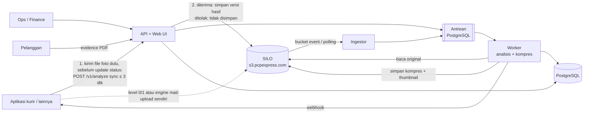

# Photo Quality Engine

Engine pemeriksa kualitas foto untuk PCP Express. Engine mendeteksi foto **buram**, **pecah**, **gelap/terlalu terang**,
dan **teks resi yang tidak terbaca**. Engine juga **mengompres** foto besar ke bawah 1 MB tanpa merusak keterbacaan,
memberi **indikasi keaslian** (EXIF, foto lama, foto dipakai ulang), dan menyediakan **bukti pengiriman (PDF)** yang
bersih untuk penagihan ke pelanggan.

Engine bisa dipakai oleh aplikasi apa pun (Android, iOS, Flutter, web, Laravel, Node). Bahkan aplikasi yang
**tidak bisa diubah** tetap bisa dipakai, karena engine membaca foto langsung dari SILO (`s3.pcpexpress.com`).

> **Prinsip utama:** engine tidak pernah memperlambat atau menggagalkan proses kurir. Semua pemeriksaan berjalan
> terpisah (async) dan fail-open.

## Fitur

| Fitur | Keterangan |
|---|---|
| Deteksi kualitas | Ketajaman (per tile), resolusi, blocking JPEG, foto kecil yang diperbesar, exposure, glare, kontras, OCR resi |
| Verdict + alasan + saran | `PASS` / `WARN` / `REJECT` dengan pesan ID/EN yang bisa langsung ditampilkan ke kurir |
| Keputusan siap pakai | `allow_status_update` (false = foto ditolak: aplikasi pengiriman **jangan** update status, minta foto ulang) + `courier_message` (kalimat siap tampil). Status pengiriman tetap milik aplikasi pengiriman; engine mati/lambat = fail-open |
| Wajib foto ulang | Jika kualitas tidak memenuhi syarat (buram/pecah/terlalu kecil/terlalu gelap), respons langsung berisi `retake_required: true` + pesan untuk kurir |
| Optimasi tanpa manipulasi | Isi gambar tidak diubah (tanpa AI, filter, penajaman, crop, koreksi cahaya). Hanya diperkecil proporsional bila perlu + kompresi dinamis < 1 MB dengan pengaman SSIM. Foto yang sudah kecil tidak disentuh. Original dan hash tidak berubah. Koreksi pencahayaan terverifikasi tersedia sebagai opsi per profile (nonaktif bawaan) |
| Indikasi keaslian | EXIF (kamera, waktu, GPS, software editing), foto lama, beda waktu/lokasi, foto identik/mirip dipakai ulang |
| Multi-aplikasi & multi-jenis foto | Tenant per aplikasi, profile per jenis foto (POD penerima, resi, paket, lokasi, barang), semua lewat config |
| Mode bertahap | `shadow` → `warn` → `enforce` per tenant/profile tanpa deploy ulang |
| Integrasi tercepat: kirim foto, terima keputusan | Engine **hanya memproses gambar**. Aplikasi mengirim file foto ke engine (`POST /v1/analyze`, client `checkFile`, maks. 3 detik). Engine menjawab keputusan + foto hasil optimasi (`output_image`); aplikasi yang menyimpannya ke SILO lalu mengupdate status. Foto ditolak: tanpa foto hasil, pesan dikirim balik ke kurir. Engine mati → aplikasi menyimpan foto asli (fail-open). Alternatif: `checkObject` untuk foto yang sudah di SILO, atau tanpa ubah aplikasi (baca SILO / metadata saat upload) |
| Web UI | Dashboard, antrean review ops (opsional), pencarian, **Evidence** (PDF penagihan per resi/invoice), uji foto, editor config tenant, API key, **Koneksi SILO** (hanya baca; impor JSON mc, tes koneksi), **Backup NAS**, status sistem + **preflight**. Bisa dibuka dari HP |
| Engine tidak menulis ke SILO | Engine hanya membaca SILO (Web UI, evidence, backup NAS, polling); service account cukup izin baca. Penulisan ke bucket aplikasi diblokir di kode walau key punya akses penuh. `PQE_ENV=production` (bawaan) menolak perintah demo yang menulis foto sintetis |
| Backup NAS | Salinan terjadwal database dan foto yang disimpan aplikasi di SILO ke NAS (folder SMB/NFS atau NAS S3-compatible), diatur di Web UI (test, jadwal, backup sekarang, status). Hanya menyalin, tidak pernah menghapus di NAS |
| Panduan developer di browser | `/ui/guide.html`: panduan integrasi interaktif tanpa login, diagram alur (integrasi, penggunaan, keputusan di aplikasi pengiriman, proses engine), contoh kode curl/PHP/TS/Python/Kotlin dengan URL server terisi otomatis |
| Uji coba tanpa aplikasi | `/ui/coba.html`: buka dari HP, ambil foto dengan kamera, lihat pesan yang tampil di layar kurir + detail analisis (simulasi penuh atau uji cepat) |
| Evidence pelanggan | JSON/PDF per resi atau per invoice, hanya foto layak (bawaan: PASS + WARN; REJECT tidak pernah), dengan hash verifikasi keaslian |
| Andal | Antrean dengan retry & dead-letter, reconciliation harian, idempotent, webhook bertanda tangan HMAC |
| Siap produksi | `docker-compose.prod.yml` (engine + Postgres + HTTPS Caddy) dengan `scripts/prod-setup.sh` (secret acak otomatis), `pqe preflight` (cek kesiapan go-live), manifest Kubernetes, metrik Prometheus, CI |

## Arsitektur singkat



Penjelasan lengkap (alur, fallback, retensi, backup): [docs/sdlc-plan.md](docs/sdlc-plan.md).

## Mulai cepat

```bash
git clone https://github.com/anas-fikri/ocr-engine.git
cd ocr-engine
cp .env.example .env
docker compose up -d --build
docker compose exec engine pqe demo-upload
```

Perintah di atas menjalankan engine + SILO lokal + PostgreSQL, lalu mengisi 12 contoh foto (compose lokal memakai
`PQE_ENV=development`; di server perintah demo ditolak). Setelah itu:

- Web UI: http://localhost:8000/ui (API key lokal: `pqe_local_admin_change_me`)
- Panduan developer: http://localhost:8000/ui/guide.html
- Uji coba dari HP (kamera): `http://<IP-PC>:8000/ui/coba.html`

Butuh Docker Desktop yang sedang berjalan (Mac Intel/Apple Silicon, Windows, Linux). Blok perintah di dokumentasi ini
sengaja tanpa komentar `#` agar aman di-paste ke zsh (Mac).

Integrasi tercepat dari aplikasi pengiriman: kirim foto, terima keputusan (satu panggilan). Engine hanya memproses;
penyimpanan ke SILO tetap dikerjakan aplikasi:

```php
$d = $pqe->checkFile($pathFoto, ['awb' => $awb, 'photo_type' => 'pod_recipient'], 3000, $key);   // maks. 3 detik, fail-open
if (!$d['allow_status_update']) { /* ditolak: jangan simpan, kirim $d['message'] ke kurir, minta foto ulang */ }
$isi = $d['image']['data'] ?? file_get_contents($pathFoto);   // image null = engine tidak menjawab -> foto asli
/* simpan $isi ke SILO di $key (kode aplikasi), update status, tampilkan $d['message'] jika tidak null */
```

Langkah lengkap: [docs/getting-started.md](docs/getting-started.md).

## Dokumentasi

| Untuk | Dokumen |
|---|---|
| Semua orang | [Memulai dalam 10 menit](docs/getting-started.md) |
| **Programmer aplikasi** | [Cara tercepat: kirim foto, terima keputusan](docs/integration-guide.md#0-cara-tercepat-kirim-foto-terima-keputusan) · Panduan di browser: `http://<server-engine>/ui/guide.html` · [Panduan integrasi](docs/integration-guide.md) · [Referensi API](docs/api-reference.md) · [Client siap pakai](clients/README.md) |
| Admin engine | [Konfigurasi (env, tenant, profile, mapping, kalibrasi)](docs/configuration.md) |
| Ops / finance | [Panduan Web UI](docs/web-ui-guide.md) |
| DevOps / infra | **[Deploy ke production (live uji coba & UAT)](docs/deploy-production.md)** · [Operasional (SILO, K8s, monitoring, backup, runbook)](docs/operations.md) |
| PIC UAT / semua peran | [Rencana UAT (skenario, kalibrasi, sign-off)](docs/uat-plan.md) |
| Developer engine | [Pengembangan](docs/development.md) · [Keputusan arsitektur (ADR)](docs/adr/) |
| Saat ada masalah | [Troubleshooting](docs/troubleshooting.md) |
| Perencanaan | [Dokumen SDLC](docs/sdlc-plan.md) · [Keputusan arsitektur (ADR)](docs/adr/) · [Catatan versi](CHANGELOG.md) |

## Struktur repository

```
engine/               kode engine (Python)
  analyzers/          pemeriksaan: sharpness, resolution, exposure, exif, duplicate, ocr
  imaging/            decode gambar, perbaikan pencahayaan aman, kompresi, thumbnail
  api/                REST API (FastAPI)
  webui/              Web UI (HTML/JS tanpa build step)
  defaults/           profile bawaan
  locales/            pesan ID/EN
config/tenants/       contoh config tenant (seed)
clients/              client TypeScript & PHP siap salin
deploy/k8s/           manifest Kubernetes
scripts/              skrip bantu (aktivasi event SILO)
tests/                test unit & end-to-end
docs/                 dokumentasi
```

## Perintah `pqe`

| Perintah | Fungsi |
|---|---|
| `pqe run` | API + worker + ingestor dalam satu proses (PC / uji coba) |
| `pqe --version` | Versi engine (juga tampil di Web UI, `/healthz`, `/v1/me`, dan header `X-PQE-Version`) |
| `pqe api` / `pqe worker` / `pqe ingestor` | Jalankan komponen terpisah (Kubernetes) |
| `pqe analyze FOTO...` | Analisis file lokal tanpa server (`--profile`, `--json`, `--out-dir`) |
| `pqe create-key --name X --role app --tenant T` | Buat API key |
| `pqe import-tenants [--force]` | Import config tenant dari `config/tenants/` |
| `pqe validate-tenant FILE...` | Validasi file config tenant |
| `pqe preflight [--no-silo] [--json]` | Cek kesiapan production (secret, database, akses baca SILO, tenant, backup NAS, worker, OCR). Exit 1 jika ada yang gagal |
| `pqe demo-upload` | Upload foto contoh ke bucket (ditolak di `PQE_ENV=production` kecuali `--force`) |
| `pqe synth-samples DIR` | Buat sampel foto sintetis |
| `pqe reconcile` | Pindai ulang semua source (lookback panjang) |
| `pqe process` | Proses semua antrean lalu berhenti |
| `pqe migrate-legacy DIR --bucket B` | Pindahkan foto lama dari server aplikasi ke SILO (dengan verifikasi checksum) |

## Status

Versi **0.1.0** (lihat [CHANGELOG.md](CHANGELOG.md)). Versi yang sedang berjalan tampil di Web UI, `/healthz`, dan header
`X-PQE-Version`. Fase 1 dan sebagian fase 2 dari [rencana SDLC](docs/sdlc-plan.md) sudah diimplementasikan
dan diuji end-to-end. Threshold bawaan dikalibrasi dengan foto sintetis dan foto publik. **Wajib dikalibrasi ulang
dengan foto POD asli** dalam mode `shadow` sebelum `warn`/`enforce` (lihat
[configuration.md](docs/configuration.md#6-kalibrasi-threshold)).
