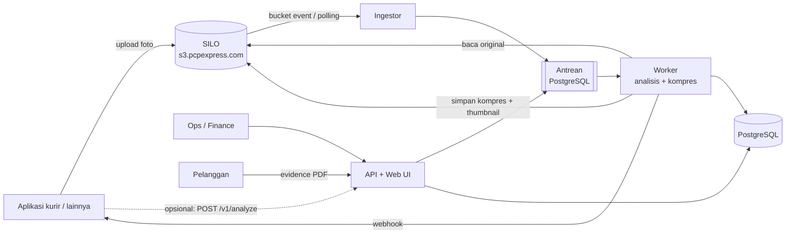

# Photo Quality Engine

Engine pemeriksa kualitas foto untuk PCP Express. Engine mendeteksi foto **buram**, **pecah**, **gelap/terlalu terang**,
dan **teks resi yang tidak terbaca**. Engine juga **mengompres** foto besar ke bawah 1 MB tanpa merusak keterbacaan,
memberi **indikasi keaslian** (EXIF, foto lama, foto dipakai ulang), dan menyediakan **bukti pengiriman (PDF)** yang
bersih untuk penagihan ke pelanggan.

Engine bisa dipakai oleh aplikasi apa pun (Android, iOS, Flutter, web, Laravel, Node). Bahkan aplikasi yang
**tidak bisa diubah** tetap bisa dipakai, karena engine membaca foto langsung dari SILO (`s3.pcpexpress.com`).

> **Prinsip utama:** engine tidak pernah memperlambat atau menggagalkan proses kurir. Semua pemeriksaan berjalan
> terpisah (async) dan fail-open.

## Fitur

| Fitur | Keterangan |
|---|---|
| Deteksi kualitas | Ketajaman (per tile), resolusi, blocking JPEG, foto kecil yang diperbesar, exposure, glare, kontras, OCR resi |
| Verdict + alasan + saran | `PASS` / `WARN` / `REJECT` dengan pesan ID/EN yang bisa langsung ditampilkan ke kurir |
| Perbaikan otomatis yang aman | Foto gelap/terlalu terang/pudar/silau diperbaiki **tanpa AI**: hanya satu kurva pencahayaan global yang diverifikasi eksak, sehingga mustahil menambah/mengubah teks atau angka. Original dan hash tidak berubah |
| Wajib foto ulang | Jika kualitas tidak bisa dimaksimalkan (buram/pecah/terlalu kecil), respons langsung berisi `retake_required: true` + pesan untuk kurir |
| Kompresi dinamis | < 1 MB dengan pengaman SSIM. Foto yang sudah kecil tidak disentuh. Keterbacaan diutamakan |
| Indikasi keaslian | EXIF (kamera, waktu, GPS, software editing), foto lama, beda waktu/lokasi, foto identik/mirip dipakai ulang |
| Multi-aplikasi & multi-jenis foto | Tenant per aplikasi, profile per jenis foto (POD penerima, resi, paket, lokasi, barang), semua lewat config |
| Mode bertahap | `shadow` → `warn` → `enforce` per tenant/profile tanpa deploy ulang |
| 3 cara integrasi | Tanpa ubah aplikasi (baca SILO) · tambah metadata saat upload · panggil REST API |
| Web UI | Dashboard, antrean review ops (opsional), pencarian, uji foto, editor config tenant, API key, **Pengaturan SILO** (impor JSON mc, tes koneksi), status sistem |
| Panduan developer di browser | `/ui/guide.html`: panduan integrasi interaktif tanpa login, contoh kode curl/PHP/TS/Python/Kotlin dengan URL server terisi otomatis |
| Evidence pelanggan | JSON/PDF per resi atau per invoice, hanya foto layak (bawaan: PASS + WARN; REJECT tidak pernah), dengan hash verifikasi keaslian |
| Andal | Antrean dengan retry & dead-letter, reconciliation harian, idempotent, webhook bertanda tangan HMAC |
| Siap produksi | Docker, docker-compose (SILO + Postgres), manifest Kubernetes, metrik Prometheus, CI |

## Arsitektur singkat



Penjelasan lengkap (alur, fallback, retensi, backup): [docs/sdlc-plan.md](docs/sdlc-plan.md).

## Mulai cepat

```bash
docker compose up -d --build             # engine + SILO lokal + PostgreSQL
docker compose exec engine pqe demo-upload
# buka http://localhost:8000/ui  (API key: pqe_local_admin_change_me)
# panduan developer: http://localhost:8000/ui/guide.html
```

Langkah lengkap: [docs/getting-started.md](docs/getting-started.md).

## Dokumentasi

| Untuk | Dokumen |
|---|---|
| Semua orang | [Memulai dalam 10 menit](docs/getting-started.md) |
| **Programmer aplikasi** | Panduan di browser: `http://<server-engine>/ui/guide.html` · [Panduan integrasi](docs/integration-guide.md) · [Referensi API](docs/api-reference.md) · [Client siap pakai](clients/README.md) |
| Admin engine | [Konfigurasi (env, tenant, profile, mapping, kalibrasi)](docs/configuration.md) |
| Ops / finance | [Panduan Web UI](docs/web-ui-guide.md) |
| DevOps / infra | [Operasional (deploy, SILO, K8s, monitoring, backup, runbook)](docs/operations.md) |
| Developer engine | [Pengembangan](docs/development.md) · [Keputusan arsitektur (ADR)](docs/adr/) |
| Saat ada masalah | [Troubleshooting](docs/troubleshooting.md) |
| Perencanaan | [Dokumen SDLC](docs/sdlc-plan.md) |

## Struktur repository

```
engine/               kode engine (Python)
  analyzers/          pemeriksaan: sharpness, resolution, exposure, exif, duplicate, ocr
  imaging/            decode gambar, perbaikan pencahayaan aman, kompresi, thumbnail
  api/                REST API (FastAPI)
  webui/              Web UI (HTML/JS tanpa build step)
  defaults/           profile bawaan
  locales/            pesan ID/EN
config/tenants/       contoh config tenant (seed)
clients/              client TypeScript & PHP siap salin
deploy/k8s/           manifest Kubernetes
scripts/              skrip bantu (aktivasi event SILO)
tests/                test unit & end-to-end
docs/                 dokumentasi
```

## Perintah `pqe`

| Perintah | Fungsi |
|---|---|
| `pqe run` | API + worker + ingestor dalam satu proses (PC / uji coba) |
| `pqe api` / `pqe worker` / `pqe ingestor` | Jalankan komponen terpisah (Kubernetes) |
| `pqe analyze FOTO...` | Analisis file lokal tanpa server (`--profile`, `--json`, `--out-dir`) |
| `pqe create-key --name X --role app --tenant T` | Buat API key |
| `pqe import-tenants [--force]` | Import config tenant dari `config/tenants/` |
| `pqe validate-tenant FILE...` | Validasi file config tenant |
| `pqe demo-upload` | Upload foto contoh ke bucket |
| `pqe synth-samples DIR` | Buat sampel foto sintetis |
| `pqe reconcile` | Pindai ulang semua source (lookback panjang) |
| `pqe process` | Proses semua antrean lalu berhenti |
| `pqe migrate-legacy DIR --bucket B` | Pindahkan foto lama dari server aplikasi ke SILO (dengan verifikasi checksum) |

## Status

Versi **0.1.0**. Fase 1 dan sebagian fase 2 dari [rencana SDLC](docs/sdlc-plan.md) sudah diimplementasikan
dan diuji end-to-end. Threshold bawaan dikalibrasi dengan foto sintetis dan foto publik. **Wajib dikalibrasi ulang
dengan foto POD asli** dalam mode `shadow` sebelum `warn`/`enforce` (lihat
[configuration.md](docs/configuration.md#kalibrasi-threshold)).
