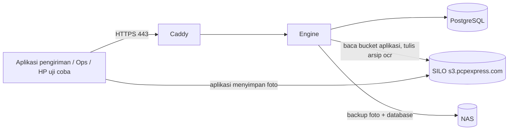

# Deploy ke Production (live uji coba & UAT)

Panduan ini menaikkan engine ke server production untuk **live uji coba dan UAT**, dalam **mode aman**: tenant aplikasi
kurir berjalan di mode `shadow`, jadi engine membaca dan menilai foto asli tanpa mengganggu kurir maupun aplikasi.
Perkiraan waktu: 30–60 menit jika prasyarat sudah siap.

Setelah selesai, lanjut ke [Rencana UAT](uat-plan.md).



Semua komponen di atas (Caddy, engine, PostgreSQL) berjalan di **satu server** lewat `docker-compose.prod.yml`.

---

## 1. Prasyarat

| # | Kebutuhan | Keterangan |
|---|---|---|
| 1 | Server Linux | Minimal 4 vCPU, 8 GB RAM, 50 GB disk. Menyala terus. Untuk ±1.000 foto/hari ini cukup |
| 2 | Docker 24+ dan Docker Compose v2 | `docker compose version` |
| 3 | Nama domain internal | Contoh `photo-quality.pcpexpress.com`, diarahkan ke IP server (DNS kantor atau `/etc/hosts`) |
| 4 | Port 443 (dan 80) terbuka | Dari jaringan aplikasi pengiriman, ops, dan HP uji coba ke server |
| 5 | Server bisa menjangkau SILO | `curl -I https://s3.pcpexpress.com` dari server |
| 6 | Bucket arsip + key SILO | Bucket `ocr` untuk arsip engine dan service account khusus engine: **baca** di bucket aplikasi, **baca/tulis/hapus** di `ocr` (langkah 2). Engine tidak pernah menulis ke bucket aplikasi (dijaga di kode), tetapi sebaiknya tidak memakai key admin |
| 7 | Share NAS | Folder SMB/NFS khusus backup + akun yang bisa menulis (langkah 3) |

## 2. Siapkan SILO (sekali, oleh tim infra)

Aplikasi pengiriman tetap menyimpan foto pengirimannya ke bucket-nya sendiri
([ADR 0006](adr/0006-engine-hanya-memproses-gambar.md)). Engine menyimpan **arsipnya sendiri** di bucket `ocr`
(per aplikasi, masa simpan 520 hari; foto ditolak = foto asli untuk review) dan hanya **membaca** bucket aplikasi
([ADR 0007](adr/0007-arsip-engine-di-bucket-ocr.md)).

Buat bucket arsip dan service account engine: baca (`s3:GetObject`, `s3:ListBucket`) di bucket aplikasi, baca/tulis/hapus
di bucket `ocr`:

```bash
mcli alias set pcp https://s3.pcpexpress.com <ACCESS_KEY_ADMIN> <SECRET_KEY_ADMIN>
```

```bash
mcli mb pcp/ocr
```

Policy dan perintahnya: [operations.md bagian 4.2](operations.md#42-service-account-engine-least-privilege) (contoh
policy juga tampil di Web UI → **Koneksi SILO**). Kalau memakai key yang sudah ada, engine tetap **tidak bisa** menulis
atau menghapus di bucket aplikasi (dijaga di kode).

## 3. Mount NAS di server

SMB (Synology/QNAP/Windows share):

```bash
sudo apt-get install -y cifs-utils
sudo mkdir -p /mnt/nas-pqe
sudo mount -t cifs //192.168.1.20/pqe-backup /mnt/nas-pqe -o username=<user-nas>,password=<password-nas>,uid=10001,gid=10001,file_mode=0660,dir_mode=0770
```

`uid=10001` adalah user di dalam container engine, supaya engine bisa menulis. Agar tetap ter-mount setelah server
restart, tambahkan baris yang sama ke `/etc/fstab` (pakai file credentials, jangan password di fstab). NFS dan NAS
S3-compatible juga didukung, lihat [operations.md bagian 6.3](operations.md).

## 4. Ambil kode

```bash
git clone https://github.com/anas-fikri/ocr-engine.git
cd ocr-engine
git checkout v0.1.0
```

Pakai tag versi (bukan cabang yang terus bergerak) supaya production bisa di-rollback dengan jelas.

## 5. Buat konfigurasi production

```bash
scripts/prod-setup.sh photo-quality.pcpexpress.com
```

Script ini membuat `.env` dengan semua secret acak (password database, API key admin, kunci enkripsi, token event),
`PQE_ENV=production`, domain HTTPS, dan izin file `600`. Aman dijalankan ulang: secret yang sudah ada tidak diganti.
**API key admin** tidak dicetak (supaya tidak ikut tersalin ke chat atau tiket). Lihat dengan
`grep ^PQE_BOOTSTRAP_ADMIN_KEY= .env` langsung di server, lalu simpan di password manager. Jangan tempel ke chat.

Lalu edit `.env`:

```bash
nano .env
```

- `NAS_MOUNT=/mnt/nas-pqe` (folder dari langkah 3).
- Key SILO **boleh dikosongkan** dan diisi nanti lewat Web UI (langkah 7), atau isi `AWS_ACCESS_KEY_ID` dan
  `AWS_SECRET_ACCESS_KEY` di sini.
- Sertifikat: bawaan `PQE_TLS=internal` (CA internal, untuk intranet). Jika domain publik dan port 80/443 terbuka dari
  internet, jalankan `scripts/prod-setup.sh <domain> admin@pcpexpress.com` untuk sertifikat Let's Encrypt otomatis.

## 6. Jalankan

```bash
docker compose -f docker-compose.prod.yml up -d --build
docker compose -f docker-compose.prod.yml ps
```

Ketiga layanan (`postgres`, `engine`, `https`) harus `Up`, engine `healthy`. Build pertama butuh beberapa menit.

### 6a. (Opsional) PostgreSQL di host server, bukan di container

Bawaannya PostgreSQL berjalan sebagai container. Jika database ingin dikelola langsung di server (paket OS, backup
dan monitoring yang sudah ada di tim infra):

```bash
sudo scripts/host-postgres-setup.sh
```

```bash
docker compose -f docker-compose.prod.yml up -d --remove-orphans
```

Script memasang PostgreSQL dari repo OS (Ubuntu 24.04: versi 16), membuat user/database `pqe` dengan
`POSTGRES_PASSWORD` dari `.env`, hanya mengizinkan koneksi dari jaringan Docker (`172.16.0.0/12`), menyalin data dari
container jika ada, lalu mengisi `PQE_BUNDLED_POSTGRES=0` dan `PQE_DATABASE_URL` di `.env`. Container `postgres` tidak
dijalankan lagi; volume lamanya tidak dihapus. Backup database di Web UI → Backup NAS tetap jalan (`pg_dump` ke host).
Jika server memakai `ufw`, izinkan port 5432 dari jaringan Docker: `sudo ufw allow from 172.16.0.0/12 to any port 5432`.

## 7. Konfigurasi lewat Web UI

Buka `https://photo-quality.pcpexpress.com/ui`, masuk dengan API key admin dari langkah 5.

1. **Koneksi SILO**: endpoint `https://s3.pcpexpress.com`, access key, secret key, bucket aplikasi. Klik **Test koneksi**
   ("Baca bucket aplikasi", "Baca isi foto", "Tulis bucket arsip 'ocr'" ✅). Bucket arsip bawaan `ocr`; isi field
   **Bucket arsip engine** hanya jika memakai nama lain. Lalu **Simpan**.
2. **Backup NAS**: tujuan Folder `/backup`, klik **Test NAS** (semua ✅), centang **Aktifkan backup terjadwal**,
   **Simpan**, lalu **Backup database sekarang**.
3. **Tenant** → `courier-app`: sesuaikan `bucket`/`prefix` dengan folder foto POD di SILO. Biarkan `mode: shadow`.
   Prefix yang tepat membuat polling ringan; tanpa prefix engine memeriksa seluruh bucket.
4. **API key**: buat key per orang/aplikasi (role `ops`, `viewer`, `app`). Jangan bagikan key admin.

## 8. Preflight: harus tanpa ❌

```bash
docker compose -f docker-compose.prod.yml exec engine pqe preflight
```

atau Web UI → **Sistem** → **Jalankan preflight**. Preflight memeriksa secret, database, koneksi SILO
("Baca bucket aplikasi", "Tulis bucket arsip 'ocr'", "Bucket aplikasi hanya dibaca"), mode tenant, backup NAS, worker, dan OCR. Hasil akhir harus **"SIAP production"**.
Peringatan (⚠️) boleh untuk uji coba, tetapi baca saran perbaikannya.

## 9. Sertifikat internal di perangkat uji

Engine bisa dibuka lewat nama domain atau langsung lewat IP (`scripts/prod-setup.sh 10.3.3.243`). Dengan
`PQE_TLS=internal`, browser dan HP akan memberi peringatan sampai root CA Caddy dipasang:

```bash
docker compose -f docker-compose.prod.yml cp https:/data/caddy/pki/authorities/local/root.crt ./pqe-root.crt
```

Pasang `pqe-root.crt` sebagai sertifikat tepercaya di PC ops (Windows/macOS), HP uji coba (Android: Settings →
Security → Install certificate; iOS: buka file, lalu aktifkan di Settings → General → About → Certificate Trust
Settings), dan server aplikasi pengiriman yang memanggil engine. Alternatif: pakai sertifikat resmi perusahaan atau
Let's Encrypt.

## 10. Uji coba langsung

- HP uji coba: `https://photo-quality.pcpexpress.com/ui/coba.html` (kamera langsung berfungsi karena sudah HTTPS).
  Hasil analisis masuk tenant `uji-coba`, tidak tercampur data kurir. Foto uji diarsipkan engine di
  `ocr/uji-coba/...`, jadi bisa dibuka di Web UI dan Evidence (resi uji). Di aplikasi asli, aplikasi juga menyimpan
  foto hasil ke bucket-nya sendiri.
- Developer aplikasi: `https://photo-quality.pcpexpress.com/ui/guide.html`.
- Ops: Web UI → Dashboard / Review untuk foto asli yang dinilai di mode shadow.

Lanjutkan dengan [Rencana UAT](uat-plan.md).

## 11. Operasional

| Kebutuhan | Perintah |
|---|---|
| Lihat log | `docker compose -f docker-compose.prod.yml logs -f engine` |
| Status | `docker compose -f docker-compose.prod.yml ps` |
| Update ke kode terbaru | `scripts/deploy.sh` (git pull, build dengan kode build = commit, tunggu siap, cek build yang berjalan, preflight) |
| Update ke versi/tag tertentu | `scripts/deploy.sh v0.1.1` |
| Rollback | `scripts/deploy.sh v0.1.0` |
| Restart | `docker compose -f docker-compose.prod.yml restart engine` |
| Cek versi yang berjalan | `docker compose -f docker-compose.prod.yml exec engine pqe --version`, atau lihat Web UI (sidebar / pojok kanan atas), `GET /healthz`, header `X-PQE-Version` |
| Restore dari NAS | [operations.md bagian 6.4](operations.md) |

Sebelum update, pastikan backup database terakhir berhasil (Web UI → Backup NAS). Setelah update atau rollback, cek
versi yang tampil di Web UI sama dengan tag yang di-checkout. Saat start, engine membuat tabel
baru yang belum ada; versi 0.1.x tidak mengubah tabel lama, jadi rollback cukup dengan kembali ke tag sebelumnya.
Jika suatu rilis mengubah skema, catatan rilisnya akan menyebutkan langkah tambahan.

## 12. Checklist keamanan production

- `.env` hanya bisa dibaca root/admin server (`chmod 600`, sudah diatur script).
- Key SILO admin yang pernah dibagikan di chat/email sudah diganti (rotate). Key engine hanya baca di bucket aplikasi dan baca/tulis/hapus di `ocr`.
- Key admin engine hanya dipegang 1–2 orang; tim lain memakai key `ops`/`viewer`/`app`.
- Port 8000 hanya terbuka di `127.0.0.1` server (sudah diatur compose); akses dari luar hanya lewat HTTPS.
- Backup NAS aktif dan uji restore dilakukan minimal sebulan sekali.
- Tenant `uji-coba` dinonaktifkan setelah UAT selesai (Web UI → Tenant).
