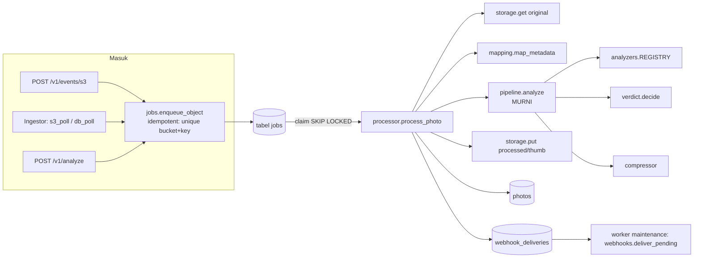

# Panduan Pengembangan Engine

Dokumen ini untuk programmer yang mengubah **kode engine** (menambah check, memperbaiki bug, merilis versi baru). Kalau Anda hanya mengintegrasikan aplikasi, baca [integration-guide.md](integration-guide.md). Kalau Anda menjalankan/men-deploy engine, baca [operations.md](operations.md).

## Daftar Isi

1. [Struktur repository](#struktur-repository)
2. [Arsitektur kode](#arsitektur-kode)
3. [Setup lokal](#setup-lokal)
4. [Test & lint](#test--lint)
5. [Menambah analyzer (check baru)](#menambah-analyzer-check-baru)
6. [Menambah kode alasan / terjemahan](#menambah-kode-alasan--terjemahan)
7. [Menambah tipe source atau sink](#menambah-tipe-source-atau-sink)
8. [Mengubah skema database](#mengubah-skema-database)
9. [Sampel sintetis & kalibrasi threshold](#sampel-sintetis--kalibrasi-threshold)
10. [Konvensi kode](#konvensi-kode)
11. [Proses rilis](#proses-rilis)

---

## Struktur repository

```
ocr-engine/
├── engine/                     # paket Python (perintah CLI: pqe)
│   ├── analyzers/              # plugin check: sharpness, resolution, exposure, exif, duplicate, ocr
│   │   ├── base.py             # kontrak: AnalysisContext, CheckResult, Finding, DuplicateMatch
│   │   └── __init__.py         # REGISTRY analyzer
│   ├── imaging/
│   │   ├── loader.py           # decode sekali (EXIF orientation, HEIC, grayscale cache)
│   │   └── compressor.py       # kompresi dinamis + SSIM guard + thumbnail
│   ├── api/
│   │   ├── app.py              # FastAPI: router, error handler, /healthz /readyz /metrics, mount /ui
│   │   ├── routes.py           # /v1: analyze, photos, review, evidence, verify, events, stats, meta
│   │   ├── admin.py            # /v1/admin: tenant, API key, jobs, sources, audit
│   │   ├── auth.py             # API key + role
│   │   └── common.py           # helper error & bahasa
│   ├── defaults/profiles.yaml  # profile bawaan (threshold, params, kompresi)
│   ├── locales/{id,en}.yaml    # pesan per kode alasan
│   ├── webui/                  # Web UI vanilla JS (index.html, app.js, style.css), tanpa build step
│   ├── pipeline.py             # pipeline MURNI: bytes + profile -> hasil (tanpa DB/S3)
│   ├── verdict.py              # skor -> PASS/WARN/REJECT + alasan + aksi sesuai mode
│   ├── processor.py            # proses satu job: SILO -> pipeline -> simpan varian & hasil -> webhook
│   ├── jobs.py                 # antrean job di database (SKIP LOCKED), enqueue idempotent
│   ├── worker.py               # loop worker + pemeliharaan (job macet, retensi, gauge)
│   ├── ingestor.py             # polling S3, event S3, polling DB aplikasi, reconciliation
│   ├── tenants.py              # simpan/validasi config tenant + cache registry
│   ├── tenant_config.py        # skema Pydantic config tenant & profile, resolve profile
│   ├── mapping.py              # aturan mapping metadata (meta:, key:regex:, ...)
│   ├── serializers.py          # bentuk JSON foto untuk API/webhook/UI
│   ├── evidence.py             # data & PDF bukti pengiriman
│   ├── webhooks.py             # outbox webhook + HMAC + retry
│   ├── storage.py              # adapter S3 (SILO)
│   ├── db.py                   # model SQLAlchemy
│   ├── settings.py             # env var (pydantic-settings, juga membaca .env)
│   ├── i18n.py                 # pilih bahasa & terjemahkan alasan
│   ├── metrics.py              # metrik Prometheus
│   ├── bootstrap.py            # persiapan saat start
│   ├── synth.py                # generator sampel sintetis
│   └── cli.py                  # perintah pqe
├── tests/                      # pytest (unit + end-to-end dengan moto S3)
├── clients/                    # client siap salin (TypeScript, PHP) + test
├── config/tenants/             # contoh/seed config tenant
├── deploy/k8s/                 # manifest Kubernetes (kustomize)
├── scripts/                    # skrip bantu (aktifkan bucket notification SILO lokal)
├── docs/                       # dokumentasi + ADR
├── Dockerfile, docker-compose.yml, docker-compose.remote-silo.yml
├── pyproject.toml              # metadata paket, dependency, ruff, pytest
└── requirements.lock           # versi dependency terkunci (dipakai Docker & CI)
```

---

## Arsitektur kode



Prinsip penting:

- **`pipeline.analyze()` murni**: input bytes + `AnalysisContext` (profile, metadata, waktu terima, timezone, fungsi cek duplikat), output `PipelineResult`. Tidak menyentuh DB/S3. Dipakai worker, endpoint preview, CLI `pqe analyze`, dan test. Logika analisis baru ditaruh di sini (lewat analyzer), bukan di processor.
- **Analyzer = plugin.** Setiap analyzer mengembalikan `CheckResult` (skor 0-100, makin tinggi makin baik, `issue_code`, metrik, `Finding` info/risk). `verdict.decide()` membandingkan skor dengan threshold profile, dan menghitung skor `authenticity` = 100 − total poin `Finding` bertipe `risk`.
- **Antrean di database** (`jobs.py`): `claim_job` memakai `with_for_update(skip_locked=True)`. Retry: backoff `10 × 2^(attempt-1)` detik (maks 1 jam) sampai `PQE_JOB_MAX_ATTEMPTS`, lalu `dead`. Job `running` lebih lama dari `PQE_JOB_STALE_AFTER_SEC` dikembalikan ke antrean oleh worker. Lihat [ADR 0001](adr/0001-queue-di-postgres.md).
- **Error permanen vs sementara** (`processor.execute_job`): `UnreadableImage`, `ObjectNotFound`, `TenantNotFound` langsung menandai foto `error` tanpa retry. Exception lain dianggap sementara dan di-retry.
- **Ingestor** (`Ingestor.tick`): setiap source dijadwalkan sesuai `poll_interval_sec`. Source `s3_event` hanya di-poll saat reconciliation. Tick pertama setelah start selalu reconciliation (lookback minimal 7 hari) untuk mengejar foto saat engine mati.
- **Config tenant** disimpan di DB (`tenants.py`). `TenantRegistry` meng-cache semua tenant dan me-refresh paling lambat tiap `CACHE_TTL_SEC` (5 detik), sehingga perubahan dari Web UI berlaku tanpa restart di semua proses. Profile hasil akhir = `default` bawaan ← `default` tenant ← `extends` ← profile bawaan bernama sama ← override tenant (`tenant_config.build_profile`).
- **Mapping metadata** dilakukan dua kali: perkiraan awal saat enqueue (dari key/field, agar foto langsung bisa dicari per resi) dan final di worker setelah metadata objek S3 terbaca.
- **Serializer tunggal** (`serializers.photo_to_dict`) dipakai API, webhook, dan Web UI agar bentuk JSON konsisten. Skor `authenticity_risk` = 100 − `authenticity` hanya ditambahkan di serializer.
- **i18n**: hasil disimpan sebagai kode alasan. Pesan diterjemahkan saat respons (`i18n.localize_reasons`) sesuai `Accept-Language` / `?lang=`. Webhook memakai `default_lang` tenant.
- **Duplikat**: `processor.PhashIndex` menyimpan hash per tenant di memori, di-update inkremental dari DB (lookback `PQE_DUPLICATE_LOOKBACK_DAYS`).

---

## Setup lokal

Kebutuhan: Python **3.11+** (Docker & CI memakai 3.12). Docker opsional.

```bash
python3.12 -m venv .venv
. .venv/bin/activate
pip install -r requirements.lock -e ".[dev]"
```

OCR opsional: `requirements.lock` sudah memuat `pytesseract`, tapi Anda perlu binary Tesseract (`apt install tesseract-ocr tesseract-ocr-ind tesseract-ocr-eng`). Tanpa Tesseract, check `ocr` dilewati dengan info `OCR_UNAVAILABLE`.

### Menjalankan engine tanpa Docker (SQLite + S3 tiruan)

`moto[server]` termasuk extras `dev`, jadi Anda bisa menjalankan S3 tiruan:

```bash
moto_server -H 127.0.0.1 -p 5055        # terminal 1 (data di memori, hilang saat dihentikan)
```

Buat `.env` di root repo (otomatis dibaca `engine/settings.py`):

```bash
DATABASE_URL=sqlite:///./pqe.db
AWS_ENDPOINT=http://127.0.0.1:5055
AWS_ACCESS_KEY_ID=test
AWS_SECRET_ACCESS_KEY=test
AWS_BUCKET=ekas-pcptransport
ENGINE_CREATE_BUCKETS=true
PQE_BOOTSTRAP_ADMIN_KEY=pqe_dev_admin
PQE_TENANTS_DIR=config/tenants
```

```bash
pqe run                                  # terminal 2 -> http://localhost:8000/ui (key: pqe_dev_admin)
pqe demo-upload                          # terminal 3 -> upload foto contoh, cek menu Review
```

Alternatif paling mirip produksi: `docker compose up -d --build` (SILO asli + Postgres), lihat [operations.md](operations.md#2-docker-compose-lokal-full-stack).

Mencoba analisis tanpa server sama sekali:

```bash
pqe synth-samples ./samples
pqe analyze ./samples/*.jpg --profile pod_recipient
pqe analyze foto-asli.jpg --profile pod_document --json --out-dir ./hasil
```

---

## Test & lint

```bash
pytest                       # semua test (sekitar 1-2 menit)
pytest tests/test_analysis.py -k blur
ruff check engine tests      # lint (aturan di pyproject.toml, panjang baris 120)
ruff check engine tests --fix
```

Isi test:

- `tests/test_analysis.py`: analyzer, verdict, kompresi, EXIF, duplikat, mode. Murni, tanpa DB/S3.
- `tests/test_e2e.py`: alur lengkap S3 → ingestor → antrean → worker → API → webhook (HMAC) → review → evidence/PDF → verify, plus retry/dead, API key per role, admin tenant.

Fixture di `tests/conftest.py`:

| Fixture | Fungsi |
|---|---|
| `s3_endpoint` (session) | Menjalankan `moto` `ThreadedMotoServer` di port acak sebagai pengganti SILO |
| `env` | SQLite sementara per test, tenant `test-app` (bucket `app-photos`, prefix `pod/`, webhook ke `http://hooks.test/photo` dengan secret `s3cr3t`, `pod_recipient` mode `warn`), env var, reset semua cache, `bootstrap()`, mengosongkan bucket |
| `client` | `TestClient` FastAPI (`create_app(run_bootstrap=False)`) |
| `admin_headers` | `{"X-API-Key": "pqe_admin_test_key"}` |
| `samples` | Dict sampel sintetis dari `engine.synth.variants()` |

Webhook di test dicegat dengan `httpx.MockTransport` (fixture `hooks` di `test_e2e.py`).

Test client (TypeScript/PHP) ada di `clients/` dan wajib dijalankan di runtime yang sudah di-patch. Lihat [clients/README.md](../clients/README.md).

CI (`.github/workflows/ci.yml` dan `.gitlab-ci.yml`) menjalankan ruff, pytest, test client di image Node/PHP terkunci, dan build image Docker + smoke test.

---

## Menambah analyzer (check baru)

Contoh: check `glare_spot` (titik silau) bernilai skor.

**1. Buat analyzer** `engine/analyzers/glare_spot.py`:

```python
"""Titik silau lokal (misal pantulan lampu di plastik paket)."""

from __future__ import annotations

from engine.analyzers.base import AnalysisContext, CheckResult, linear_score
from engine.imaging.loader import LoadedImage


class GlareSpotAnalyzer:
    name = "glare_spot"

    def __call__(self, img: LoadedImage, ctx: AnalysisContext) -> CheckResult:
        max_ratio = float(ctx.profile.param("glare_spot", "max_ratio", 0.08))
        g = img.gray_scaled(512)
        ratio = float((g >= 252).mean())
        return CheckResult(
            check=self.name,
            score=linear_score(ratio, max_ratio * 2, max_ratio / 2),  # bad -> 0, good -> 100
            issue_code="GLARE_SPOT",
            metrics={"bright_ratio": round(ratio, 4)},
        )
```

Aturan kontrak (`engine/analyzers/base.py`):

- `name` unik, sama dengan nama check di config.
- Kembalikan `CheckResult`: `score` 0-100 (makin tinggi makin baik) atau `None` jika check tidak menilai (contoh: `exif`, `duplicate` hanya menghasilkan `Finding`).
- `issue_code` = kode alasan saat skor di bawah threshold.
- `Finding(code, "info")` untuk informasi, `Finding(code, "risk", points)` untuk risiko keaslian (mengurangi skor `authenticity`).
- Baca parameter lewat `ctx.profile.param("<check>", "<nama>", default)`.
- Pakai `img.gray` / `img.gray_scaled(n)` (sudah di-cache) agar tidak decode ulang.
- Jangan akses DB/S3 di analyzer. Kalau butuh data luar, tambahkan callable di `AnalysisContext` (seperti `find_duplicates`).

**2. Daftarkan** di `engine/analyzers/__init__.py` (tambahkan `GlareSpotAnalyzer()` ke `REGISTRY`).

**3. Izinkan di config** `engine/tenant_config.py`:
- tambahkan `"glare_spot"` ke `CHECKS`;
- karena bernilai skor, tambahkan juga ke `SCORED_CHECKS` (agar boleh punya threshold).

**4. Default profile** `engine/defaults/profiles.yaml`: tambahkan threshold & params, dan masukkan ke `checks` profile yang membutuhkan:

```yaml
default:
  thresholds:
    glare_spot: { reject: null, warn: 40 }
  params:
    glare_spot: { max_ratio: 0.08 }
package:
  checks: [sharpness, resolution, exposure, exif, duplicate, glare_spot]
```

Profile tenant lama tidak berubah kecuali `checks`-nya ikut diubah (override `checks` adalah list utuh, bukan digabung).

**5. Kode alasan** `GLARE_SPOT` di `engine/locales/id.yaml` dan `engine/locales/en.yaml` (lihat bagian berikut).

**6. Test** di `tests/test_analysis.py`: kasus lolos dan gagal, minimal satu sampel sintetis. Jika butuh sampel baru, tambahkan ke `engine/synth.py` dengan prefix nama sesuai verdict yang diharapkan (`pass_`, `warn_`, `reject_`). Test `test_synthetic_verdicts` memakai prefix itu.

**7. Dokumentasi**: tambahkan check & kode alasan di [configuration.md](configuration.md) dan [api-reference.md](api-reference.md).

**8. Kalibrasi** dengan foto asli sebelum dipakai di mode `warn`/`enforce` (lihat bagian sampel & kalibrasi).

---

## Menambah kode alasan / terjemahan

1. Tambahkan entri di **kedua** file `engine/locales/id.yaml` dan `engine/locales/en.yaml`, di bawah `reasons:`:

   ```yaml
   GLARE_SPOT:
     message: Ada titik silau yang menutupi bagian foto
     suggestion: Miringkan kamera sedikit agar pantulan lampu tidak mengenai label.
   ```

2. `message` menjelaskan masalah, `suggestion` = apa yang harus dilakukan kurir (ditampilkan aplikasi untuk severity `warn`/`reject`).
3. Kode alasan adalah **kontrak API** (aplikasi bisa memakainya di logika). Jangan mengganti nama kode yang sudah dipakai. Tambah kode baru, dan tandai yang lama sebagai deprecated di dokumentasi.
4. Bahasa baru: buat `engine/locales/<kode>.yaml` dengan struktur sama, lalu tambahkan kode bahasa ke `SUPPORTED` di `engine/i18n.py`. Validator `default_lang` di `TenantConfig` dan pola `lang` di beberapa endpoint (`^(id|en)$`) juga perlu diperluas.
5. Endpoint `GET /v1/meta/reason-codes` otomatis menampilkan kode baru.

---

## Menambah tipe source atau sink

**Source** (cara menemukan foto baru):

1. Tambahkan nilai ke `Source.type` (Literal) di `engine/tenant_config.py`, plus field konfigurasi yang dibutuhkan.
2. Implementasikan fungsi poll di `engine/ingestor.py` yang memanggil `enqueue_object(...)` (idempotent) dan kembalikan jumlah foto baru.
3. Arahkan dari `run_source()` dan atur jadwalnya di `Ingestor.tick()`.
4. Catat error lewat `metrics.SOURCE_ERRORS` (sudah ditangani `run_source`). State/checkpoint simpan di `SourceState`.
5. Test end-to-end di `tests/test_e2e.py`.

**Sink** (ke mana hasil dikirim):

1. Tambahkan nilai ke `Sink.type` di `engine/tenant_config.py`.
2. Saat ini semua sink diantre sebagai `WebhookDelivery` di `processor._queue_webhooks` dan dikirim `webhooks.deliver_pending`. Untuk sink non-HTTP, buat outbox/pengirim sendiri dengan pola yang sama: antre di DB dalam transaksi yang sama dengan hasil analisis, kirim dari loop pemeliharaan worker dengan retry.
3. Jangan pernah mengirim langsung di dalam `process_photo` (pengiriman yang lambat akan menahan antrean).

---

## Mengubah skema database

Saat ini skema dibuat dengan `Base.metadata.create_all()` saat bootstrap (`engine/db.py:init_db`). Perilakunya:

- Tabel **baru** otomatis dibuat.
- Kolom baru / perubahan tipe di tabel yang sudah ada **tidak** diterapkan otomatis.

Aturan sementara:

- Selama belum ada data produksi, perubahan skema boleh lewat `create_all` (reset DB lokal: hapus `pqe.db`).
- **Sebelum perubahan skema pertama yang menyentuh tabel yang sudah dipakai di produksi**, perkenalkan Alembic (`alembic init`, revision awal dari skema saat ini, jalankan `alembic upgrade head` di bootstrap/CI). Jangan mengubah kolom produksi dengan SQL manual tanpa skrip migrasi yang di-commit.
- Perubahan harus kompatibel mundur selama rolling update (tambah kolom nullable dulu, isi, baru wajibkan), karena versi lama dan baru bisa berjalan bersamaan.

---

## Sampel sintetis & kalibrasi threshold

`pqe synth-samples FOLDER` (`engine/synth.py`) membuat adegan mirip POD (paket + label resi + barcode + "penerima" + tekstur + noise sensor), lalu variasinya:

| Nama | Kondisi |
|---|---|
| `pass_sharp_large`, `pass_huge_camera` (4000×3000, > 1 MB), `pass_small_ok` | Foto layak |
| `warn_blur_mild`, `warn_pixelated_upscaled` | Kurang ideal |
| `reject_blur_severe`, `reject_upscaled_blurry`, `reject_tiny`, `reject_heavy_jpeg`, `reject_dark`, `reject_overexposed`, `reject_low_contrast` | Tidak layak |

Prefix nama = verdict yang diharapkan dan dipakai test.

Batasan: sampel sintetis punya bidang datar dan garis lurus yang tidak realistis. Threshold bawaan dikalibrasi dengan foto asli publik + variasi degradasi, tapi **wajib dikalibrasi ulang dengan foto POD asli** ([sdlc-plan.md](sdlc-plan.md) 6.2 dan 8.2):

1. Jalankan tenant di mode `shadow` 1-2 minggu.
2. Ops memberi label lewat review (approve = foto sebenarnya layak, retake/fraud = memang buruk).
3. Bandingkan skor per check dengan label. Contoh query: `select verdict, review_status, scores from photos where review_status <> 'none';`
4. Coba threshold baru dengan `pqe analyze --tenant-file config-baru.yaml folder/*.jpg --json` atau Web UI → Uji foto.
5. Terapkan sebagai versi config baru (riwayat versi tersimpan otomatis), lalu "Analisis ulang" foto yang perlu.

Metrik mentah setiap check (`metrics` di detail foto) membantu memahami alasan skor.

---

## Konvensi kode

- **Identifier dalam bahasa Inggris** (nama fungsi, variabel, kolom, field JSON, kode alasan). **Komentar, docstring, pesan error, dan pesan untuk pengguna dalam bahasa Indonesia**, mengikuti kode yang sudah ada.
- Pesan untuk kurir/pelanggan selalu lewat file locale, jangan di-hardcode.
- Error API memakai format `{"error": {"code": "...", "message": "..."}}` (`api_error()` di `engine/api/common.py`). `code` stabil (UPPER_SNAKE), `message` boleh berubah.
- Waktu selalu timezone-aware (UTC di DB). Gunakan `db.utcnow()` dan `db.as_aware()` (SQLite mengembalikan datetime naive).
- Jangan menambah dependency tanpa alasan kuat. Jika perlu, tambahkan di `pyproject.toml` lalu regenerasi `requirements.lock`.
- Jaga prinsip [ADR](adr/): engine read-only terhadap sistem lain, fail-open, rule-based yang bisa dijelaskan.
- Commit memakai Conventional Commits (`feat:`, `fix:`, `docs:`, `chore:`).

---

## Proses rilis

1. Naikkan versi di **dua tempat**: `pyproject.toml` (`version`) dan `engine/__init__.py` (`__version__`).
2. Jika dependency berubah, regenerasi lockfile di environment bersih:

   ```bash
   python3.12 -m venv /tmp/lockenv
   /tmp/lockenv/bin/pip install ".[ocr]"
   /tmp/lockenv/bin/pip freeze --exclude photo-quality-engine > requirements.lock
   pip install -r requirements.lock -e ".[dev]" && pytest     # pastikan test lolos dengan versi baru
   ```

3. Merge request → CI hijau (lint, pytest, test client, build image + smoke test).
4. Tag `vX.Y.Z` di default branch. Pipeline GitLab mem-push image `$CI_REGISTRY_IMAGE:<sha>`. Tag image versi untuk produksi (`registry.pcpexpress.com/photo-quality-engine:X.Y.Z`) dan update `deploy/k8s/kustomization.yaml`.
5. Deploy sesuai [operations.md](operations.md#10-upgrade--rollback).

### Menjaga versi runtime client tetap aman

Client di `clients/` dikunci ke versi Node/PHP dari security release **21 Oktober 2026** (Node 22.23.4 / 24.22.1 / 26.12.1, PHP 8.2.35 / 8.3.36 / 8.4.27 / 8.5.12). Saat ada security release baru, perbarui sekaligus:

- `clients/README.md`
- `clients/typescript/package.json` (`engines.node`), `clients/typescript/.nvmrc`, `MIN_PATCHED` di `clients/typescript/test.ts`
- `clients/php/composer.json` (`require.php`), `MIN_PATCHED` di `clients/php/test.php`
- matrix image di `.github/workflows/ci.yml` (job `clients`) dan job `client-node` / `client-php` di `.gitlab-ci.yml`
- checklist keamanan di [operations.md](operations.md#11-checklist-keamanan)

Base image engine (`python:3.12-slim`) tidak memuat Node/PHP, tapi tetap rebuild image berkala untuk patch OS.
