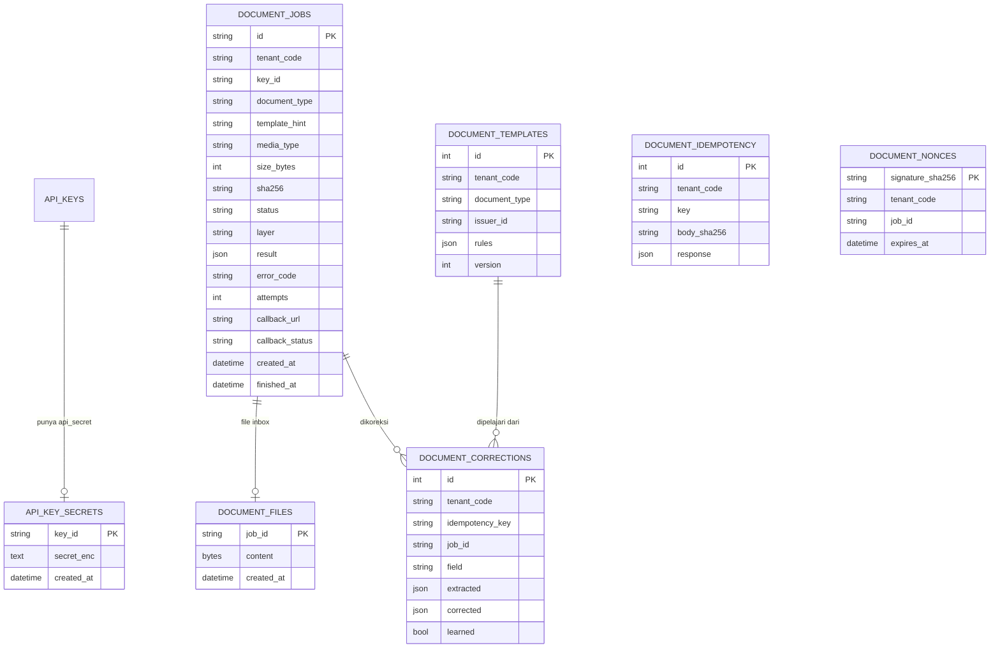
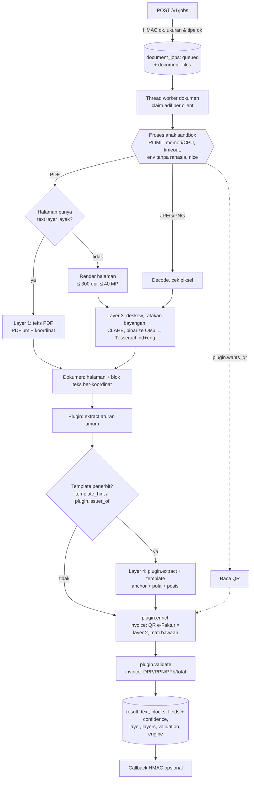

# Desain Modul OCR Dokumen

| | |
|---|---|
| **Versi** | 2.0 (30 Okt 2026) |
| **Pemilik** | Anas Fikri |
| **Status** | Diimplementasikan di engine 0.5.0 |
| **Keputusan** | [ADR 0008](adr/0008-modul-ocr-invoice.md) (perluasan engine), [ADR 0009](adr/0009-modul-dokumen-generik-multi-client.md) (generik multi-client, plugin) |
| **Kebutuhan** | FR-OCR-001..013 (OCR dokumen: async job, layer 1-4, template per penerbit, HMAC, callback, retensi, health, plugin, tanpa AI generatif) |

Engine yang sama (satu deployment) punya **dua fungsi**: pemeriksaan foto POD (sudah ada, tidak berubah) dan **modul OCR
dokumen** (baru). Modul dokumen **generik**: dipakai aplikasi client mana pun, masing-masing dengan namespace, API key,
template, dan callback sendiri. Jenis dokumen adalah **plugin**; plugin pertama `invoice` (invoice vendor Indonesia).

Referensi API: [api-reference.md](api-reference.md#dokumen); cara integrasi:
[integration-guide.md §13](integration-guide.md#13-integrasi-modul-dokumen); variabel:
[configuration.md §1.8](configuration.md#18-modul-dokumen); client contoh: [clients/](../clients/README.md).

## 1. Batasan & prinsip

1. **Fungsi foto POD tidak boleh rusak.** Modul dokumen punya router, tabel (`document_*`, `api_key_secrets`),
   antrean, dan thread worker sendiri (`engine/documents/`). Tidak ada kolom/tabel lama yang diubah (satu field opsional
   baru di config tenant: `callback_hosts`).
2. **Generik, tidak spesifik client** (ADR 0009). Tidak ada nama aplikasi client di kode, tabel, config, endpoint, atau
   dokumen API. Kontrak yang diusulkan client = masukan; versi generiknya yang berlaku.
3. **Core tidak tahu jenis dokumen.** API, antrean, sandbox, template, retensi, callback generik; label, field,
   validasi, identitas penerbit, dan pengayaan (QR e-Faktur) ada di plugin.
4. **Yang dipakai ulang:** API key + tenant (namespace), log, metrik Prometheus, `/healthz`, enkripsi rahasia
   (`PQE_SECRET_KEY`), backup database (tabel dokumen ikut dump), Docker image & compose.
5. **Tanpa AI generatif dan tanpa model ML** selain Tesseract (FR-OCR-013). Aturan (label, pola, posisi) yang bisa
   dijelaskan, sejalan dengan [ADR 0004](adr/0004-rule-based-sebelum-ml.md).
6. **Dokumen tidak dipercaya.** PDF/gambar diproses di **proses anak** dengan batas memori, CPU, waktu, tanpa rahasia
   di environment-nya. Bom PDF/gambar hanya mematikan proses anak.
7. **Foto POD diprioritaskan.** OCR dokumen berjalan dengan prioritas CPU lebih rendah (`nice`), bawaan 1 thread,
   kerja sinkron API di threadpool (event loop yang melayani analisis sinkron foto kurir tidak tertahan).

## 2. Model client (multi-tenant)

| Konsep | Implementasi |
|---|---|
| Client | Satu aplikasi pemakai OCR dokumen = satu **tenant** (namespace). Dibuat dengan `pqe create-client --code <kode> --name "<nama>"` (di server: `scripts/pqe.sh create-client ...`; tenant + API key role `app` + `api_secret`) |
| Kredensial | API key (disimpan hash) + `api_secret` HMAC (terenkripsi). Rotasi `pqe set-api-secret <key_id>`, cabut lewat Web UI |
| Data milik client | Job, file inbox, hasil, template penerbit, koreksi, idempotency, nonce replay: semua berkolom `tenant_code`, semua query difilter tenant API key. Data client lain = `404` |
| Callback | Opsional per job. Host harus ada di `callback_hosts` tenant client itu atau `PQE_DOCS_CALLBACK_HOSTS` global. Ditandatangani dengan `api_secret` key pembuat job |
| Kuota | Antrean per client `PQE_DOCS_MAX_PENDING_PER_TENANT`; claim worker adil antar-client |

## 3. Endpoint (API v1)

Semua endpoint wajib **API key + tanda tangan HMAC** (bagian 6.1).

| Method | Path | Fungsi | Sukses |
|---|---|---|---|
| `POST` | `/v1/jobs` | Kirim file (PDF/JPEG/PNG) + `document_type` (+ `template_hint`, `callback_url` opsional). Job async | `202 {"job_id", "status": "queued", "poll_url"}` |
| `GET` | `/v1/jobs/{id}` | Status; setelah selesai: `text`, `blocks` (koordinat), `fields` (+ confidence), `layer`, `engine` | `200` |
| `POST` | `/v1/templates` | Koreksi pengguna → belajar/update template penerbit (idempoten) | `200` |
| `GET` | `/v1/templates/{document_type}/{issuer_id}` | Lihat template penerbit di namespace sendiri | `200` |
| `GET` | `/healthz` | (diperluas) versi engine, Tesseract/PDFium, jenis dokumen terdaftar | `200` |

Status job: `queued` → `running` → `succeeded` | `failed`. Error: `{"error": {"code", "message"}}`. API berversi:
perubahan tidak kompatibel memakai `/v2`; field baru boleh ditambah kapan saja (client mengabaikan field asing).

## 4. Skema database (tabel baru)



- Hasil (JSON) di `document_jobs.result`; file asli di `document_files` (polling status tidak membaca blob). Antrean
  memakai pola [ADR 0001](adr/0001-queue-di-postgres.md) (`SELECT ... FOR UPDATE SKIP LOCKED`), claim adil per tenant.
- Unique: `document_templates(tenant_code, document_type, issuer_id)`, `document_corrections(tenant_code,
  idempotency_key)`, `document_idempotency(tenant_code, key)`.
- File inbox di PostgreSQL (bukan SILO), dihapus setelah `PQE_DOCS_INBOX_RETENTION_DAYS`. Alasan di ADR 0008.

## 5. Alur pemrosesan



### 5.1 Layer 1: PDF digital

PDFium (`pypdfium2`) membaca teks + kotak per halaman. Halaman dianggap punya text layer layak bila ≥ 20 karakter dan
≥ 50% huruf/angka; selain itu dirender lalu masuk layer 3. Satu dokumen boleh campuran.

### 5.2 Layer 2: QR (plugin invoice: e-Faktur, mati secara bawaan)

`PQE_INVOICE_EFAKTUR_QR` = `off` (bawaan) / `decode` (QR dibaca lokal: NPWP penjual & nomor faktur, tanpa jaringan) /
`lookup` (+ panggil validasi DJP: hanya host di `PQE_INVOICE_EFAKTUR_HOSTS`, HTTPS, tanpa redirect, timeout 10 dtk,
respons ≤ 256 KB, `defusedxml`). Isi QR dikendalikan pembuat dokumen, jadi QR **tidak** menimpa nilai tercetak yang
berbeda: sama → confidence 0,99; field kosong → diisi (0,9); berbeda → nilai tercetak dipertahankan, confidence turun,
`EFAKTUR_MISMATCH`. Format respons DJP diasumsikan e-Faktur 3.x (`resValidateFakturPm`), **belum diverifikasi**;
Coretax bisa berbeda. Aktifkan setelah izin dikonfirmasi dan diuji dengan faktur asli.

### 5.3 Layer 3: gambar / scan

Grayscale → skala baca (sisi panjang 1.600-4.200 px) → deskew (estimasi kemiringan yang sama dengan analyzer foto) →
ratakan bayangan (bagi dengan estimasi latar) → CLAHE → binarize Otsu → Tesseract `ind+eng` (PSM 3), dibaca per baris
dengan kotak dan confidence. Binarize adaptif lokal sempat dicoba dan memperburuk scan bernoise (confidence ±93 → ±45).

### 5.4 Layer 4: template penerbit (generik)

Template per **(client, document_type, issuer_id)**. `issuer_id` dinormalisasi plugin (invoice: NPWP digit). Aturan
per field: `anchor` (label dokumen di dekat nilai, minimal 3 huruf, bukan kode mata uang), jenis nilai dari daftar
tetap (`date`, `money`, `npwp`, `account`, `docno`, `text`, `currency`) + `shape` opsional untuk nomor dokumen (regex
linear), dan posisi (`same_line`, `offset`, cadangan `value_box`). Client **tidak pernah** mengirim regex.

- Dipakai bila `template_hint` cocok, atau penerbit hasil aturan umum (`plugin.issuer_of`) cocok.
- Hasil yang hanya berdasar posisi (tanpa anchor) hanya mengisi field kosong.
- Belajar (`POST /v1/templates`): nilai `corrected` dicari di blok teks job (milik client yang sama); label di
  kiri/atasnya menjadi anchor. Field yang bisa dipelajari = `plugin.field_kinds`. Satu field sekali per request.
  Penerbit harus lolos `plugin.issuer_check` (bawaan: tercetak di dokumen atau = `template_hint` job; invoice: NPWP
  penjual tercetak, bukan NPWP pembeli).

### 5.5 Plugin jenis dokumen (FR-OCR-012)

```python
class DocumentExtractor:                       # engine/documents/plugins.py
    document_type = "receipt"; version = "1"
    field_kinds = {"total": "money"}           # field yang bisa dipelajari template → jenis nilai
    extra_fields = ()                          # field lain (mis. tabel) yang tidak dipelajari
    def detect(self, doc) -> float             # 0-1
    def extract(self, doc, template, hint) -> dict[str, Field]   # template diterapkan dengan rules.apply_rule
    def validate(self, fields) -> list[issue]
    # opsional: normalize_issuer, issuer_of, issuer_check, wants_qr, enrich, status
```

Dimuat dari entry point `pqe.document_extractors` atau `PQE_DOCUMENT_PLUGINS=modul:Kelas`. `document_type` tidak
terdaftar → `422 UNSUPPORTED_DOCUMENT_TYPE`. Test `test_new_document_type_with_templates_without_core_change`
membuktikan jenis dokumen baru + template berjalan tanpa mengubah core.

### 5.6 Plugin `invoice`

Field: `vendor_npwp`, `vendor_name`, `bank_account`, `invoice_number`, `invoice_date`, `due_date`, `period_start`,
`period_end`, `currency`, `subtotal`, `discount`, `dpp`, `vat_amount`, `wht_amount`, `total`, `lines[]`
(`description`, `quantity`, `unit_price`, `amount`). Label ID/EN, zona identitas pembeli (NPWP pembeli tidak dipakai
sebagai penjual), NPWP polos tanpa label tidak dianggap NPWP (nomor VA/NIK), validasi silang subtotal − diskon = DPP,
PPN ≈ 10/11/12% DPP, total = DPP + PPN (− PPh), jumlah item = subtotal.

### 5.7 Normalisasi & confidence

| Jenis | Keluaran |
|---|---|
| Tanggal | `YYYY-MM-DD` (urutan hari/bulan Indonesia; nama bulan ID/EN termasuk `Nop`, `Agt`) |
| Uang & kuantitas | **string desimal** (`"1234567.89"`, `"1500000"`), tidak pernah float |
| NPWP, rekening | digit saja |
| Mata uang | kode ISO |

Confidence 0-1 = keyakinan teks (PDF 0,99; OCR = confidence Tesseract baris) × metode (template + anchor 0,95; label
0,72-0,85; posisi saja 0,6; tebakan 0,4-0,6) × penalti validasi (× 0,6). Field yang tidak ditemukan **tidak dikirim**.
Lebih baik kosong daripada salah: label yang sudah diikuti isi bukan-nilai tidak mengambil nilai dari baris lain.

## 6. Keamanan

### 6.1 Autentikasi & tanda tangan (FR-OCR-008)

```
X-Api-Key:   pqe_...
X-Timestamp: 1793337600                         (Unix detik, angka saja)
X-Signature: hex(HMAC-SHA256(api_secret, timestamp + "\n" + METHOD + "\n" + path + "\n" + hex(sha256(body))))
```

- `path` = path mentah tanpa query, persis seperti dikirim. `body` = byte mentah (GET = kosong).
- Key, format & jendela timestamp (±300 dtk), dan keberadaan `api_secret` dicek **sebelum** body dibaca; tanda tangan
  dibandingkan timing-safe setelah body (dibatasi) terbaca.
- Replay `POST /v1/jobs` dengan tanda tangan sama persis → `job_id` yang sama (`Idempotent-Replayed: true`).
- Hanya key role `app` yang terikat tenant. Key dicabut → request dan callback berhenti.

### 6.2 Abuse case & mitigasi

| # | Abuse case | Mitigasi | Test (`tests/test_documents_*.py`, `tests/test_invoice_*.py`) |
|---|---|---|---|
| A1 | Tanda tangan palsu / secret salah | HMAC dihitung ulang, `compare_digest`, 401 | `test_bad_signature_rejected`, `test_signature_compare_is_timing_safe` |
| A2 | Replay | Jendela ±300 dtk; replay POST jobs = job yang sama; koreksi idempoten per key | `test_replay_rejected`, `test_old_timestamp_rejected` |
| A3 | Body/path diubah | Hash body + path mentah ditandatangani | `test_tampered_body_rejected` |
| A4 | Client lain membaca/mengubah job, file, template | Semua query difilter tenant API key → `404`; nonce, idempotency, koreksi per tenant | `test_namespace_isolation_*`, `test_create_client_cli` |
| A5 | File berbahaya berganti nama / polyglot | Magic bytes di awal file (`%PDF-`, JPEG, PNG) → `415` | `test_unsupported_file_rejected`, `test_pdf_header_must_be_at_start` |
| A6 | PDF bom | Batas ukuran/halaman/ukuran halaman/piksel render, proses anak `RLIMIT_AS`/`RLIMIT_CPU`/timeout, error permanen (tidak di-retry) | `test_sandbox_memory_bomb`, `test_sandbox_flate_bomb`, `test_too_many_pages` |
| A7 | Zip/gambar bom | ZIP ditolak; dimensi gambar dicek dari header | `test_image_pixel_bomb` |
| A8 | Path traversal lewat nama file | File di database, nama hanya dicatat (basename) | `test_filename_is_not_a_path` |
| A9 | ReDoS | Tanpa regex dari client; `shape` → regex linear; teks dipotong | `test_shape_regex_is_linear`, `test_template_rules_contain_no_client_regex` |
| A10 | DoS upload/antrean | Key dicek sebelum body; batas ukuran; kuota antrean per client; claim adil | `test_upload_too_large`, `test_queue_full`, `test_body_not_read_before_api_key_check`, `test_fair_queue_between_namespaces` |
| A11 | DoS CPU lewat dokumen kecil berisi ribuan blok | Maks. 4.000 blok, 30 hit per label, pencarian tetangga ber-indeks, kerja API di threadpool | `test_extraction_is_not_quadratic`, `test_npwp_candidates_linear_per_row` |
| A12 | Respons raksasa | `text`/`blocks` dipotong ≤ ±900 KB | `test_response_size_capped` |
| A13 | SSRF callback / QR | Allowlist host per client + global, port eksplisit, tanpa redirect; QR hanya host DJP | `test_callback_signed`, `test_callback_port_and_revoked_key`, `test_callback_hosts_are_per_client`, `test_efaktur_url_allowlist` |
| A14 | XXE / XML bom | `defusedxml`, batas ukuran | `test_efaktur_xml_entities_rejected` |
| A15 | Rahasia bocor ke proses anak | Env proses anak hanya variabel non-rahasia | `test_sandbox_env_has_no_secrets` |
| A16 | Idempotency disalahgunakan | Key sama + body beda → 422; key koreksi dipakai ulang untuk nilai lain → `conflict` | `test_template_idempotency`, `test_idempotency_key_128_chars_and_conflict` |
| A17 | Template diracuni (penerbit salah, anchor "Rp") | `issuer_check` plugin, anchor wajib label, posisi saja hanya mengisi kosong | `test_template_for_buyer_npwp_rejected`, `test_template_lookup_ignores_buyer_npwp`, `test_issuer_must_be_printed_seller`, `test_template_anchor_is_a_real_label` |
| A18 | QR palsu menimpa nilai tercetak | QR tidak menimpa nilai berbeda (`EFAKTUR_MISMATCH`) | `test_efaktur_qr_cannot_override_printed_npwp` |

Risiko sisa: proses anak masih bisa membuka koneksi jaringan (perlu network namespace/seccomp di level container);
PDFium kode C++ (dibatasi isolasi proses, user non-root, batas sumber daya); plugin pihak ketiga berjalan di proses
worker (pasang hanya yang direview).

### 6.3 Verifikasi independen

Subagent terpisah (tidak ikut menulis kode) menyerang modul ini dua putaran: 14 temuan (5 high) lalu 2 sisa. Semua
diperbaiki dan punya test regresi (bagian "temuan audit independen" di test).

## 7. Batas (bawaan)

| Batas | Nilai | Variabel |
|---|---|---|
| Ukuran file | 20 MB | `PQE_DOCS_MAX_UPLOAD_MB` |
| Halaman PDF | 20 | `PQE_DOCS_MAX_PAGES` |
| Ukuran halaman PDF | ≤ 5.000 pt per sisi | tetap |
| Render PDF | 300 dpi, maks. 40 MP per halaman | `PQE_DOCS_RENDER_DPI` |
| Piksel gambar | 50 MP | `PQE_DOCS_MAX_IMAGE_PIXELS` |
| Memori / CPU / waktu proses anak | 1.536 MB / 120 dtk / 180 dtk | `PQE_DOCS_SANDBOX_MEMORY_MB`, `PQE_DOCS_SANDBOX_TIMEOUT_SEC` |
| Blok teks per dokumen | 4.000 (8.000 baris dari proses anak) | tetap |
| Antrean per client | 200 job | `PQE_DOCS_MAX_PENDING_PER_TENANT` |
| Respons | ±900 KB | tetap |
| Retensi file inbox / hasil | 30 / 365 hari | `PQE_DOCS_INBOX_RETENTION_DAYS`, `PQE_DOCS_RESULT_RETENTION_DAYS` |

## 8. Acceptance criteria

| ID | Kriteria | Test |
|---|---|---|
| AC-01 | `POST /v1/jobs` (PDF/JPEG/PNG + `document_type` + tanda tangan) → `202 {"job_id", "status":"queued"}` | `test_documents_api::test_create_job_and_poll` |
| AC-02 | `GET /v1/jobs/{id}` → status; selesai: `text`, `blocks` (bbox 0-1), `fields {value, confidence}`, `layer`, `engine` | `test_create_job_and_poll` |
| AC-03 | PDF digital tanpa OCR (`layer: "pdf_text"`) | `test_invoice_golden::test_digital_pdf_golden` |
| AC-04 | QR e-Faktur mati bawaan; `decode`/`lookup` bekerja dan tidak menimpa cetakan yang berbeda | `test_invoice_extract::test_efaktur_*` |
| AC-05 | Scan miring/bernoise/berbayang dibaca (`layer: "ocr"`) | `test_invoice_golden::test_scanned_image_golden` |
| AC-06 | Template penerbit memperbaiki field yang gagal dibaca aturan umum (PDF & scan) | `test_invoice_golden::test_template_learning_fixes_field`, `test_documents_api::test_template_learning_and_reuse` |
| AC-07 | `POST /v1/templates` di namespace sendiri; idempoten per key & per request | `test_documents_api::test_template_*` |
| AC-08 | Tanda tangan salah/kedaluwarsa/diulang ditangani | `test_documents_security` |
| AC-09 | Callback ber-HMAC per client; polling tetap jalan | `test_callback_signed`, `test_callback_hosts_are_per_client` |
| AC-10 | File inbox lewat retensi dihapus, hasil tetap | `test_inbox_retention` |
| AC-11 | `/healthz`: versi engine, OCR, jenis dokumen | `test_healthz_versions` |
| AC-12 | Jenis dokumen baru (+ template) tanpa mengubah core | `test_plugin_registry`, `test_new_document_type_with_templates_without_core_change` |
| AC-13 | Tanpa AI generatif / ML selain Tesseract (dependency baru: `pypdfium2`) | review dependency |
| AC-14 | Format nilai (tanggal, uang string, digit) dan confidence 0-1 | `test_normalizers*`, golden |
| AC-15 | Abuse case 6.2 dites | `test_documents_security.py` |
| AC-16 | Client generik: onboarding satu perintah, isolasi antar-client | `test_create_client_cli`, `test_namespace_isolation_*` |
| AC-17 | Client contoh PHP/TS memakai tanda tangan yang sama dengan engine | `clients/php/test.php`, `clients/typescript/test.ts` |
| AC-18 | Test fungsi foto POD tetap hijau | seluruh suite |
