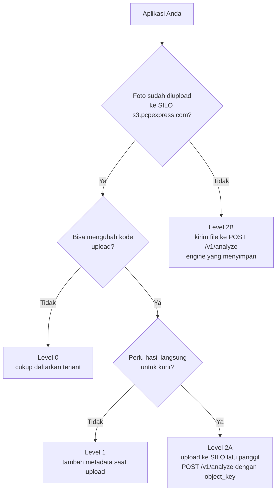

# Panduan Integrasi Photo Quality Engine

Dokumen ini untuk **programmer aplikasi** (Android, iOS, Flutter, web, backend Laravel/Node) yang ingin
menghubungkan aplikasinya ke Photo Quality Engine. Ikuti dari atas ke bawah. Semua contoh kode bisa langsung disalin.

> Butuh gambaran sistemnya dulu? Baca [README](../README.md). Ingin mencoba engine di PC? Baca [getting-started.md](getting-started.md).
>
> **Versi ringkas di browser:** buka `https://<server-engine>/ui/guide.html` (tanpa login). Isinya sama dengan
> dokumen ini dalam bentuk interaktif: contoh kode curl/PHP/TypeScript/Python/Kotlin dengan URL server yang sudah
> terisi otomatis dan tombol salin, plus **diagram alur** (integrasi sampai go-live, alur penggunaan saat runtime,
> keputusan di aplikasi kurir, proses di dalam engine). Link-nya juga ada di menu Web UI (**Panduan Integrasi ↗**) dan di halaman login.
>
> **Coba dulu sebelum menulis kode:** buka `https://<server-engine>/ui/coba.html` dari HP. Halaman itu berperan sebagai
> aplikasi kurir (ambil foto → kirim → tampil pesan untuk kurir + detail analisis), lihat
> [getting-started.md §4b](getting-started.md#4b-uji-coba-dari-hp-tanpa-membangun-aplikasi).

## Daftar isi

1. [Aturan emas (wajib dibaca)](#1-aturan-emas-wajib-dibaca)
2. [Pilih cara integrasi](#2-pilih-cara-integrasi)
3. [Persiapan: tenant & API key](#3-persiapan-tenant--api-key)
4. [Level 0: tanpa mengubah aplikasi](#4-level-0-tanpa-mengubah-aplikasi)
5. [Level 1: tambahkan metadata saat upload ke SILO](#5-level-1-tambahkan-metadata-saat-upload-ke-silo)
6. [Level 2: panggil API engine](#6-level-2-panggil-api-engine)
7. [Menampilkan hasil ke kurir](#7-menampilkan-hasil-ke-kurir) (termasuk `retake_required` dan perbaikan otomatis)
8. [Menerima webhook](#8-menerima-webhook)
9. [Evidence untuk pelanggan (penagihan)](#9-evidence-untuk-pelanggan-penagihan)
10. [Kode error](#10-kode-error)
11. [Checklist sebelum go-live](#11-checklist-sebelum-go-live)
12. [FAQ integrasi](#12-faq-integrasi)

---

## 1. Aturan emas (wajib dibaca)

1. **Engine tidak boleh memperlambat atau menggagalkan proses kurir.** Update status pengiriman *tidak boleh*
   bergantung pada engine. Upload foto dan update status jalan seperti biasa. Engine hanya memberi penilaian.
2. **Selalu pakai timeout dan fail-open.** Kalau engine lambat, error, atau mati, anggap saja "tidak ada hasil"
   lalu lanjutkan proses. Batas waktu yang disarankan: **3 detik** untuk mode sinkron, 5 detik untuk request lain.
   Client resmi di [`clients/`](../clients) sudah fail-open secara bawaan.
3. **API key adalah rahasia server.** Jangan menaruh API key di aplikasi Android/iOS/Flutter atau JavaScript
   di browser (bisa dibongkar). Aplikasi mobile memanggil **backend Anda sendiri**, lalu backend yang memanggil engine.
4. **Pakai kode alasan (`code`) untuk logika, pakai `message`/`suggestion` untuk teks.** Kode stabil.
   Teks bisa berubah dan sudah diterjemahkan (ID/EN).
5. **Kirim foto asli dari kamera.** Jangan kompres atau resize di aplikasi. Engine yang mengurus kompresi
   tanpa merusak keterbacaan. Kompresi agresif di aplikasi adalah penyebab utama foto "pecah".
6. **Runtime harus versi yang sudah di-patch.** Node.js ≥ 22.23.4 / 24.22.1 / 26.12.1 dan PHP ≥ 8.2.35 / 8.3.36 /
   8.4.27 / 8.5.12 (security release 21 Oktober 2026). Detail di [clients/README.md](../clients/README.md).

---

## 2. Pilih cara integrasi



| Level | Yang dikerjakan aplikasi | Hasil | Kapan dipilih |
|---|---|---|---|
| **0** | Tidak ada. Upload ke SILO seperti biasa | Laporan & review ops, evidence pelanggan | Aplikasi lama yang belum bisa diubah |
| **1** | Tambah metadata (`awb`, `photo-type`, ...) saat upload | Sama dengan level 0, tapi data resi/kurir akurat | Aplikasi yang sedang dikembangkan (disarankan minimal) |
| **2A** | Level 1 + panggil API setelah upload | Hasil per foto langsung, bisa memberi notif/menolak | Ingin memberi feedback ke kurir |
| **2B** | Kirim file ke engine | Sama dengan 2A, engine yang menyimpan file | Aplikasi tanpa penyimpanan S3 sendiri |

Semua level bisa naik bertahap tanpa mengubah engine.

---

## 3. Persiapan: tenant & API key

Minta ke admin engine (atau lakukan sendiri jika Anda admin, lewat Web UI menu **Tenant** dan **API key**):

| Yang diminta | Contoh | Keterangan |
|---|---|---|
| Kode tenant | `courier-app` | Satu tenant per aplikasi |
| Base URL engine | `https://photo-quality.pcpexpress.com` (produksi), `http://localhost:8000` (lokal) | Sesuai lingkungan |
| API key role `app` | `pqe_...` | Terikat ke tenant Anda. Simpan di env backend (`PQE_API_KEY`) |
| Secret webhook (opsional) | string acak | Jika ingin menerima webhook |

Informasi yang perlu Anda berikan ke admin agar tenant dikonfigurasi dengan benar:

- Nama bucket dan prefix (folder) tempat aplikasi menyimpan foto, misal `ekas-pcptransport`, prefix `pod/`.
- Contoh 3-5 object key nyata, misal `pod/2026/10/22/AWB123_K045_1729580000.jpg`.
- Di mana nomor resi, jenis foto, dan kurir bisa ditemukan (metadata objek, nama file, atau tabel DB).
- Jenis foto yang dihasilkan aplikasi: `pod_recipient` (foto penerima), `pod_document` (resi/dokumen),
  `package`, `goods`, `location`, atau jenis lain.

Cek API key Anda:

```bash
curl -s -H "X-API-Key: $PQE_API_KEY" https://photo-quality.pcpexpress.com/v1/me
# {"name":"aplikasi-kurir-prod","role":"app","tenant":"courier-app","customer_id":null}
```

Dokumentasi API interaktif (Swagger, bisa langsung dicoba) tersedia di `<base-url>/docs`.

---

## 4. Level 0: tanpa mengubah aplikasi

Tidak ada kode yang perlu ditulis. Admin menambahkan *source* di config tenant agar engine memantau bucket Anda:

```yaml
sources:
  - type: s3_poll
    bucket: ekas-pcptransport
    prefix: "pod/"
    date_prefix_format: "%Y/%m/%d/"   # jika key mengandung tanggal: jauh lebih ringan
    poll_interval_sec: 15
mapping:
  awb: ["key:regex:(?P<awb>[A-Z0-9]{8,20})_"]   # ambil resi dari nama file
  photo_type: ["key:segment:1", "default:pod_recipient"]
```

Engine akan menemukan foto baru dalam beberapa detik (atau langsung, jika bucket notification SILO aktif),
menganalisis, mengompres, lalu menampilkannya di Web UI. Referensi lengkap aturan mapping:
[configuration.md](configuration.md).

Jika data resi tidak ada di nama file tetapi ada di database aplikasi, admin bisa memakai source `db_poll`
(membaca tabel link foto secara read-only). Lihat [configuration.md](configuration.md).

---

## 5. Level 1: tambahkan metadata saat upload ke SILO

Tambahkan **metadata objek** (`x-amz-meta-*`) saat upload. Engine membacanya otomatis.
Tidak menambah request baru dan tidak memperlambat upload.

| Metadata | Contoh | Wajib? | Keterangan |
|---|---|---|---|
| `awb` | `AWB123` | Disarankan | Nomor resi |
| `photo-type` | `pod_recipient` | Disarankan | Menentukan profile pemeriksaan |
| `courier-id` | `K045` | Disarankan | Untuk laporan per kurir |
| `customer-id` | `CUST-001` | Disarankan | Untuk evidence per pelanggan |
| `branch` | `JKT01` | Opsional | Untuk laporan per cabang |
| `captured-at` | `2026-10-22T08:13:20+07:00` | Opsional | Dicocokkan dengan waktu EXIF |
| `lat` / `lng` | `-6.2001` / `106.8166` | Opsional | Dicocokkan dengan GPS EXIF |
| `source` | `camera` / `gallery` | Opsional | Asal foto di HP |
| `external-id` | `foto-998877` | Opsional | ID foto di aplikasi Anda |

**Konvensi key yang disarankan** (tidak wajib, tapi memudahkan):
`{app}/{photo_type}/{yyyy}/{mm}/{dd}/{awb}_{courier_id}_{timestamp}.jpg`

### Laravel (backend upload langsung ke SILO)

```php
use Illuminate\Support\Facades\Storage;

$path = sprintf('pod/%s/%s_%s_%d.jpg', now()->format('Y/m/d'), $awb, $courierId, now()->timestamp);

Storage::disk('s3')->put($path, file_get_contents($request->file('photo')->getRealPath()), [
    'visibility'  => 'private',
    'ContentType' => 'image/jpeg',
    'Metadata'    => [
        'awb'         => $awb,
        'photo-type'  => 'pod_recipient',
        'courier-id'  => $courierId,
        'customer-id' => $customerId,
        'captured-at' => now()->toIso8601String(),
        'source'      => 'camera',
    ],
]);
```

### Laravel: presigned upload untuk aplikasi mobile (disarankan)

Backend membuat URL upload sementara. Aplikasi mobile meng-upload langsung ke SILO tanpa memegang kredensial.
Metadata ikut ditandatangani, jadi aplikasi **wajib** mengirim header yang dikembalikan backend.

```php
// routes/api.php -> POST /api/pod-photo/upload-url  (Laravel 11+, disk s3; cek dokumentasi versi Laravel Anda)
['url' => $url, 'headers' => $headers] = Storage::disk('s3')->temporaryUploadUrl(
    $path,
    now()->addMinutes(10),
    [
        'ContentType' => 'image/jpeg',
        'Metadata'    => ['awb' => $awb, 'photo-type' => 'pod_recipient', 'courier-id' => $courierId],
    ]
);

return response()->json(['url' => $url, 'headers' => $headers, 'object_key' => $path]);
```

> Jika library HTTP di aplikasi menolak header `Host` dari daftar `headers`, lewati header itu. Header lain
> (`Content-Type`, `x-amz-meta-*`) wajib dikirim persis sama.

### Node.js / TypeScript (AWS SDK v3)

```ts
import { S3Client, PutObjectCommand } from "@aws-sdk/client-s3";

const s3 = new S3Client({
  endpoint: process.env.AWS_ENDPOINT,            // https://s3.pcpexpress.com
  region: process.env.AWS_DEFAULT_REGION ?? "us-east-1",
  forcePathStyle: true,                           // wajib untuk SILO
  credentials: { accessKeyId: process.env.AWS_ACCESS_KEY_ID!, secretAccessKey: process.env.AWS_SECRET_ACCESS_KEY! },
});

await s3.send(new PutObjectCommand({
  Bucket: process.env.AWS_BUCKET,                 // ekas-pcptransport
  Key: key,
  Body: photoBuffer,
  ContentType: "image/jpeg",
  Metadata: { awb, "photo-type": "pod_recipient", "courier-id": courierId, source: "camera" },
}));
```

### Flutter / Dart (upload ke presigned URL dari backend)

```dart
import 'dart:convert';
import 'dart:io';
import 'package:http/http.dart' as http;

Future<String?> uploadPodPhoto(File photo, String awb) async {
  // 1. Minta URL upload ke backend Anda (bukan ke engine)
  final r = await http.post(Uri.parse('$backendUrl/api/pod-photo/upload-url'),
      headers: {'Authorization': 'Bearer $userToken', 'Content-Type': 'application/json'},
      body: jsonEncode({'awb': awb})).timeout(const Duration(seconds: 10));
  final upload = jsonDecode(r.body) as Map<String, dynamic>;

  // 2. Upload file ASLI dari kamera (jangan dikompres) dengan header yang diberikan backend
  final headers = Map<String, String>.from(
      (upload['headers'] as Map).map((k, v) => MapEntry(k.toString(), v is List ? v.first.toString() : v.toString())))
    ..remove('Host');
  final put = await http.put(Uri.parse(upload['url']), headers: headers, body: await photo.readAsBytes())
      .timeout(const Duration(seconds: 60));
  return put.statusCode == 200 ? upload['object_key'] as String : null;
}
```

Saat mengambil foto dengan `image_picker`, **jangan** mengisi `imageQuality`, `maxWidth`, atau `maxHeight`
dengan nilai kecil. Itu penyebab utama foto pecah. Biarkan default (foto asli).

### Kotlin / Android (OkHttp)

```kotlin
val body = photoFile.asRequestBody("image/jpeg".toMediaType())
val request = Request.Builder()
    .url(upload.url)
    .put(body)
    .apply { upload.headers.filterKeys { it != "Host" }.forEach { (k, v) -> header(k, v) } }
    .build()
okHttpClient.newCall(request).execute().use { resp ->
    if (!resp.isSuccessful) { /* simpan ke antrean retry lokal, JANGAN blok update status */ }
}
```

### Swift / iOS (URLSession)

```swift
var request = URLRequest(url: upload.url)
request.httpMethod = "PUT"
for (key, value) in upload.headers where key != "Host" { request.setValue(value, forHTTPHeaderField: key) }
let (_, response) = try await URLSession.shared.upload(for: request, from: photoData)
if (response as? HTTPURLResponse)?.statusCode != 200 { /* antre ulang, jangan blok proses kurir */ }
```

Setelah upload berhasil, tidak ada lagi yang perlu dilakukan untuk Level 1. Engine memprosesnya sendiri.

---

## 6. Level 2: panggil API engine

### 6.1 Endpoint utama

`POST /v1/analyze`, dengan dua bentuk:

| Bentuk | Content-Type | Isi | Kapan |
|---|---|---|---|
| **Referensi objek (2A)** | `application/json` | `{"object_key": "...", "awb": "...", ...}` | Foto sudah di SILO. Paling hemat kuota kurir |
| **Upload file (2B)** | `multipart/form-data` | field `file` + metadata sebagai form field | Aplikasi tidak menyimpan ke SILO sendiri |

Parameter query:

| Parameter | Default | Keterangan |
|---|---|---|
| `sync` | `false` | `true` = tunggu hasil sampai `timeout_ms`. Lewat batas: tetap `202` (fail-open) |
| `timeout_ms` | `3000` | 100-30000. Disarankan ≤ 3000 |
| `lang` | sesuai `Accept-Language` | `id` atau `en` |
| `tenant` | tenant API key | Hanya untuk key admin/ops |

Respons:

| HTTP | Arti | Yang dilakukan aplikasi |
|---|---|---|
| `200` | Hasil sudah ada (`status: done` atau `error`) | Baca `verdict`, `action`, `reasons` |
| `202` | Diterima, masih diproses | Lanjutkan proses. Ambil hasil nanti via `poll_url` atau webhook |
| `4xx` | Request salah (lihat [kode error](#10-kode-error)) | Perbaiki request, jangan diulang terus |
| `5xx` / timeout | Engine bermasalah | **Fail-open**: lanjutkan proses seperti biasa |

### 6.2 Contoh dengan curl

```bash
# 2A: foto sudah ada di SILO
curl -s -X POST "$PQE_URL/v1/analyze?sync=true&timeout_ms=3000" \
  -H "X-API-Key: $PQE_API_KEY" -H "Content-Type: application/json" -H "Accept-Language: id" \
  -d '{"object_key":"pod/2026/10/22/AWB123_K045_1729580000.jpg","awb":"AWB123","photo_type":"pod_recipient","courier_id":"K045"}'

# 2B: kirim file
curl -s -X POST "$PQE_URL/v1/analyze?sync=true" -H "X-API-Key: $PQE_API_KEY" \
  -F "file=@foto.jpg" -F "awb=AWB123" -F "photo_type=pod_recipient" -F "courier_id=K045" -F "source=camera"

# ambil hasil (mode async)
curl -s -H "X-API-Key: $PQE_API_KEY" "$PQE_URL/v1/photos/<id>"
```

### 6.3 Contoh respons

```json
{
  "id": "e350b8bdf97e4be6afd39df178bd922c",
  "tenant": "courier-app",
  "status": "done",
  "verdict": "REJECT",
  "verdict_text": "Foto tidak layak",
  "action": "notify",
  "retake_required": true,
  "retake_message": "Kualitas foto tidak memenuhi syarat dan tidak bisa diperbaiki otomatis. Silakan ambil foto ulang.",
  "photo_type": "pod_recipient",
  "profile": "pod_recipient",
  "awb": "AWB123",
  "courier_id": "K045",
  "customer_id": null,
  "branch": null,
  "external_id": null,
  "captured_at": null,
  "received_at": "2026-10-22T16:36:49.747312+00:00",
  "analyzed_at": "2026-10-22T16:36:50.059097+00:00",
  "scores": { "sharpness": 0.0, "resolution": 100.0, "exposure": 100.0, "authenticity": 100.0, "authenticity_risk": 0.0 },
  "reasons": [
    {
      "code": "BLURRY", "check": "sharpness", "severity": "reject", "score": 0.0, "detail": {},
      "message": "Foto buram",
      "suggestion": "Pegang HP dengan stabil, ketuk layar untuk fokus, lalu foto ulang."
    },
    {
      "code": "EXIF_MISSING", "check": "exif", "severity": "info", "score": null, "detail": {},
      "message": "Metadata kamera tidak tersedia",
      "suggestion": "Tidak perlu tindakan. Ini hanya informasi."
    }
  ],
  "review": { "status": "none", "by": null, "at": null, "note": null },
  "evidence_eligible": false,
  "object": { "bucket": "ekas-pcptransport", "key": "pod/2026/10/22/AWB123_K045_1729580000.jpg" },
  "sha256": "2a7572fdcb5afcfcd8beb90057115f6f0e643f33ab081b7a5de202e3516e82ce",
  "error": null,
  "urls": {
    "original": "https://s3.pcpexpress.com/ekas-pcptransport/pod/...jpg?X-Amz-Signature=...",
    "processed": "https://s3.pcpexpress.com/photos-processed/courier-app/2026/10/22/e350....jpg?X-Amz-Signature=...",
    "thumbnail": "https://s3.pcpexpress.com/photos-thumb/courier-app/2026/10/22/e350....jpg?X-Amz-Signature=...",
    "expires_in": 900
  }
}
```

Arti field penting:

| Field | Nilai | Arti |
|---|---|---|
| `status` | `pending` / `done` / `error` | `error` = file rusak atau gagal diproses (lihat `error.code`) |
| `verdict` | `PASS` / `WARN` / `REJECT` | Penilaian kualitas |
| `action` | `log` / `notify` / `reject` | **Yang sebaiknya dilakukan aplikasi**, sudah memperhitungkan mode tenant |
| `retake_required` | `true` / `false` | `true` = kualitas tidak bisa dimaksimalkan (sudah dicoba diperbaiki otomatis tapi tetap `REJECT`, atau ops meminta foto ulang): **foto harus diambil ulang**. Lihat [§7](#7-menampilkan-hasil-ke-kurir) |
| `retake_message` | teks / `null` | Pesan siap tampil untuk kurir (ID/EN sesuai `Accept-Language`). Hanya terisi jika `retake_required: true` |
| `evidence_eligible` | `true` / `false` | Apakah foto ini tampil di evidence pelanggan (lihat [§9](#9-evidence-untuk-pelanggan-penagihan)) |
| `reasons[].severity` | `reject` / `warn` / `info` | `info` hanya informasi, jangan ditampilkan sebagai kesalahan |
| `scores` | 0-100 | Makin tinggi makin baik. `authenticity_risk` makin tinggi makin mencurigakan |
| `urls.processed` | URL sementara | Versi terkompres (<1 MB). Jika pencahayaan diperbaiki otomatis, ini versi yang sudah diperbaiki. Berlaku `expires_in` detik |
| `urls.original` | URL sementara | File asli dari kamera, **tidak pernah diubah**. `sha256` selalu merujuk ke file ini |

Detail foto (`GET /v1/photos/{id}`) dan endpoint uji `POST /v1/analyze/preview` juga berisi objek `enhancement`
(apakah perbaikan otomatis dicoba/dipakai). Penjelasannya di [§7.1](#71-perbaikan-otomatis-tanpa-ai).

### 6.4 Laravel (backend) dengan fail-open

Cara paling sederhana: salin [`clients/php/PhotoQualityClient.php`](../clients/php/PhotoQualityClient.php).

```php
// config/services.php
'pqe' => ['url' => env('PQE_URL'), 'key' => env('PQE_API_KEY')],

// Controller setelah foto tersimpan di SILO
$pqe = new PhotoQualityClient(config('services.pqe.url'), config('services.pqe.key'), 5000, 'id');
$r = $pqe->analyzeObject($path, [
    'awb' => $awb, 'photo_type' => 'pod_recipient', 'courier_id' => $courierId,
    'captured_at' => now()->toIso8601String(), 'external_id' => (string) $photo->id,
], true, 3000);

// Status pengiriman SUDAH di-update sebelum baris ini. Hasil engine hanya pelengkap.
$quality = null;
if ($r['ok'] && ($r['data']['status'] ?? null) === 'done') {
    $quality = [
        'verdict' => $r['data']['verdict'],
        'action'  => $r['data']['action'],
        'retake_required' => $r['data']['retake_required'],   // true = minta kurir foto ulang
        'retake_message'  => $r['data']['retake_message'],
        'reasons' => array_values(array_filter($r['data']['reasons'], fn ($x) => $x['severity'] !== 'info')),
    ];
}
return response()->json(['ok' => true, 'photo_quality' => $quality]);   // null = belum ada hasil, lanjut saja
```

Tanpa client, dengan `Http` bawaan Laravel:

```php
use Illuminate\Http\Client\ConnectionException;
use Illuminate\Support\Facades\Http;

try {
    $res = Http::withHeaders(['X-API-Key' => config('services.pqe.key'), 'Accept-Language' => 'id'])
        ->connectTimeout(2)->timeout(5)
        ->post(config('services.pqe.url') . '/v1/analyze?sync=true&timeout_ms=3000', [
            'object_key' => $path, 'awb' => $awb, 'photo_type' => 'pod_recipient',
        ]);
    $quality = $res->successful() ? $res->json() : null;
} catch (ConnectionException $e) {
    $quality = null; // engine tidak tersedia: lanjutkan proses, JANGAN gagalkan request kurir
}
```

### 6.5 Node.js / TypeScript (backend)

Salin [`clients/typescript/pqe-client.ts`](../clients/typescript/pqe-client.ts) (tanpa dependency).

```ts
import { PhotoQualityClient } from "./pqe-client.ts";

const pqe = new PhotoQualityClient({ baseUrl: process.env.PQE_URL!, apiKey: process.env.PQE_API_KEY!, lang: "id" });

const r = await pqe.analyzeObject(objectKey, { awb, photo_type: "pod_recipient", courier_id: courierId }, { sync: true, timeoutMs: 3000 });
if (r.ok && r.photo.status === "done") {
  // r.photo.retake_required (true = minta foto ulang), r.photo.retake_message, r.photo.action, r.photo.reasons
} else {
  // r.unavailable === true -> engine lambat/mati. Lanjutkan proses seperti biasa.
}
```

### 6.6 Python

```python
import requests

def analyze(object_key: str, awb: str) -> dict | None:
    try:
        r = requests.post(
            f"{PQE_URL}/v1/analyze", params={"sync": "true", "timeout_ms": 3000},
            headers={"X-API-Key": PQE_API_KEY, "Accept-Language": "id"},
            json={"object_key": object_key, "awb": awb, "photo_type": "pod_recipient"},
            timeout=(2, 5),
        )
        return r.json() if r.ok else None
    except requests.RequestException:
        return None  # fail-open
```

### 6.7 Mode async + polling

Jika tidak perlu hasil langsung, panggil tanpa `sync` (respons `202` + `poll_url`), lalu ambil hasilnya nanti:

```ts
const sent = await pqe.analyzeObject(objectKey, { awb });
if (sent.ok) {
  const done = await pqe.waitForResult(sent.photo.id, { timeoutMs: 15000 });  // polling tiap 1 detik
}
```

Lebih efisien lagi: pakai [webhook](#8-menerima-webhook) supaya tidak perlu polling.

### 6.8 Mencari hasil berdasarkan resi

```bash
curl -s -H "X-API-Key: $PQE_API_KEY" "$PQE_URL/v1/photos?awb=AWB123"
curl -s -H "X-API-Key: $PQE_API_KEY" "$PQE_URL/v1/photos?external_id=foto-998877"
```

---

## 7. Menampilkan hasil ke kurir

Dua field menentukan apa yang ditampilkan:

- **`retake_required`** menjawab *"apakah foto ini harus diambil ulang?"*. Engine selalu mencoba memperbaiki
  pencahayaan dulu (lihat [§7.1](#71-perbaikan-otomatis-tanpa-ai)). Jika hasilnya tetap `REJECT` (buram berat,
  pecah, terlalu kecil, putih/hitam total), `retake_required` = `true` dan `retake_message` berisi pesan siap tampil.
  Foto `WARN` (kurang ideal tapi masih terbaca) **tidak** perlu diulang.
- **`action`** menjawab *"seberapa tegas aplikasi boleh bertindak saat ini?"*. Nilainya sudah memperhitungkan mode
  yang diatur admin (`shadow` → `warn` → `enforce`), jadi aplikasi tidak perlu diubah saat mode dinaikkan.

| Kondisi | Perilaku aplikasi yang disarankan |
|---|---|
| `retake_required: true` dan `action: reject` | Tampilkan `retake_message` + `suggestion` alasan pertama, minta foto ulang. Sediakan jalur darurat (misal "Lapor ke SPV") agar kurir tidak terjebak |
| `retake_required: true` dan `action: notify` | Tampilkan `retake_message` + saran, beri pilihan **"Foto ulang"** atau **"Tetap kirim"** |
| `action: notify` (verdict `WARN`) | Opsional: tampilkan saran ringan. Foto tetap diterima dan masuk evidence (bawaan) |
| `action: log` (mode `shadow`, atau verdict `PASS`) | Tidak menampilkan apa-apa |
| *(tidak ada hasil / engine tidak tersedia)* | Lanjutkan seperti biasa, jangan tampilkan apa-apa |

Contoh teks (pakai `retake_message`, lalu `message` dan `suggestion` dari alasan; bahasa mengikuti `Accept-Language`):

```
⚠ Foto buram
Kualitas foto tidak memenuhi syarat dan tidak bisa diperbaiki otomatis. Silakan ambil foto ulang.
Saran: Pegang HP dengan stabil, ketuk layar untuk fokus, lalu foto ulang.
[ Foto ulang ]   [ Tetap kirim ]      <- "Tetap kirim" hanya jika action = notify
```

Flutter (contoh widget):

```dart
Widget qualityBanner(Map<String, dynamic>? q) {
  if (q == null || q['action'] == 'log') return const SizedBox.shrink();
  final reasons = (q['reasons'] as List).where((r) => r['severity'] != 'info').toList();
  return Card(
    color: q['retake_required'] == true ? Colors.red.shade50 : Colors.orange.shade50,
    child: Column(children: [
      if (q['retake_required'] == true) ListTile(title: Text(q['retake_message'])),
      for (final r in reasons)
        ListTile(title: Text(r['message']), subtitle: Text(r['suggestion'])),
    ]),
  );
}
```

Daftar semua kode alasan dan pesannya: `GET /v1/meta/reason-codes?lang=id` atau [api-reference.md](api-reference.md#kode-alasan).

### 7.1 Perbaikan otomatis (tanpa AI)

Foto yang **gelap, terlalu terang, pudar, atau silau** (kode `TOO_DARK`, `TOO_BRIGHT`, `LOW_CONTRAST`, `GLARE`)
diperbaiki otomatis sebelum diputuskan. Aplikasi **tidak perlu melakukan apa-apa**: versi yang sudah diperbaiki
ada di `urls.processed`, dan verdict/`retake_required` sudah dihitung dari hasil perbaikan.

Metodenya sengaja dibuat aman untuk dokumen bukti penagihan:

- **Tanpa AI / model generatif.** Tidak ada piksel yang "dikarang".
- **Satu-satunya operasi** adalah satu tabel kurva pencahayaan (levels + gamma, seperti fitur *Levels/Curves* di
  aplikasi foto) yang sama untuk **seluruh piksel dan ketiga kanal warna**. Nilai baru tiap piksel hanya bergantung
  pada nilai piksel itu sendiri, bukan posisi atau tetangganya. Kurvanya selalu naik (monoton).
- **Kenapa mustahil menambah/mengubah teks atau angka:** untuk menggambar huruf baru, piksel yang nilainya sama harus
  diberi nilai berbeda di tempat yang berbeda. Kurva selalu memberi nilai yang sama untuk nilai yang sama, dan
  karena naik terus, urutan terang-gelap (bentuk tulisan) tidak pernah terbalik.
- **Verifikasi eksak setiap foto:** setelah koreksi, engine memeriksa bahwa setiap nilai masukan pada setiap kanal
  menghasilkan tepat satu nilai keluaran dan urutannya tidak terbalik. Satu pelanggaran saja = hasil dibuang dan
  foto dinilai apa adanya.
- **Tanpa penajaman, tanpa resize/crop/rotasi** pada langkah perbaikan, dan **tanpa label/watermark** di foto hasil.
- **Original tidak disentuh.** File asli tetap di SILO dan `sha256`/kode verifikasi selalu merujuk ke original.
- Setelah perbaikan, hanya skor `exposure` dan `ocr` yang dihitung ulang. Skor ketajaman dan resolusi tetap dari
  foto asli, jadi foto buram/pecah tidak bisa "lolos" karena perbaikan.
- Hasil perbaikan hanya dipakai jika verdict **membaik** (misal `REJECT` → `WARN`/`PASS`).

Foto **buram berat, pecah, atau terlalu kecil** tidak bisa diperbaiki secara jujur, sehingga engine langsung
mengembalikan `retake_required: true`.

Objek `enhancement` di detail foto (`GET /v1/photos/{id}`) dan di `POST /v1/analyze/preview`:

```json
"enhancement": {
  "attempted": true,
  "applied": true,
  "operations": ["levels:12-140", "gamma:0.62"],
  "verified": "global_monotonic_curve",
  "before": { "verdict": "REJECT", "scores": { "exposure": 0.0 }, "codes": ["TOO_DARK"] }
}
```

| Field | Arti |
|---|---|
| `attempted` | Perbaikan dicoba (hanya jika ada alasan `TOO_DARK`/`TOO_BRIGHT`/`LOW_CONTRAST`/`GLARE` dan profile mengizinkan) |
| `applied` | Hasil perbaikan dipakai untuk versi processed dan verdict |
| `operations` | Kurva yang dipakai: `levels:<min>-<max>` dan/atau `gamma:<nilai>` |
| `before` | Verdict, skor, dan kode alasan **sebelum** perbaikan |
| `reason` | Jika tidak dipakai: `nothing_to_fix` (kurva tidak perlu), `verification_failed` (verifikasi gagal, dibuang), `no_improvement` (verdict tidak membaik) |

Admin bisa mematikan perbaikan per profile (`enhance.enabled: false`, lihat
[configuration.md](configuration.md#25-profiles-aturan-per-jenis-foto)).

---

## 8. Menerima webhook

Engine bisa mengirim hasil ke backend Anda, sehingga tidak perlu polling. Minta admin menambahkan *sink* di config tenant:

```yaml
sinks:
  - type: webhook
    url: https://backend-anda.internal/hooks/photo-quality
    secret_env: COURIER_WEBHOOK_SECRET      # nama env di server ENGINE yang berisi secret
    events: [analysis.completed, review.updated]
```

### Format

```
POST /hooks/photo-quality
Content-Type: application/json
X-PQE-Event: analysis.completed
X-PQE-Delivery: 1234
X-PQE-Timestamp: 1761151010
X-PQE-Signature: sha256=5f2c...

{"event":"analysis.completed","photo":{ ...objek foto, sama dengan respons API tanpa field urls (termasuk retake_required & retake_message)... }}
```

| Event | Kapan |
|---|---|
| `analysis.completed` | Foto selesai dianalisis (termasuk `status: error` untuk file rusak) |
| `review.updated` | Ops mengubah keputusan review (approve, minta foto ulang, kecurangan) |

Aturan penerima:

- Balas **2xx secepatnya** (di bawah 5 detik). Proses berat lakukan di background/queue Anda.
- **Verifikasi tanda tangan** dengan body mentah, dan tolak timestamp yang lebih tua dari 5 menit.
- **Idempotent**: webhook bisa terkirim lebih dari sekali. Pakai `X-PQE-Delivery` atau `photo.id` untuk dedup.
- Jika gagal (non-2xx/timeout), engine mencoba ulang dengan jeda bertambah (30 dtk, 1, 2, 4, 8, 16, 32 menit),
  maksimal 8 kali.

### Verifikasi tanda tangan

Laravel:

```php
Route::post('/hooks/photo-quality', function (Illuminate\Http\Request $request) {
    $ok = PhotoQualityClient::verifyWebhook(
        env('PQE_WEBHOOK_SECRET'), $request->header('X-PQE-Timestamp'),
        $request->getContent(), $request->header('X-PQE-Signature')
    );
    abort_unless($ok, 401);
    dispatch(new HandlePhotoQuality($request->json()->all()));   // proses di queue
    return response()->noContent();
});
```

Node.js (Express, body harus mentah):

```ts
import express from "express";
import { verifyWebhook } from "./pqe-client.ts";

app.post("/hooks/photo-quality", express.raw({ type: "application/json" }), async (req, res) => {
  const ok = await verifyWebhook(process.env.PQE_WEBHOOK_SECRET!, req.get("X-PQE-Timestamp"), req.body, req.get("X-PQE-Signature"));
  if (!ok) return res.sendStatus(401);
  res.sendStatus(204);
  const event = JSON.parse(req.body.toString("utf8"));   // proses setelah membalas
});
```

Python:

```python
import hashlib, hmac, time

def verify(secret: str, ts: str, raw_body: bytes, signature: str) -> bool:
    if not ts or abs(time.time() - int(ts)) > 300:
        return False
    mac = hmac.new(secret.encode(), ts.encode() + b"." + raw_body, hashlib.sha256).hexdigest()
    return hmac.compare_digest(f"sha256={mac}", signature or "")
```

---

## 9. Evidence untuk pelanggan (penagihan)

Evidence hanya berisi foto yang **layak**. Aturannya tergantung setelan tenant `review_required`
(lihat [configuration.md](configuration.md#21-field-tingkat-atas)):

| `review_required` | Yang masuk evidence |
|---|---|
| `false` (**bawaan**) | `PASS` dan `WARN` langsung masuk tanpa menunggu ops. `REJECT` tidak pernah masuk kecuali di-*approve* ops |
| `true` | Hanya `PASS`, atau `WARN`/`REJECT` yang sudah di-*approve* ops |

Foto yang ditandai ops "minta foto ulang" atau "kecurangan" tidak pernah masuk. Field `evidence_eligible` di objek
foto menunjukkan hasilnya. Skor internal dan risiko keaslian **tidak** ikut ditampilkan ke pelanggan.

| Endpoint | Hasil |
|---|---|
| `GET /v1/evidence/{awb}` | JSON: daftar foto bukti + URL gambar (berlaku 7 hari) + hash verifikasi |
| `GET /v1/evidence/{awb}/pdf` | PDF bukti pengiriman per resi |
| `POST /v1/evidence/batch` body `{"awbs": [...]}` | Satu PDF untuk banyak resi (misal lampiran invoice) |
| `GET /v1/verify/{sha256}` | Publik, tanpa API key: cek apakah file identik dengan yang diterima sistem |

Dua cara menampilkan ke pelanggan:

1. **Lewat portal/sistem invoice Anda (disarankan):** backend portal memanggil endpoint di atas dengan API key
   role `app`, lalu menampilkan hasilnya. Pelanggan tidak perlu akun baru.
2. **API key per pelanggan:** admin membuat API key role `customer` dengan `customer_id`. Key ini hanya bisa
   membaca evidence untuk foto dengan `customer_id` yang sama (pastikan aplikasi mengirim metadata `customer-id`).

```bash
curl -s -H "X-API-Key: $PQE_API_KEY" "$PQE_URL/v1/evidence/AWB123"
curl -s -H "X-API-Key: $PQE_API_KEY" -o pod-AWB123.pdf "$PQE_URL/v1/evidence/AWB123/pdf"
curl -s -X POST -H "X-API-Key: $PQE_API_KEY" -H "Content-Type: application/json" \
  -d '{"awbs":["AWB123","AWB124"]}' -o invoice-oktober.pdf "$PQE_URL/v1/evidence/batch"
```

---

## 10. Kode error

Semua error berbentuk:

```json
{"error": {"code": "TENANT_REQUIRED", "message": "parameter tenant wajib untuk API key yang tidak terikat tenant"}}
```

| HTTP | `code` | Penyebab | Solusi |
|---|---|---|---|
| 401 | `UNAUTHORIZED` | API key kosong/salah/dicabut | Cek header `X-API-Key` dan minta key baru |
| 403 | `FORBIDDEN` | Role tidak boleh, atau tenant lain | Pakai key yang sesuai tenant/role |
| 400 | `TENANT_REQUIRED` | Key admin/ops tanpa `?tenant=` | Tambahkan `?tenant=<kode>` |
| 404 | `TENANT_NOT_FOUND` | Kode tenant salah | Cek dengan admin |
| 409 | `TENANT_DISABLED` | Tenant sedang dinonaktifkan | Hubungi admin |
| 404 | `OBJECT_NOT_FOUND` | `object_key`/bucket tidak ada di SILO | Pastikan upload selesai dan key benar |
| 404 | `PHOTO_NOT_FOUND` | ID foto salah / milik tenant lain | Cek ID |
| 413 | `FILE_TOO_LARGE` | File > `PQE_MAX_UPLOAD_MB` (default 25 MB) | Kirim file asli kamera; jangan file video/raw |
| 422 | `NO_INPUT` / `EMPTY_FILE` / `INVALID_BODY` / `VALIDATION_ERROR` | Body tidak sesuai | Lihat `message` |
| 422 | `UNREADABLE_FILE` | File bukan gambar (endpoint preview) | Kirim JPEG/PNG/HEIC/WebP |
| 500 | `INTERNAL_ERROR` | Bug/gangguan engine | **Fail-open**, laporkan ke tim engine |

Untuk foto yang gagal diproses setelah diterima, `status` = `error` dan `error.code` berisi salah satu dari:
`UNREADABLE_FILE`, `OBJECT_NOT_FOUND`, `PROCESSING_FAILED`, `TENANT_NOT_FOUND`.

---

## 11. Checklist sebelum go-live

- [ ] Status pengiriman kurir **tidak bergantung** pada respons engine (uji dengan engine dimatikan)
- [ ] Semua panggilan ke engine punya timeout (≤ 3 dtk sync, ≤ 5 dtk lainnya) dan fail-open
- [ ] API key hanya ada di server (env), tidak di aplikasi mobile/browser, tidak di git
- [ ] Foto dikirim asli dari kamera (tanpa `imageQuality`/`maxWidth` kecil)
- [ ] Metadata `awb`, `photo-type`, `courier-id`, `customer-id` terkirim (cek di Web UI → detail foto)
- [ ] Teks ke kurir memakai `retake_message`/`message`/`suggestion`, logika memakai `retake_required`/`code`/`action`
- [ ] `retake_required: true` ditangani di aplikasi kurir (pesan + tombol **Foto ulang**, dengan jalur darurat)
- [ ] Webhook (jika dipakai): tanda tangan diverifikasi, balas 2xx cepat, idempotent
- [ ] Runtime Node/PHP sudah versi patch 21 Okt 2026 (lihat [clients/README.md](../clients/README.md))
- [ ] Tenant berjalan di mode `shadow` minimal 1-2 minggu sebelum `warn`/`enforce`
- [ ] Sudah dicoba end-to-end di lingkungan lokal/staging ([getting-started.md](getting-started.md))

---

## 12. FAQ integrasi

**Apakah engine membuat upload kurir lebih lambat?**
Tidak. Di Level 0/1 engine bekerja setelah upload, terpisah dari aplikasi. Di Level 2 Anda memanggilnya dengan
timeout dan fail-open. Analisis umumnya 0,2-1,5 detik per foto (foto resi dengan OCR bisa sampai ~3 detik di CPU biasa).

**Bolehkah aplikasi mobile memanggil engine langsung?**
Tidak disarankan karena API key akan bocor. Panggil lewat backend Anda. Jika terpaksa dari web (misal portal
internal), admin harus mengisi `PQE_CORS_ORIGINS` dan memakai key dengan role seminimal mungkin.

**Foto dianalisis dua kali kalau saya pakai Level 1 dan Level 2 sekaligus?**
Tidak. Engine idempotent per objek (bucket + key). Panggilan API mengembalikan hasil yang sama.

**Bagaimana kalau foto ditimpa (key sama, isi berbeda)?**
Engine mendeteksi perubahan ETag dan menganalisis ulang.

**HEIC dari iPhone didukung?** Ya. JPEG, PNG, HEIC/HEIF, dan WebP didukung. Hasil kompres berupa JPEG.

**Apakah foto yang diperbaiki otomatis masih sah sebagai bukti?**
Ya. Perbaikan hanya mengubah pencahayaan dengan satu kurva global yang diverifikasi eksak, tanpa AI, sehingga tidak
mungkin menambah/mengubah teks atau angka (lihat [§7.1](#71-perbaikan-otomatis-tanpa-ai)). File original tetap
tersimpan utuh di SILO dan kode verifikasi (SHA-256) di PDF evidence merujuk ke original.

**Foto `WARN` perlu menunggu persetujuan ops?**
Tidak, dengan setelan bawaan (`review_required: false`) foto `WARN` langsung masuk evidence. Hanya tenant yang
menyalakan `review_required: true` yang menunggu ops.

**Kenapa ada `EXIF_MISSING` di hampir semua foto?**
Banyak aplikasi/platform menghapus EXIF. Ini hanya `info` dan tidak memengaruhi verdict.

**Saya ingin aturan berbeda untuk foto resi dan foto penerima.**
Kirim `photo_type` yang berbeda (`pod_document` vs `pod_recipient`). Setiap jenis punya profile sendiri yang
bisa diatur admin tanpa mengubah aplikasi.

**Bagaimana tahu threshold sudah cocok?**
Admin menjalankan mode `shadow`, meninjau hasil di Web UI, lalu menyesuaikan profile. Lihat
[configuration.md](configuration.md#6-kalibrasi-threshold).

**Siapa yang dihubungi jika ada masalah?**
Cek [troubleshooting.md](troubleshooting.md) dulu. Hampir semua masalah umum ada di sana beserta solusinya.
