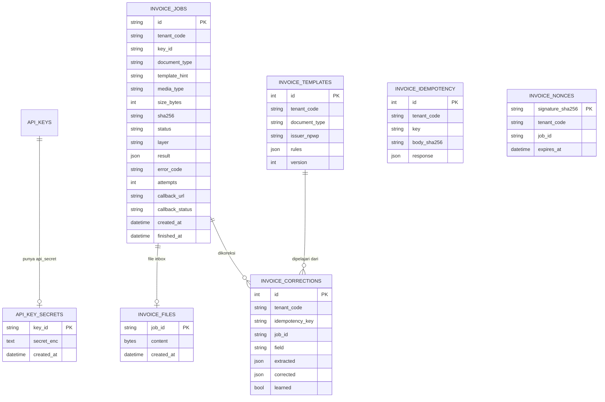
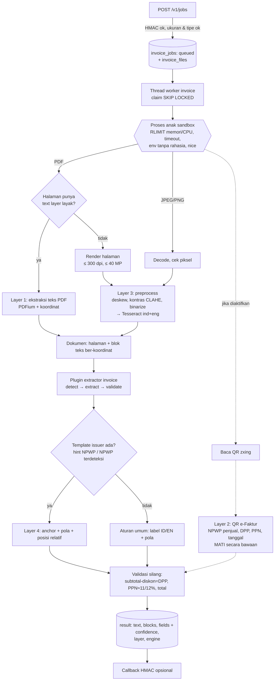

# Desain Modul OCR Dokumen Invoice

| | |
|---|---|
| **Versi** | 1.0 (30 Okt 2026) |
| **Pemilik** | Anas Fikri |
| **Status** | Diimplementasikan di engine 0.5.0 |
| **Keputusan** | [ADR 0008](adr/0008-modul-ocr-invoice.md) |
| **Klien pertama** | ICTNotes v3 (FEAT-043), SRS FR-OCR-001..013, kontrak TBD-OCR-1..9 |

Engine yang sama (server 10.3.3.243) sekarang punya **dua fungsi**: pemeriksaan foto POD (sudah ada, tidak berubah)
dan **ekstraksi data invoice vendor** (baru). Dokumen ini menjelaskan endpoint, skema database, alur layer 1-4,
keamanan, dan acceptance criteria modul invoice. Referensi API: [api-reference.md](api-reference.md#dokumen-invoice);
cara integrasi: [integration-guide.md](integration-guide.md#13-integrasi-dokumen-invoice); variabel:
[configuration.md](configuration.md#18-modul-invoice).

## 1. Batasan & prinsip

1. **Fungsi foto POD tidak boleh rusak.** Modul invoice punya router, tabel, antrean, dan thread worker sendiri
   (`engine/invoice/`). Tidak ada kolom/tabel lama yang diubah; tabel baru dibuat otomatis saat start.
2. **Yang dipakai ulang:** API key + tenant (namespace), log, metrik Prometheus, `/healthz`, enkripsi rahasia
   (`PQE_SECRET_KEY`), backup database (tabel invoice ikut dump), Docker image & compose.
3. **Tanpa AI generatif dan tanpa model ML** selain Tesseract (FR-OCR-013). Ekstraksi field memakai aturan
   (label, pola, posisi) yang bisa dijelaskan, sejalan dengan [ADR 0004](adr/0004-rule-based-sebelum-ml.md).
4. **Dokumen tidak dipercaya.** PDF/gambar diproses di **proses anak terpisah** dengan batas memori, CPU, waktu, dan
   tanpa rahasia di environment-nya. PDF bom/gambar bom hanya mematikan proses anak itu, bukan worker foto.
5. **Foto POD diprioritaskan.** Proses OCR invoice berjalan dengan prioritas CPU lebih rendah (`nice`) dan
   bawaan 1 thread, supaya analisis sinkron foto kurir (≤ 3 detik) tidak melambat.

## 2. Endpoint

Semua endpoint invoice wajib **API key + tanda tangan HMAC** (bagian 5.1). Namespace = tenant milik API key
(role `app`).

| Method | Path | Fungsi | Sukses |
|---|---|---|---|
| `POST` | `/v1/jobs` | Kirim file (PDF/JPEG/PNG) + `document_type` (+ `template_hint`, `callback_url` opsional). Membuat job async | `202 {"job_id", "status": "queued"}` |
| `GET` | `/v1/jobs/{id}` | Status job; setelah selesai: `text`, `blocks` (koordinat), `fields` (+ confidence), `layer` | `200` |
| `POST` | `/v1/templates` | Koreksi dari pengguna → engine belajar/mengupdate template issuer (idempotent) | `200` |
| `GET` | `/v1/templates/{document_type}/{npwp}` | Lihat template issuer di namespace sendiri (debug/audit) | `200` |
| `GET` | `/healthz` | (diperluas) versi engine + versi Tesseract/PDFium + status modul invoice | `200` |

Status job: `queued` → `running` → `succeeded` | `failed`. Error: `{"error": {"code", "message"}}`.

## 3. Skema database (tabel baru)



- `invoice_jobs` menyimpan hasil (JSON) di kolom `result`; file asli di `invoice_files` (tabel terpisah supaya
  polling status tidak membaca blob). Antrean memakai pola yang sama dengan [ADR 0001](adr/0001-queue-di-postgres.md)
  (`SELECT ... FOR UPDATE SKIP LOCKED`).
- Unique: `invoice_templates(tenant_code, document_type, issuer_npwp)`,
  `invoice_corrections(tenant_code, idempotency_key)`, `invoice_idempotency(tenant_code, key)`.
- File inbox disimpan di PostgreSQL (bukan SILO): atomik dengan job, tidak bergantung SILO saat menerima invoice,
  ikut backup database, dan volumenya kecil (puluhan-ratusan invoice/hari, ≤ 20 MB, dihapus setelah
  `PQE_INVOICE_INBOX_RETENTION_DAYS`). Alasan lengkap di ADR 0008.

## 4. Alur pemrosesan (layer 1-4)



### 4.1 Layer 1: PDF digital

PDFium (`pypdfium2`) membaca teks beserta kotak koordinatnya per halaman. Halaman dianggap punya text layer layak bila
berisi ≥ 20 karakter dan ≥ 50% karakternya huruf/angka; selain itu halaman dirender lalu masuk layer 3 (PDF hasil
scan). Satu dokumen boleh campuran.

### 4.2 Layer 2: QR e-Faktur (mati secara bawaan, TBD-15)

`PQE_INVOICE_EFAKTUR_QR`:

| Nilai | Perilaku |
|---|---|
| `off` (bawaan) | QR tidak dibaca sama sekali |
| `decode` | QR dibaca **lokal saja**; dari URL QR diambil NPWP penjual & nomor faktur. Tidak ada koneksi keluar |
| `lookup` | Seperti `decode`, lalu URL validasi DJP dipanggil untuk NPWP penjual, nama, DPP, PPN, tanggal faktur. Hanya host di `PQE_INVOICE_EFAKTUR_HOSTS`, HTTPS, tanpa redirect, timeout 10 detik, respons ≤ 256 KB, XML di-parse dengan `defusedxml` |

Isi QR dikendalikan pembuat dokumen (bisa QR milik faktur lain), jadi QR **tidak** menimpa nilai tercetak yang
berbeda: sama → confidence 0,99; field kosong → diisi dari QR (0,9); berbeda → nilai tercetak dipertahankan,
confidence turun, `EFAKTUR_MISMATCH`. Format
respons DJP diasumsikan format e-Faktur 3.x (`resValidateFakturPm`); **belum diverifikasi ke DJP** dan format Coretax
bisa berbeda. Aktifkan hanya setelah izin TBD-15 dikonfirmasi dan diuji dengan faktur asli di server.

### 4.3 Layer 3: gambar / scan

Grayscale → perbesar bila teks kecil (sisi panjang < 1.600 px) → deskew (estimasi kemiringan yang sama dengan
analyzer foto) → kontras CLAHE → binarize adaptif → Tesseract `ind+eng` (PSM 3), dibaca per baris beserta kotak dan
confidence. Batas waktu Tesseract per halaman (`PQE_INVOICE_OCR_PAGE_TIMEOUT_SEC`).

### 4.4 Layer 4: template issuer

Template per **(namespace, document_type, NPWP issuer)**. Setiap aturan field berisi:

- `anchor`: teks label di dekat nilai (contoh `no invoice`), dicari tanpa beda huruf besar/kecil/tanda baca;
- `pattern`: **jenis pola dari daftar tetap** (`date`, `money`, `npwp`, `digits`, `doc_number`, `text`) + `shape`
  opsional untuk nomor dokumen (contoh `AAA/9999/99`, diubah menjadi regex tanpa quantifier bersarang);
- posisi relatif: `same_line` (nilai di kanan label) atau `offset` (jarak pusat nilai dari pusat label, koordinat
  0-1), plus `value_box` (posisi absolut) sebagai cadangan bila label tidak ditemukan.

Klien **tidak pernah** mengirim regex. Template dipakai bila `template_hint` cocok, atau bila `vendor_npwp` hasil
aturan umum cocok (bukan sembarang NPWP di dokumen: NPWP pembeli ada di semua invoice masuk). Anchor harus label
sungguhan (minimal 3 huruf, bukan "Rp"/kode mata uang). Hasil yang hanya berdasar posisi (`value_box`, tanpa anchor)
hanya mengisi field yang kosong. Template hanya bisa dibuat untuk NPWP penjual job (`ISSUER_MISMATCH`,
`ISSUER_IS_BUYER`).

**Belajar dari koreksi** (`POST /v1/templates`): untuk setiap koreksi, engine mencari nilai `corrected` di blok teks
hasil job (`job_id`, harus milik namespace yang sama). Jika ketemu, label di kiri/atasnya menjadi anchor dan posisinya
dicatat; aturan field itu di template diganti dan `version` naik. Jika tidak ketemu (misal OCR salah baca), koreksi
tetap dicatat (`learned: false`, alasan `VALUE_NOT_FOUND_IN_DOCUMENT`). `lines` tidak dipelajari (dicatat saja).

### 4.5 Aturan umum (tanpa template)

Label Indonesia/Inggris per field (contoh `No. Invoice`/`Nomor Faktur`/`Invoice No`, `Jatuh Tempo`/`Due Date`,
`DPP`/`Dasar Pengenaan Pajak`, `PPN`/`VAT`, `PPh 23`, `Grand Total`/`Total Tagihan`), nilai dicari di kanan label
pada baris yang sama atau tepat di bawahnya. Tabel item dibaca dari header (`Deskripsi/Uraian/Description` +
`Jumlah/Amount`) sampai baris subtotal/total.

### 4.6 Normalisasi & confidence

| Jenis | Format keluaran |
|---|---|
| Tanggal | `YYYY-MM-DD` (masukan `30/10/2026`, `30-10-26`, `30 Oktober 2026`, `Oct 30, 2026`, ...; urutan hari/bulan Indonesia) |
| Uang | **string desimal** (`"1234567.89"`, `"1500000"`), tidak pernah float. `1.234.567,89`, `1,234,567.89`, `Rp 1.500.000,-` dikenali |
| NPWP, rekening | digit saja (NPWP 15 atau 16 digit) |
| Mata uang | kode ISO (`IDR`, `USD`, ...) |

Confidence 0-1 = keyakinan teks sumber (PDF text 0,99; OCR = confidence Tesseract baris) × keyakinan metode
(template + anchor 0,95; template posisi saja 0,8; label umum 0,8; tebakan tanpa label 0,4-0,6) × penalti validasi
(nilai yang tidak konsisten dengan validasi silang dikali 0,6). Field yang tidak ditemukan **tidak dikirim**
(bukan `null` dengan confidence 0).

### 4.7 Plugin jenis dokumen (FR-OCR-012)

Setiap jenis dokumen = kelas dengan `document_type`, `version`, `detect(doc) → 0..1`, `extract(doc, template) →
fields`, `validate(fields) → issues` (`engine/invoice/plugins.py`). Bawaan: `invoice`. Plugin tambahan dimuat dari
entry point Python `pqe.document_extractors` atau `PQE_DOCUMENT_PLUGINS=modul:Kelas`. `document_type` yang tidak
terdaftar ditolak `422 UNSUPPORTED_DOCUMENT_TYPE`.

## 5. Keamanan

### 5.1 Autentikasi & tanda tangan (FR-OCR-008)

```
X-Api-Key:   pqe_...
X-Timestamp: 1793337600                         (Unix detik)
X-Signature: hex(HMAC-SHA256(api_secret, timestamp + "\n" + METHOD + "\n" + path + "\n" + hex(sha256(body))))
```

- `path` = path URL tanpa query string, persis seperti dikirim (contoh `/v1/jobs/abc`). Endpoint invoice tidak
  memakai query string. `body` = byte mentah body (multipart apa adanya; GET = body kosong).
- `api_secret` dibuat engine (`pqe create-key ... --with-secret`), disimpan **terenkripsi** (`PQE_SECRET_KEY`), hanya
  ditampilkan sekali. API key sendiri tetap disimpan sebagai hash.
- Timestamp di luar ±`PQE_INVOICE_SIGNATURE_WINDOW_SEC` (bawaan 300) → `401 TIMESTAMP_OUT_OF_WINDOW`.
- Perbandingan memakai `hmac.compare_digest` (timing-safe).
- **Replay:** tanda tangan `POST /v1/jobs` dicatat sampai jendela waktu lewat; request dengan tanda tangan yang sama
  persis (replay penyadap atau retry jaringan klien) **tidak membuat job baru**, tetapi mendapat `job_id` yang sama
  (`Idempotent-Replayed: true`). `POST /v1/templates` sudah idempoten lewat `idempotency_key`. `GET` boleh diulang.
  (Rancangan awal menolak replay dengan `409`; diubah karena retry klien dalam detik yang sama ikut tertolak.)
- Hanya role `app` yang terikat tenant; key admin/ops tidak bisa memakai endpoint invoice (namespace tidak jelas).

### 5.2 Abuse case & mitigasi

| # | Abuse case | Mitigasi | Test |
|---|---|---|---|
| A1 | Tanda tangan palsu / secret salah | HMAC dihitung ulang, `compare_digest`, 401 | `test_invoice_api::test_bad_signature_rejected` |
| A2 | Replay request yang disadap | Jendela ±300 dtk; replay `POST /v1/jobs` dalam jendela mengembalikan job yang sama (tidak ada efek ganda); koreksi template idempoten per key | `test_replay_rejected`, `test_old_timestamp_rejected` |
| A3 | Body diubah di tengah jalan | Hash body ikut ditandatangani | `test_tampered_body_rejected` |
| A4 | Namespace lain membaca job/template, atau melatih template namespace lain | Semua query difilter tenant dari API key; job/template milik tenant lain → `404` (tidak membocorkan keberadaan) | `test_namespace_isolation_*` |
| A5 | File berbahaya (EXE/ZIP/HTML berganti nama `.pdf`) | Tipe ditentukan dari **magic bytes** (`%PDF-`, JPEG, PNG), bukan nama/Content-Type → `415` | `test_unsupported_file_rejected` |
| A6 | PDF bom (stream Flate raksasa, halaman ribuan, ukuran halaman ekstrem) | Batas ukuran upload, batas halaman, batas ukuran halaman & piksel render, proses anak dengan `RLIMIT_AS` + `RLIMIT_CPU` + timeout dinding; job gagal permanen (`RESOURCE_LIMIT`/`PROCESSING_TIMEOUT`/`TOO_MANY_PAGES`), tidak di-retry | `test_sandbox_memory_bomb`, `test_too_many_pages` |
| A7 | Zip bom / gambar bom (PNG 1×1 → 60.000×60.000) | ZIP tidak diterima; dimensi gambar dicek dari header sebelum decode (`PQE_INVOICE_MAX_IMAGE_PIXELS`) | `test_image_pixel_bomb` |
| A8 | Path traversal (`filename="../../etc/passwd"`) | Nama file tidak pernah dipakai sebagai path: file disimpan di database, nama hanya dicatat (basename, ≤ 200 karakter) | `test_filename_is_not_a_path` |
| A9 | ReDoS lewat pola template | Klien tidak bisa mengirim regex. Pola template berasal dari daftar tetap; `shape` dibatasi 40 karakter dan diterjemahkan ke regex linear (kelas karakter + quantifier tetap). Teks yang dicocokkan dipotong per baris | `test_shape_regex_is_linear` |
| A10b | DoS CPU lewat dokumen kecil berisi ribuan label | Maks. 4.000 blok per dokumen, 5.000 potongan teks per halaman, 30 hit per label, pencarian tetangga ber-indeks (bukan kuadratik); endpoint menjalankan kerja sinkron di threadpool (event loop foto tidak tertahan); belajar template sekali per field per request | `test_extraction_is_not_quadratic` |
| A16 | Antrean dimonopoli satu namespace | Claim adil: namespace yang paling lama tidak dilayani lebih dulu | `test_fair_queue_between_namespaces` |
| A17 | Template diracuni (NPWP pembeli / issuer lain / anchor "Rp") | Lihat 4.4 | `test_template_for_buyer_npwp_rejected`, `test_template_lookup_ignores_buyer_npwp`, `test_template_anchor_is_a_real_label` |
| A10 | DoS: banyak job / file besar | API key & timestamp dicek sebelum body dibaca; ukuran upload ≤ `PQE_INVOICE_MAX_UPLOAD_MB` (dicek dari `Content-Length` sebelum dibaca dan saat streaming), antrean per namespace ≤ `PQE_INVOICE_MAX_PENDING_PER_TENANT` → `429 QUEUE_FULL`, worker invoice terpisah dengan prioritas CPU rendah | `test_upload_too_large`, `test_queue_full` |
| A11 | Respons raksasa (klien membatasi 1 MB) | `text` dan `blocks` dipotong agar JSON ≤ ±900 KB (`truncated: true`) | `test_response_size_capped` |
| A12 | SSRF lewat `callback_url` / QR e-Faktur | Callback hanya ke host di `PQE_INVOICE_CALLBACK_HOSTS` (kosong = callback ditolak); QR hanya ke host DJP di allowlist, HTTPS, tanpa redirect | `test_callback_host_not_allowed`, `test_efaktur_url_allowlist` |
| A13 | XXE / XML bom dari respons e-Faktur | `defusedxml` + batas ukuran respons | `test_efaktur_xml_entities_rejected` |
| A14 | Kebocoran rahasia lewat proses anak | Environment proses anak hanya `PATH`, `HOME`, `LANG`, `TESSDATA_PREFIX`, `OMP_THREAD_LIMIT`, `PYTHONPATH`; tidak ada `DATABASE_URL`/AWS/`PQE_*` | `test_sandbox_env_has_no_secrets` |
| A15 | Idempotency disalahgunakan (key sama, isi beda) | `Idempotency-Key` sama + body beda → `422 IDEMPOTENCY_KEY_REUSED`; key per koreksi diterapkan paling banyak sekali per namespace | `test_template_idempotency_*` |

Risiko sisa (dicatat, belum dimitigasi): proses anak masih bisa membuka koneksi jaringan (perlu network namespace /
seccomp di level container bila diinginkan); PDFium adalah kode C++ (bug memori PDFium dibatasi oleh isolasi proses,
user non-root container, dan batas sumber daya, bukan dicegah).

### 5.3 Verifikasi independen

Setelah implementasi, subagent terpisah (tidak ikut menulis kode) menyerang modul ini: 14 temuan (5 high: template
memilih nilai salah lewat anchor "Rp", template berbasis NPWP pembeli, ekstraksi kuadratik di proses induk, endpoint
template memblokir event loop, beberapa layout menghasilkan nilai salah dengan confidence tinggi). Semua sudah
diperbaiki dan punya test regresi (bagian "temuan audit independen" di `tests/test_invoice_*.py`).

## 6. Batas (bawaan)

| Batas | Nilai | Variabel |
|---|---|---|
| Ukuran file | 20 MB | `PQE_INVOICE_MAX_UPLOAD_MB` |
| Halaman PDF | 20 | `PQE_INVOICE_MAX_PAGES` |
| Ukuran halaman PDF | ≤ 5.000 pt per sisi (±176 cm) | tetap |
| Render PDF | 300 dpi, maks. 40 MP per halaman | `PQE_INVOICE_RENDER_DPI` |
| Piksel gambar | 50 MP | `PQE_INVOICE_MAX_IMAGE_PIXELS` |
| Memori proses anak | 1.536 MB (address space) | `PQE_INVOICE_SANDBOX_MEMORY_MB` |
| CPU / waktu proses anak | 120 dtk CPU / 180 dtk dinding | `PQE_INVOICE_SANDBOX_TIMEOUT_SEC` |
| Antrean per namespace | 200 job (queued + running) | `PQE_INVOICE_MAX_PENDING_PER_TENANT` |
| Ukuran respons | ±900 KB (text & blocks dipotong) | tetap |
| Retensi file inbox | 30 hari | `PQE_INVOICE_INBOX_RETENTION_DAYS` |
| Retensi hasil job | 365 hari | `PQE_INVOICE_RESULT_RETENTION_DAYS` |

## 7. Acceptance criteria

| ID | Kriteria | Test |
|---|---|---|
| AC-01 | `POST /v1/jobs` dengan PDF/JPEG/PNG + `document_type=invoice` + tanda tangan valid → `202 {"job_id", "status":"queued"}` | `test_invoice_api::test_create_job_and_poll` |
| AC-02 | `GET /v1/jobs/{id}` → `queued`/`running`, lalu `succeeded` dengan `text`, `blocks` (bbox 0-1), `fields` `{value, confidence}`, `layer`, `engine` | `test_create_job_and_poll` |
| AC-03 | PDF digital dibaca tanpa OCR (`layer: "pdf_text"`) | `test_invoice_golden::test_digital_pdf_golden` |
| AC-04 | QR e-Faktur mati secara bawaan; `decode`/`lookup` mengisi NPWP/DPP/PPN/tanggal dari QR | `test_invoice_extract::test_efaktur_*` |
| AC-05 | Gambar/scan miring diproses (deskew, kontras, binarize) dan dibaca Tesseract `ind+eng` (`layer: "ocr"`) | `test_invoice_golden::test_scanned_image_golden` |
| AC-06 | Template issuer dipakai bila ada (`layers` berisi `template`) dan memperbaiki field yang gagal dibaca aturan umum | `test_invoice_golden::test_template_learning_fixes_field` |
| AC-07 | `POST /v1/templates` membuat/mengupdate template di namespace sendiri; key koreksi diterapkan paling banyak sekali; `Idempotency-Key` request diulang → respons sama | `test_invoice_api::test_template_*` |
| AC-08 | Tanda tangan salah/kedaluwarsa/diulang ditolak, perbandingan timing-safe | `test_invoice_api::test_*signature*`, `test_replay_rejected` |
| AC-09 | Callback ber-HMAC dikirim bila didaftarkan; polling tetap jalan tanpa callback | `test_invoice_api::test_callback_signed` |
| AC-10 | File inbox lebih tua dari retensi dihapus; hasil job tetap bisa dibaca | `test_invoice_api::test_inbox_retention` |
| AC-11 | `/healthz` berisi versi engine, Tesseract, PDFium, status modul invoice | `test_invoice_api::test_healthz_versions` |
| AC-12 | `document_type` baru bisa ditambah sebagai plugin (detect/extract/validate) | `test_invoice_extract::test_plugin_registry` |
| AC-13 | Tanpa AI generatif / model ML selain Tesseract (dependency baru hanya `pypdfium2`) | review dependency |
| AC-14 | Uang = string desimal, tanggal `YYYY-MM-DD`, NPWP & rekening digit saja, confidence 0-1 | `test_invoice_extract::test_normalizers*`, golden test |
| AC-15 | Semua abuse case bagian 5.2 punya test | `test_invoice_security.py` |
| AC-16 | Test fungsi foto POD yang sudah ada tetap hijau | seluruh suite |
