# Dokumen Perencanaan SDLC: Photo Quality Engine

| | |
|---|---|
| **Versi** | 0.2 (diperbarui setelah implementasi v0.1.0) |
| **Tanggal** | 22 Oktober 2026 |
| **Pemilik** | Anas Fikri |
| **Status** | Fase 1 selesai diimplementasikan, sebagian fase 2 selesai. Lihat [Status implementasi](#status-implementasi) |

> **Pembaruan 24 Okt 2026 (desain penyimpanan berubah):** engine kini **hanya memproses gambar** dan tidak menyimpan
> apa pun ke SILO ([ADR 0006](adr/0006-engine-hanya-memproses-gambar.md)). Aplikasi mengirim foto, engine mengembalikan
> keputusan + foto hasil optimasi (`output_image`), lalu aplikasi yang menyimpannya ke SILO dan (opsional) melaporkan
> key-nya. Bagian dokumen ini yang menyebut bucket `photos-upload`/`photos-processed`/`photos-thumb` atau field
> `stored` menggambarkan desain sebelumnya; bagian terpenting sudah diberi catatan. Rujukan yang berlaku:
> [integration-guide.md](integration-guide.md), [operations.md](operations.md), [configuration.md](configuration.md).

Dokumen ini disusun dari hasil diskusi/brainstorming dan mengikuti tahapan SDLC: **Planning → Analisis Kebutuhan → Desain → Implementasi → Testing → Deployment → Operasional & Maintenance**. Semua diagram flow ditulis dalam Mermaid dan bisa dirender langsung di GitLab/GitHub.

## Status implementasi

Per 23 Oktober 2026 (versi engine 0.1.0):

| Fase | Item | Status |
|---|---|---|
| 1 | Analyzer sharpness, resolution, exposure, EXIF, duplicate (pHash + SHA-256) | ✅ |
| 1 | Kompresi dinamis < 1 MB + guard SSIM, thumbnail | ✅ |
| 1 | Profile per jenis foto, multi-tenant, mode shadow/warn/enforce, i18n ID/EN | ✅ |
| 1 | Ingestor SILO (polling + bucket event) + reconciliation, antrean + retry + dead-letter | ✅ |
| 1 | API v1 + OpenAPI + API key per role | ✅ |
| 1 | Web UI admin + ops review + dashboard + uji foto | ✅ |
| 1 | Metrik Prometheus, health check, docker-compose (SILO + Postgres + engine) | ✅ |
| 2 | OCR keterbacaan resi (Tesseract, ind + eng) | ✅ |
| 2 | Authenticity score (EXIF, foto lama, beda waktu/GPS, duplikat) | ✅ (deteksi foto dari layar & ELA belum) |
| 2 | API evidence + PDF + verifikasi hash | ✅ |
| 2 | Webhook bertanda tangan HMAC | ✅ |
| 2 | Source DB aplikasi (read-only) + job migrasi foto lama | ✅ |
| 2 | Optimasi tanpa manipulasi isi gambar (hanya perkecil proporsional + kompresi dinamis); koreksi pencahayaan kurva global terverifikasi tersedia sebagai **opsi per profile, nonaktif bawaan** | ✅ |
| 2 | `retake_required` + `retake_message` (wajib foto ulang jika kualitas tidak memenuhi syarat) | ✅ |
| 2 | Keputusan siap pakai `allow_status_update` + `courier_message`: `REJECT` di mode `enforce` menahan update status di aplikasi pengiriman; engine mati/lambat = fail-open | ✅ |
| 2 | Integrasi tercepat: 1 panggilan sinkron, client `checkFile` (utama) / `checkObject` (TS & PHP) yang fail-open | ✅ |
| 2 | ~~"Scan dulu, baru simpan" (engine menyimpan foto diterima ke `photos-processed`, link `stored`)~~ → diganti: engine hanya memproses gambar, mengembalikan `output_image`; aplikasi yang menyimpan ke SILO ([ADR 0006](adr/0006-engine-hanya-memproses-gambar.md)) | ✅ |
| 2 | Review ops opsional per tenant (`review_required`, bawaan `false`: PASS + WARN langsung masuk evidence) | ✅ |
| 2 | Halaman Koneksi SILO (dulu "Pengaturan SILO") di Web UI (impor JSON `mc`, test koneksi baca, secret terenkripsi, tanpa restart) | ✅ |
| 2 | Panduan integrasi developer di browser (`/ui/guide.html`, tanpa login) + 4 diagram alur (integrasi, penggunaan, keputusan di aplikasi pengiriman, proses engine) | ✅ |
| 2 | Halaman Uji Coba Kamera untuk HP (`/ui/coba.html`): simulasi aplikasi kurir tanpa membangun aplikasi, tenant `uji-coba`, HTTPS opsional | ✅ |
| 2 | Pagar pengaman production: engine tidak menulis ke SILO (bucket aplikasi read-only walau key akses penuh), `PQE_ENV=production` menolak perintah demo | ✅ |
| 2 | Backup NAS terjadwal dari engine (folder SMB/NFS atau NAS S3): foto yang disimpan aplikasi di SILO (dibaca), dump database + rotasi; halaman Web UI **Backup NAS** | ✅ |
| 2 | Versi engine terlihat (Web UI, `/healthz`, `/v1/me`, header `X-PQE-Version`, `pqe --version`); Web UI dengan sidebar dan fokus otomatis ke field utama tiap halaman | ✅ |
| 2 | Laporan export CSV/Excel | ⏳ belum |
| 3 | Manifest Kubernetes + CI | ✅ (belum dideploy) |
| 3 | Client library TypeScript & PHP | ✅ (Kotlin/Swift/Dart: contoh di panduan integrasi) |
| 3 | Pre-check di HP, SSO/LDAP, model ML | ⏳ belum |
| - | Kalibrasi threshold dengan foto POD asli | ⏳ menunggu sampel / mode shadow |

**Perubahan dari rencana awal** (alasan di [docs/adr](adr/)):

1. **Antrean memakai PostgreSQL, bukan Redis** (`SELECT ... FOR UPDATE SKIP LOCKED`). Satu komponen lebih sedikit,
   transaksi foto dan job atomik, dan volume ribuan foto/hari jauh di bawah batas. Bagian dokumen ini yang masih
   menyebut Redis dibaca sebagai "antrean di PostgreSQL".
2. **Web UI memakai HTML + JavaScript tanpa build step, bukan React.** Disajikan langsung oleh engine di `/ui`,
   tidak butuh Node.js di server maupun pipeline build terpisah.
3. **Engine tidak memanipulasi isi gambar; hanya optimasi dan kompresi dinamis.** Foto adalah bukti penagihan
   (nominal, nama, resi), jadi tidak boleh ada risiko isi berubah. Foto yang kualitasnya tidak memenuhi syarat (buram,
   pecah, terlalu gelap/terang) tidak "diperbaiki" tetapi langsung dibalas wajib foto ulang (`retake_required`).
   Koreksi pencahayaan dengan kurva global yang diverifikasi eksak (tanpa AI) tetap tersedia sebagai opsi per profile
   (`enhance.enabled: true`), **nonaktif secara bawaan**.
4. **Review ops opsional.** Bawaan `review_required: false` agar foto layak tidak tertahan menunggu ops: `PASS` dan
   `WARN` langsung masuk evidence, `REJECT` dibalas foto ulang. Tenant yang butuh pengecekan manual bisa menyalakannya.
5. **Koneksi SILO bisa diatur dari Web UI** (selain env), dengan secret terenkripsi `PQE_SECRET_KEY`, supaya
   pergantian kredensial tidak butuh redeploy.
6. **Status pengiriman milik aplikasi pengiriman, dan foto ditolak menahan update status.** Engine tidak pernah
   mengubah status; engine memberi `allow_status_update` dan `courier_message`. Di mode `enforce`, foto `REJECT`
   menghasilkan `allow_status_update: false`: aplikasi pengiriman tidak mengupdate status sampai foto ulang diterima.
   Engine mati/lambat/error tetap fail-open (status diupdate). Menahan status butuh integrasi level 2 (sinkron); di
   level 0/1 engine tetap bekerja setelahnya (lihat alternatif di flow 4.1). Integrasi paling cepat: satu panggilan
   `POST /v1/analyze?sync=true` dengan file, atau `checkFile` di client.
7. **Engine hanya memproses gambar** (diperbarui, [ADR 0006](adr/0006-engine-hanya-memproses-gambar.md)). Aplikasi
   pengiriman mengirim file foto langsung ke engine sebelum menyimpannya. Engine memeriksa dan mengoptimasi foto, lalu
   mengembalikan keputusan + foto hasil (`output_image`); foto ditolak: `output_image: null`, pesannya dikirim balik ke
   kurir. **Aplikasi** yang menyimpan foto diterima ke SILO (dan boleh melaporkan key-nya ke engine). Engine tidak
   menyimpan foto apa pun. Engine mati → aplikasi menyimpan foto asli dengan kode lama (fail-open). `checkObject`
   tetap tersedia untuk aplikasi yang sudah terlanjur menyimpan ke SILO dulu.
   *(Desain sebelumnya: engine menyimpan foto diterima ke `photos-processed` dan mengembalikan link `stored`.)*
8. **Backup NAS dikerjakan engine, plus pagar pengaman bucket aplikasi.** Engine membaca foto yang disimpan aplikasi
   di SILO (dulu: foto di bucket engine) dan menyalinnya ke NAS secara terjadwal bersama dump database
   (halaman Web UI **Backup NAS**), alih-alih hanya mengandalkan `mcli mirror` di sisi infra. Backup hanya menyalin,
   tidak pernah menghapus di NAS. Engine juga dijaga di kode agar tidak bisa menulis/menghapus bucket aplikasi walau
   memakai key SILO berakses penuh, dan `PQE_ENV=production` menolak perintah demo.

## Daftar Isi

0. [Status implementasi](#status-implementasi)
1. [Planning](#1-planning)
2. [Analisis Kebutuhan](#2-analisis-kebutuhan)
3. [Desain Sistem](#3-desain-sistem)
4. [Flow Proses](#4-flow-proses)
5. [Implementasi](#5-implementasi)
6. [Testing](#6-testing)
7. [Deployment](#7-deployment)
8. [Operasional & Maintenance](#8-operasional--maintenance)
9. [Keputusan yang Masih Terbuka](#9-keputusan-yang-masih-terbuka)
10. [Glosarium](#10-glosarium)

---

## 1. Planning

### 1.1 Latar belakang

- Foto POD (Proof of Delivery) sering **buram** atau **pecah sampai tidak terbaca sama sekali**. Akibatnya penagihan ke pelanggan terganggu karena bukti pengiriman tidak valid.
- Ada kebutuhan **validasi keaslian foto**: foto lama dipakai ulang, foto dari galeri, editan, atau foto dari layar.
- Beberapa aplikasi menghasilkan foto yang kurang ideal, kemungkinan karena setting kompresi/resize di sisi aplikasi terlalu agresif.
- Penyimpanan foto sedang dipindah dari server aplikasi ke **SILO** (`s3.pcpexpress.com`, fork komunitas MinIO dari Pigsty, kompatibel S3). Ke depan semua foto akan disimpan di sana.

### 1.2 Tujuan

| # | Tujuan | Ukuran keberhasilan |
|---|---|---|
| T1 | Engine bisa diintegrasikan ke aplikasi lain dengan mudah | Aplikasi baru bisa terhubung **hanya lewat config**, tanpa ubah kode engine |
| T2 | Mendeteksi foto buram / pecah / gelap | Akurasi deteksi ≥ 90% terhadap sampel berlabel (target awal, dikalibrasi ulang) |
| T3 | Kompresi dinamis < 1 MB tanpa merusak keterbacaan | ≥ 95% foto besar turun < 1 MB, skor ketajaman/OCR tidak turun melewati batas |
| T4 | Validasi keaslian foto | Duplikat/reuse terdeteksi, risk score keaslian tersedia per foto |
| T5 | **Tidak memperlambat kurir dan proses lain** | Tidak ada penambahan latency berarti di alur upload & update status kurir (level 2: maks. 3 detik, fail-open; status hanya ditahan jika foto ditolak) |
| T6 | Bukti penagihan ke pelanggan lebih bersih | Penurunan sengketa/penolakan tagihan karena foto tidak valid |

### 1.3 Ruang lingkup

**Masuk scope:**
- Analisis kualitas foto (blur, pecah/resolusi, exposure, keterbacaan teks)
- Kompresi dinamis + thumbnail
- Validasi keaslian (EXIF, duplikat, konsistensi waktu/lokasi)
- Integrasi pasif (baca dari SILO / DB) dan aktif (REST API)
- Web UI internal: admin console, ops review, laporan
- API evidence untuk pelanggan (PDF + presigned URL)
- Multi-tenant (banyak aplikasi), multi-profile (banyak jenis foto), bahasa ID/EN

**Di luar scope (untuk saat ini):**
- Mengubah aplikasi kurir dan backend aplikasi lama (belum bisa dalam waktu dekat)
- Portal pelanggan baru. Evidence ditampilkan lewat portal/kanal yang sudah ada
- Model ML custom (baru dipertimbangkan setelah data berlabel cukup)
- Administrasi infrastruktur SILO dan NAS (dikerjakan tim infra, engine hanya memantau)

### 1.4 Prinsip desain

1. **Tidak pernah memblok kurir.** Engine selalu async dan di luar jalur kritis. Kalau engine mati, operasional tetap jalan.
2. **Mudah diintegrasikan.** Tiga level integrasi, dari tanpa ubah apa pun sampai panggil API.
3. **Mudah dipakai.** Satu perintah untuk menjalankan, aturan diubah lewat Web UI tanpa deploy ulang.
4. **Fleksibel/dinamis.** Semua threshold, profile, tenant, retensi, dan bahasa ada di config.
5. **Rule-based dulu.** Logika klasik (OpenCV) yang bisa dijelaskan. ML hanya kalau terbukti perlu.
6. **Read-only terhadap sistem lain.** Engine tidak pernah mengubah/menghapus foto original atau data aplikasi.
7. **Stateless.** Gambar tidak disimpan di disk engine, semua ada di SILO.

### 1.5 Stakeholder

| Stakeholder | Kepentingan |
|---|---|
| Tim penagihan/finance | Bukti POD valid untuk invoice |
| Pelanggan | Melihat bukti pengiriman yang jelas dan bisa diverifikasi |
| Ops / SPV cabang | Menindaklanjuti foto bermasalah, membina kurir |
| Kurir | Tidak terganggu, proses tetap cepat |
| Tim developer aplikasi | Integrasi mudah, tidak menambah beban aplikasi |
| Tim infra | Storage SILO, NAS, K8s |
| Legal / DPO | Kepatuhan data pribadi (UU PDP) dan retensi |

### 1.6 Roadmap fase

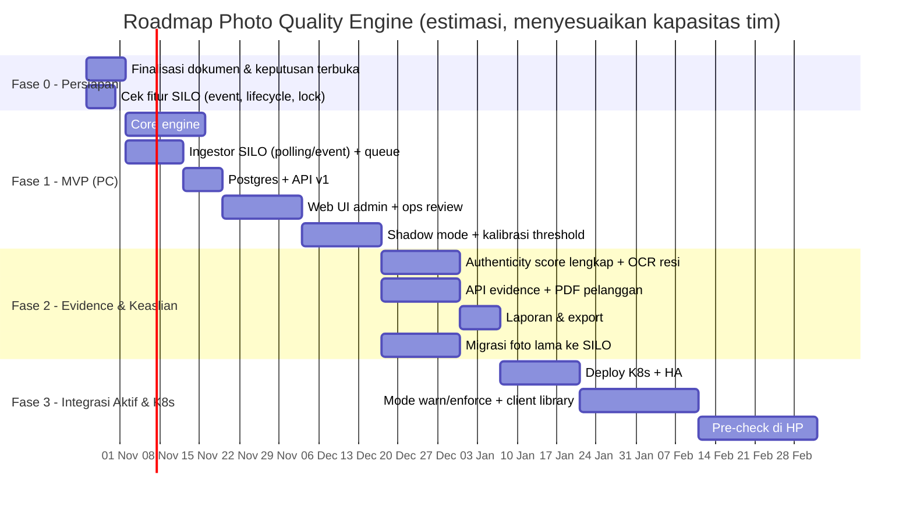

| Fase | Deliverable utama | Prasyarat |
|---|---|---|
| **0 Persiapan** | Dokumen disetujui, fitur SILO dipastikan, akses read-only ke SILO/DB | — |
| **1 MVP (PC)** | Engine jalan di PC (docker compose), shadow mode, Web UI admin & ops | Fase 0 |
| **2 Evidence & Keaslian** | Evidence pelanggan, authenticity score, OCR, laporan, migrasi foto lama | Data shadow ≥ 2 minggu |
| **3 Integrasi Aktif & K8s** | Produksi di K8s, notif/tolak ke kurir, client library, pre-check HP | Aplikasi bisa diubah |

### 1.7 Risiko

| Risiko | Dampak | Mitigasi |
|---|---|---|
| Belum ada sampel foto berlabel | Threshold tidak akurat | Sampel sintetis + shadow mode 2 minggu + review manual |
| SILO tidak mendukung bucket notification | Tidak real-time | Fallback polling (delay detik–menit) |
| False positive (foto bagus ditandai buram) | Beban ops, kepercayaan turun | Shadow dulu, threshold per profile, review manual |
| EXIF terhapus oleh aplikasi/platform | Validasi keaslian lemah | EXIF bukan alasan reject. Pakai duplikat + metadata dari aplikasi |
| Engine membebani SILO/DB | Aplikasi lain melambat | Rate limit, akses read-only, replica DB |
| SILO masih fork baru | Risiko bug/upgrade | Pakai S3 API standar, backup ke NAS, uji upgrade di staging |
| Data pribadi (wajah penerima) bocor | Pelanggaran UU PDP | Bucket private, presigned URL, isolasi per pelanggan, audit log |
| Lisensi SILO AGPL-3.0 | Kewajiban lisensi kalau dimodifikasi | Engine hanya memakai SILO lewat API (tidak memodifikasi). Konfirmasi ke legal |

---

## 2. Analisis Kebutuhan

### 2.1 Kebutuhan fungsional (FR)

| ID | Kebutuhan | Prioritas | Fase |
|---|---|---|---|
| FR-01 | Mendeteksi foto baru di SILO (bucket event / polling) | Must | 1 |
| FR-02 | Membaca link foto dari DB aplikasi (read-only) untuk foto lama/mapping | Should | 1 |
| FR-03 | Menerima foto lewat REST API (`POST /v1/analyze`) | Must | 1 |
| FR-04 | Mengukur ketajaman / blur (global + per tile) | Must | 1 |
| FR-05 | Mendeteksi resolusi rendah, pecah (blocking JPEG), dan upscale palsu | Must | 1 |
| FR-06 | Mendeteksi exposure: terlalu gelap, overexposed, glare | Must | 1 |
| FR-07 | Menghasilkan verdict `PASS` / `WARN` / `REJECT` + kode alasan + saran | Must | 1 |
| FR-08 | Kompresi dinamis ke < 1 MB dengan pengaman keterbacaan. Foto kecil tidak dikompres | Must | 1 |
| FR-09 | Membuat thumbnail untuk Web UI | Must | 1 |
| FR-10 | Membaca EXIF (kamera, waktu, GPS, software editing) | Must | 1 |
| FR-11 | Mendeteksi duplikat / reuse foto (perceptual hash) | Must | 1 |
| FR-12 | Profile per jenis foto (POD penerima, resi, paket, lokasi, barang, default) | Must | 1 |
| FR-13 | Multi-tenant: tiap aplikasi punya config sendiri (source, mapping, profile, retensi, bahasa) | Must | 1 |
| FR-14 | Mode per tenant/profile: `shadow` / `warn` / `enforce` | Must | 1 |
| FR-15 | Pesan ID/EN mengikuti `Accept-Language` / config tenant | Must | 1 |
| FR-16 | Web UI admin: kelola tenant, profile, threshold, mode, mapping, API key | Must | 1 |
| FR-17 | Web UI ops review: daftar foto bermasalah, preview, aksi approve/minta ulang/tandai fraud | Must | 1 |
| FR-18 | Webhook callback hasil analisis ke aplikasi | Should | 1 |
| FR-19 | OCR keterbacaan teks (khusus resi/dokumen) | Should | 2 |
| FR-20 | Authenticity risk score (EXIF, duplikat, waktu/GPS vs data delivery, foto dari layar, indikasi edit) | Should | 2 |
| FR-21 | API evidence pelanggan + PDF per resi/periode invoice + hash verifikasi | Must | 2 |
| FR-22 | Laporan & export (CSV/Excel) per kurir/cabang/tenant/periode | Should | 2 |
| FR-23 | Job migrasi foto lama dari server aplikasi ke SILO | Should | 2 |
| FR-24 | Analisis sinkron cepat (fast path) untuk mode warn/enforce | Could | 3 |
| FR-25 | Client library TS, Dart, Kotlin, Swift | Could | 3 |
| FR-26 | Pre-check kualitas di HP sebelum upload | Could | 3 |

### 2.2 Kebutuhan non-fungsional (NFR)

| ID | Kategori | Kebutuhan |
|---|---|---|
| NFR-01 | Performa | **Tidak menambah latency** di alur upload/update status kurir (engine di luar jalur kritis) |
| NFR-02 | Performa | Foto selesai dianalisis ≤ 1 menit setelah masuk SILO (p95) saat normal |
| NFR-03 | Performa | Fast path sinkron (fase 3) ≤ 300 ms (p95) |
| NFR-04 | Kapasitas | 1.000 foto/hari saat ini, bisa naik ≥ 10x dengan menambah worker |
| NFR-05 | Ketersediaan | Engine mati tidak menghentikan operasional (fail-open). Backlog diproses otomatis |
| NFR-06 | Keandalan | Tidak ada foto yang terlewat (checkpoint + reconciliation harian). Proses idempotent |
| NFR-07 | Keamanan | Bucket private, presigned URL kedaluwarsa, API key per tenant, RBAC Web UI, TLS |
| NFR-08 | Privasi | Isolasi data per pelanggan, audit log akses, retensi dan penghapusan otomatis (UU PDP) |
| NFR-09 | Retensi | Default 3 tahun, bisa diatur per tenant |
| NFR-10 | Portabilitas | Docker compose (PC) dan K8s (Helm) dengan kode yang sama. S3 API standar |
| NFR-11 | Konfigurasi | Perubahan threshold/profile/tenant tanpa deploy ulang |
| NFR-12 | Observability | Metrik (latency, backlog, error rate, distribusi verdict), log terstruktur, alert |
| NFR-13 | Maintainability | Analyzer berbentuk plugin, API versioning (`/v1`), dokumentasi OpenAPI |
| NFR-14 | Lokalisasi | Bahasa Indonesia (default) dan Inggris |

### 2.3 Aktor & use case

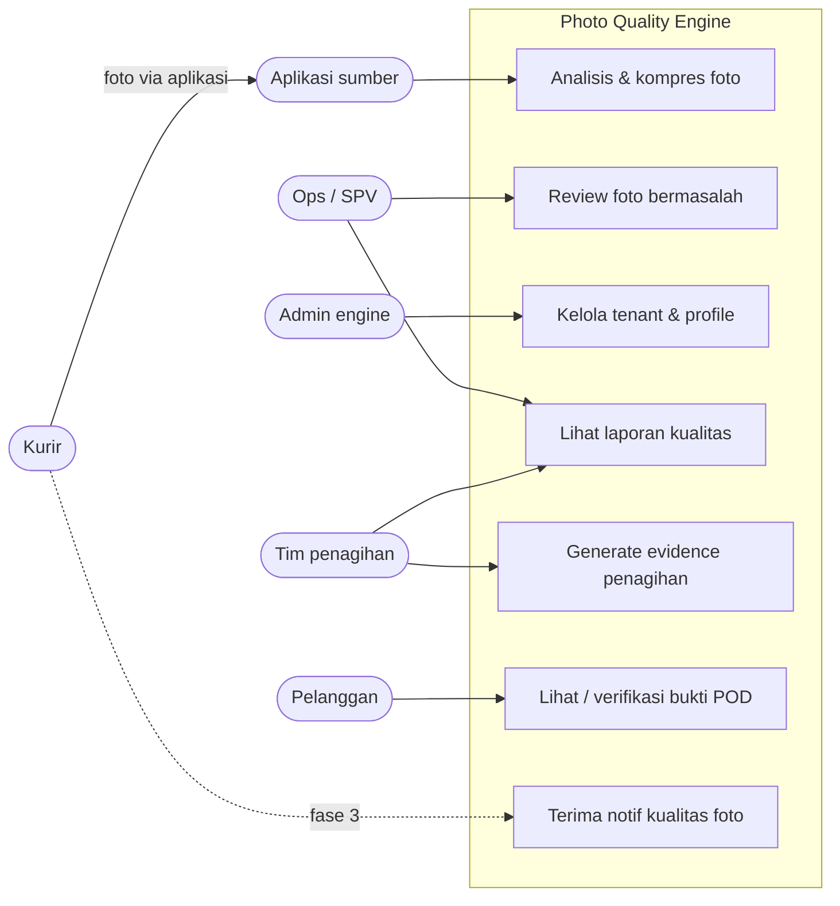

### 2.4 Profile jenis foto (awal)

| Profile | Fokus pemeriksaan | Strictness |
|---|---|---|
| `pod_recipient` | Tajam, penerima terlihat, cahaya cukup | Tinggi |
| `pod_document` (resi/dokumen) | Keterbacaan teks (OCR), tidak terpotong, lurus | Paling tinggi |
| `package` | Tajam, kondisi paket terlihat | Sedang |
| `goods` | Detail barang | Sedang |
| `location` | Wajib GPS/waktu, ketajaman lebih longgar | Rendah |
| `default` | Fallback jika jenis foto tidak dikenali | Sedang |

---

## 3. Desain Sistem

### 3.1 Arsitektur keseluruhan

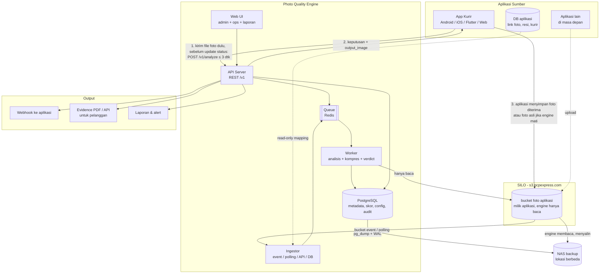

### 3.2 Komponen

| Komponen | Tanggung jawab | Catatan |
|---|---|---|
| **Ingestor** | Mendeteksi foto baru dari bucket event, polling `ListObjects`, tabel DB, atau API. Memetakan metadata (resi, jenis foto, kurir) sesuai config tenant | Menyimpan checkpoint, dedup via hash |
| **Queue (Redis)** | Penyangga antrean, retry dengan backoff, dead-letter queue | Membuat engine tidak pernah memblok aplikasi |
| **Worker** | Menjalankan analyzer plugin, kompresi, thumbnail, verdict | Stateless, di-scale horizontal |
| **API Server** | REST `/v1` untuk aplikasi, Web UI, evidence pelanggan | OpenAPI/Swagger, API key per tenant |
| **Web UI** | Admin console, ops review, laporan | React. Login SSO/LDAP kalau tersedia |
| **PostgreSQL** | Hasil analisis, config tenant/profile, audit log | **Tidak menyimpan gambar** |
| **SILO** | Penyimpanan semua gambar | Engine membaca original, menulis processed/thumb |

### 3.3 Integrasi: tiga level

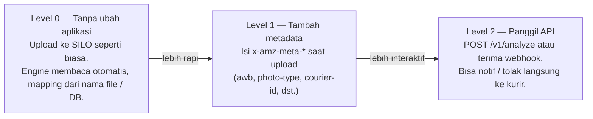

**Konvensi key objek yang direkomendasikan** (untuk aplikasi versi baru yang sedang dikembangkan):

```
{app}/{photo_type}/{yyyy}/{mm}/{dd}/{awb}_{courier_id}_{timestamp}.jpg
contoh: courier-app/pod_recipient/2026/10/22/AWB123_K045_1729580000.jpg
```

**Metadata objek yang direkomendasikan** (`x-amz-meta-*`):

| Key | Contoh | Wajib? |
|---|---|---|
| `awb` | `AWB123` | Disarankan |
| `photo-type` | `pod_recipient` | Disarankan |
| `courier-id` | `K045` | Disarankan |
| `app` | `courier-app` | Disarankan |
| `captured-at` | `2026-10-22T08:13:20+07:00` | Opsional |
| `lat` / `lng` | `-6.2`, `106.8` | Opsional |
| `source` | `camera` / `gallery` | Opsional |

Tanpa metadata pun engine tetap jalan (Level 0). Metadata hanya membuat mapping lebih akurat.

### 3.4 Penyimpanan gambar

| Data | Lokasi | Pemilik | Retensi default |
|---|---|---|---|
| Foto pengiriman (hasil optimasi engine, < 1 MB, atau foto asli jika engine mati) | SILO bucket aplikasi | Aplikasi (engine hanya baca) | 3 tahun, object lock |
| Thumbnail | Tidak disimpan; dibuat engine saat diminta Web UI | — | — |
| Skor, alasan, metadata, hash | PostgreSQL | Engine | 3 tahun |
| File di disk engine | Hanya sementara saat proses, langsung dihapus | — | — |
| Server aplikasi | **Tidak menyimpan foto permanen**, hanya outbox sementara saat SILO gagal | — | Sampai upload berhasil |

Mode penyimpanan per tenant: `store: processed` (default), `store: none` (hanya analisis, hasil dikembalikan ke pemanggil), `replace_original: true` (opsional, hanya dengan persetujuan).

### 3.5 Estimasi kapasitas (1.000 foto/hari × 3 tahun ≈ 1,1 juta foto)

| Data | Rata-rata (asumsi) | Total 3 tahun |
|---|---|---|
| Original | ~3 MB | ~3,3 TB |
| Terkompres | ~400 KB | ~450 GB |
| Thumbnail | ~30 KB | ~33 GB |
| PostgreSQL | — | < 5 GB |

Rekomendasi NAS backup: 8–12 TB (RAID), termasuk ruang untuk versioning.

### 3.6 Model data (inti)

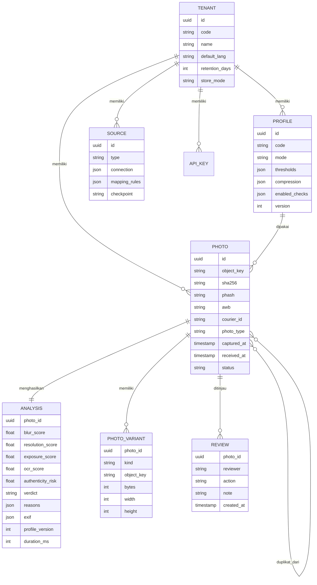

`profile_version` disimpan di setiap analisis supaya hasil lama tetap bisa dijelaskan setelah threshold diubah.

### 3.7 API (ringkasan v1)

| Method | Endpoint | Fungsi |
|---|---|---|
| `POST` | `/v1/analyze` | Kirim foto (multipart atau URL/object key). `?sync=true` untuk fast path (fase 3) |
| `GET` | `/v1/photos/{id}` | Hasil analisis + link presigned versi kompres/thumb |
| `GET` | `/v1/photos?awb=...` | Cari foto per resi/kurir/tanggal/verdict |
| `POST` | `/v1/photos/{id}/review` | Aksi ops: approve, request_retake, mark_fraud |
| `GET` | `/v1/evidence/{awb}` | Evidence pelanggan (JSON) |
| `GET` | `/v1/evidence/{awb}.pdf` | Evidence PDF |
| `POST` | `/v1/evidence/batch` | Evidence PDF per periode invoice |
| `GET` | `/v1/verify/{hash}` | Verifikasi foto tidak diubah |
| `*` | `/v1/admin/tenants`, `/v1/admin/profiles`, `/v1/admin/sources` | Kelola config (admin) |
| `GET` | `/healthz`, `/metrics` | Health check dan metrik Prometheus |

Contoh respons `GET /v1/photos/{id}`:

```json
{
  "id": "0b6f...",
  "awb": "AWB123",
  "photo_type": "pod_recipient",
  "verdict": "WARN",
  "scores": { "sharpness": 41, "resolution": 88, "exposure": 35, "authenticity_risk": 12 },
  "reasons": [
    { "code": "LOW_LIGHT", "message": "Foto terlalu gelap", "suggestion": "Cari tempat lebih terang atau nyalakan flash" }
  ],
  "variants": {
    "processed": { "url": "https://s3.pcpexpress.com/...presigned...", "bytes": 612345 },
    "thumb": { "url": "https://s3.pcpexpress.com/...presigned..." }
  },
  "profile_version": 3
}
```

### 3.8 Contoh config tenant & profile

```yaml
tenant: courier-app
name: Aplikasi Kurir
default_lang: id
retention_days: 1095          # 3 tahun
store_mode: processed

sources:
  - type: silo_event          # fallback otomatis ke polling
    bucket: photos-original
    prefix: courier-app/
    poll_interval_sec: 15
  - type: db_poll             # untuk foto lama / mapping
    dsn_ref: secret/courier-db-replica
    query: >
      SELECT photo_url, awb, courier_id, photo_type, created_at
      FROM delivery_photos WHERE created_at > :checkpoint

mapping:
  awb:        ["meta:awb", "key:regex:/(?P<awb>AWB\\w+)_/"]
  photo_type: ["meta:photo-type", "key:segment:1", "default:default"]
  courier_id: ["meta:courier-id", "key:regex:_(?P<courier_id>K\\d+)_"]

sinks:
  - type: webhook
    url: https://courier-api.internal/hooks/photo-quality
    events: [analysis.completed, review.updated]

profiles:
  pod_recipient:
    mode: shadow               # shadow | warn | enforce
    checks: [sharpness, resolution, exposure, exif, duplicate]
    thresholds:
      sharpness:  { reject: 20, warn: 45 }
      resolution: { min_short_side_px: 720 }
      exposure:   { min_mean: 40, max_mean: 220 }
    compression:
      target_max_bytes: 1000000
      skip_if_below_bytes: 1000000
      max_long_side_px: 2000
      formats: [jpeg]
      min_quality: 60
      guard: { max_sharpness_drop_pct: 10 }
  pod_document:
    mode: shadow
    checks: [sharpness, resolution, exposure, ocr, duplicate]
    thresholds:
      ocr: { min_confidence: 70 }
    compression:
      target_max_bytes: 1000000
      max_long_side_px: 2400
      min_quality: 75
      guard: { max_ocr_drop_pct: 5 }
```

Config ini dikelola lewat Web UI admin dan disimpan di Postgres (dengan versi). File YAML dipakai untuk seed awal dan GitOps.

### 3.9 Keamanan & privasi

- Bucket `photos-original` **private**. Semua akses lewat **presigned URL** dengan masa berlaku (misal 15 menit untuk UI, maksimal 7 hari untuk lampiran pelanggan).
- API key per tenant. Kunci disimpan dalam bentuk hash. Rotasi lewat Web UI.
- RBAC Web UI: `admin`, `ops`, `viewer`, `finance`.
- Isolasi evidence per pelanggan: pelanggan hanya bisa mengakses resinya sendiri.
- Audit log: siapa melihat/mengubah apa dan kapan.
- Akses ke SILO dan DB aplikasi **read-only** (kecuali bucket milik engine).
- Secret (kredensial SILO/DB) lewat environment / K8s Secret, tidak di repo.
- Retensi + penghapusan otomatis sesuai UU PDP. Durasi final dikonfirmasi ke legal/finance.

### 3.10 Konfigurasi koneksi SILO (environment variable)

Engine memakai nama variabel yang sama dengan aplikasi yang sudah ada, supaya konfigurasinya konsisten. Template ada di [`.env.example`](../.env.example). **Nilai asli disimpan di `.env` lokal (di-ignore git) atau K8s Secret, tidak pernah di repo.**

| Variabel | Contoh | Keterangan |
|---|---|---|
| `AWS_ENDPOINT` | `https://s3.pcpexpress.com` | Endpoint SILO |
| `AWS_DEFAULT_REGION` | `us-east-1` | Wajib diisi untuk SDK S3, nilainya tidak berpengaruh di SILO |
| `AWS_USE_PATH_STYLE_ENDPOINT` | `true` | Wajib `true` untuk SILO/MinIO (`endpoint/bucket/key`) |
| `AWS_ACCESS_KEY_ID` | — | Access key **service account engine** (rahasia) |
| `AWS_SECRET_ACCESS_KEY` | — | Secret key (rahasia) |
| `AWS_BUCKET` | `ekas-pcptransport` | Bucket foto original aplikasi (engine hanya baca) |
| `AWS_URL` | `https://s3.pcpexpress.com/ekas-pcptransport` | Base URL bucket |
| `ENGINE_BUCKET_PROCESSED` / `ENGINE_BUCKET_THUMB` | `photos-processed` / `photos-thumb` | Hanya untuk data versi awal (engine tidak lagi menulis ke SILO) |
| `ENGINE_PRESIGN_TTL_UI` / `_CUSTOMER` | `900` / `604800` | Masa berlaku presigned URL (detik) |

Untuk multi-tenant, kredensial per tenant direferensikan dari config (`dsn_ref`/`secret_ref`), bukan ditulis langsung.

**Aturan kredensial:**
- Engine **tidak memakai akun root/admin SILO**. Buat **service account khusus engine** dengan policy minimum: `GetObject` + `ListBucket` di bucket aplikasi. Engine tidak butuh izin tulis (ADR 0006).
- Kredensial yang pernah tersebar (chat, tiket, dokumen) dianggap bocor dan harus dirotasi.

### 3.11 Teknologi

| Lapisan | Pilihan | Alasan |
|---|---|---|
| Bahasa engine | Python 3.12 | Ekosistem image processing paling matang |
| API | FastAPI | Cepat, OpenAPI otomatis |
| Image processing | OpenCV, Pillow, pyvips (libvips) | Analisis + kompresi cepat dan hemat memori |
| OCR | PaddleOCR atau Tesseract | Self-hosted, keputusan final saat fase 2 |
| Queue | Redis (+ RQ/Celery/Arq) | Ringan, cukup untuk beban ini |
| DB | PostgreSQL 16 | Andal, JSONB untuk config/hasil |
| Storage | SILO (S3 API via boto3) | Sudah dipakai perusahaan |
| Web UI | React + TypeScript | Umum, mudah dirawat |
| Deploy | Docker compose → K8s (Helm) | Kode sama untuk PC dan produksi |
| Observability | Prometheus + Grafana, log JSON | Standar |

---

## 4. Flow Proses

### 4.1 Flow utama: kurir memotret sampai foto divalidasi

Ini alur integrasi level 2B (disarankan, diperbarui sesuai [ADR 0006](adr/0006-engine-hanya-memproses-gambar.md)):
foto **langsung dikirim ke engine** (belum ke SILO), **divalidasi dan dioptimasi di dalam panggilan itu** (sinkron,
maks. 3 detik), lalu **aplikasi** menyimpan foto yang diterima ke SILO. Semua terjadi **sebelum** aplikasi pengiriman
mengupdate status. Status pengiriman dan penyimpanan tetap milik aplikasi pengiriman; engine hanya menjawab
`allow_status_update`, `courier_message`, dan `output_image` (foto hasil optimasi, base64).

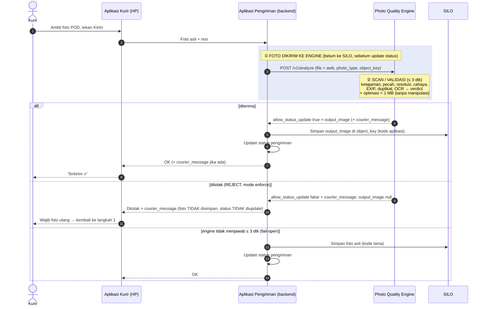

Foto yang ditolak tidak disimpan di mana pun dan tidak menjadi foto pengiriman; engine hanya mencatat metadata hasil
analisisnya (untuk review ops dan laporan). Aplikasi yang sudah terlanjur menyimpan ke SILO dulu
bisa memakai level 2A (`checkObject` dengan key objek): keputusannya sama, tetapi foto yang ditolak sudah ada di bucket
aplikasi.

**Level 0/1** (aplikasi belum memanggil engine): jalur kurir tidak berubah dan status diupdate seperti biasa. Engine
mengambil foto sendiri beberapa detik setelah upload (bucket notification, polling sebagai cadangan) lalu memvalidasinya
di belakang layar. Hasilnya dipakai untuk laporan, review ops, dan evidence, tetapi tidak bisa menahan status.

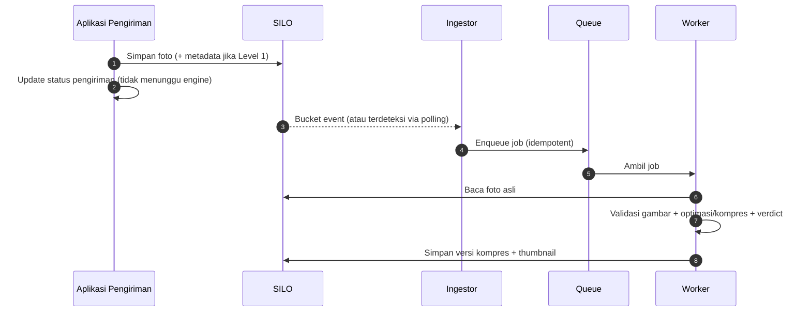

### 4.2 Flow pemrosesan di worker

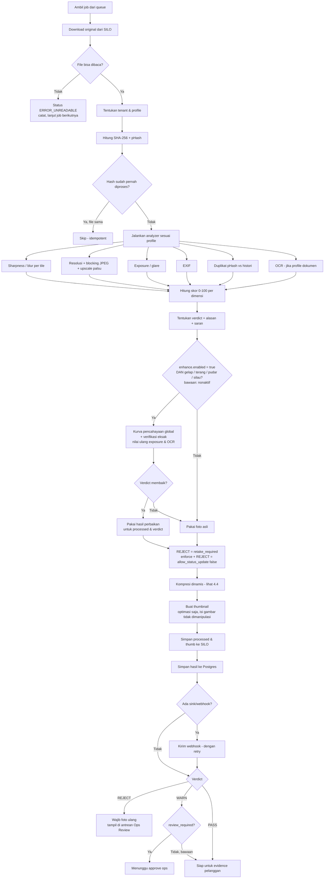

### 4.3 Flow penentuan verdict

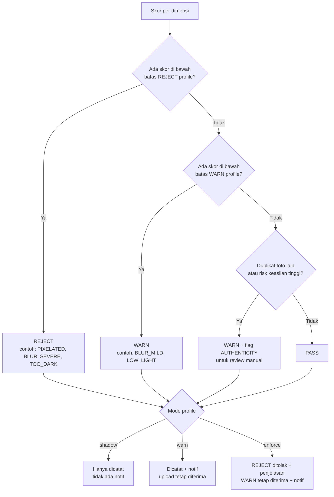

Catatan: **EXIF kosong tidak pernah menjadi alasan REJECT**, karena banyak platform menghapus EXIF.

### 4.4 Flow kompresi dinamis

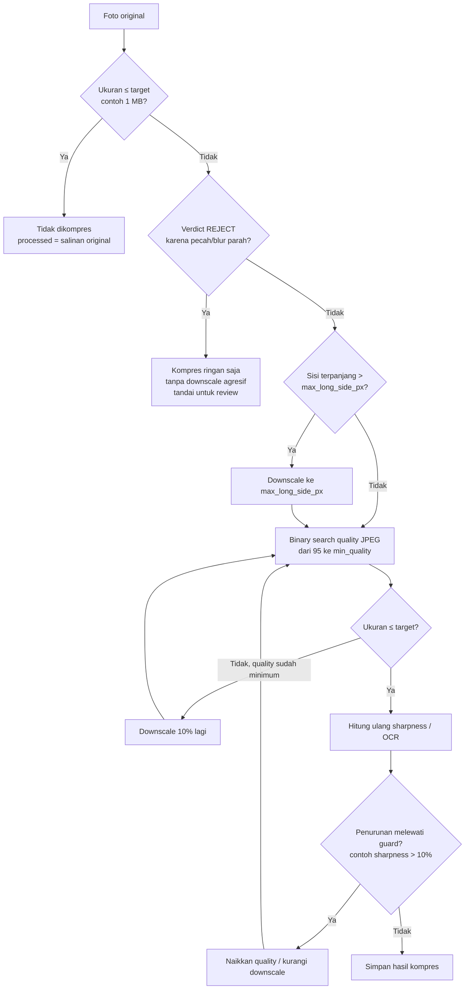

Batas iterasi dipasang supaya proses tidak berputar terus. Kalau target tidak tercapai tanpa melanggar guard, engine **memilih keterbacaan** dan mencatat `COMPRESSION_TARGET_NOT_MET`.

### 4.5 Flow fallback & penanganan error

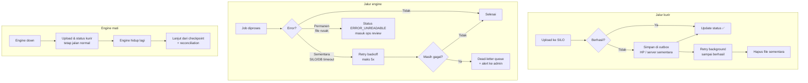

| Kejadian | Penanganan | Dampak ke kurir |
|---|---|---|
| Engine mati / restart | Lanjut dari checkpoint, backlog dikejar | Tidak ada |
| Lonjakan foto | Queue menampung, worker bertahap | Tidak ada |
| File rusak | `ERROR_UNREADABLE`, antrean lanjut | Tidak ada |
| SILO/DB gagal sementara | Retry backoff, lalu dead-letter + alert | Tidak ada |
| SILO gagal saat upload | Outbox + retry di aplikasi (fase 3 / aplikasi versi baru) | Status tetap ter-update |
| Foto diproses dua kali | Idempotent via hash | Tidak ada |
| Event terlewat | Reconciliation harian: bandingkan isi bucket vs DB engine | Tidak ada |
| Fast path API timeout (fase 3) | Fail-open: upload diterima, analisis async | Tidak ada |

### 4.6 Flow ops review

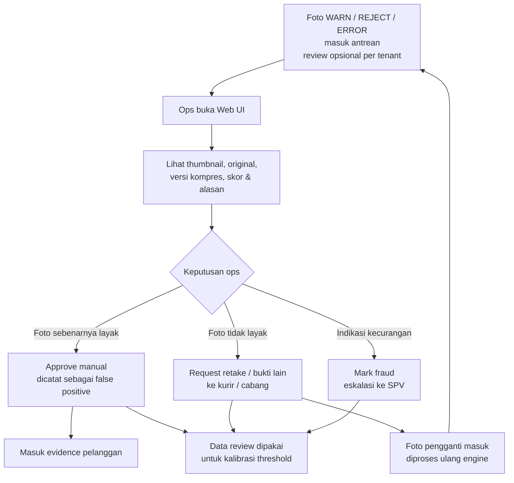

### 4.7 Flow evidence penagihan ke pelanggan

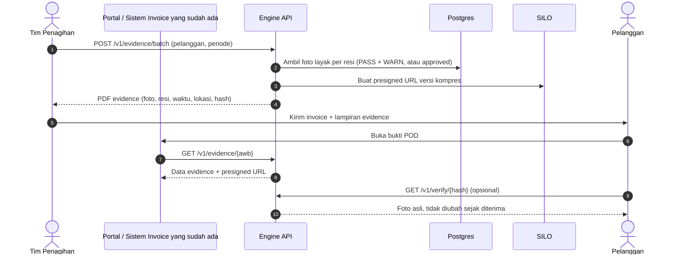

Yang dilihat pelanggan **hanya** foto layak, tanpa skor internal atau risk score: dengan `review_required: false`
(bawaan) foto `PASS` dan `WARN`; dengan `review_required: true` hanya `PASS` atau yang di-approve ops. Foto `REJECT`
dibalas wajib foto ulang ke kurir dan tidak tampil kecuali di-approve ops. Foto yang pencahayaannya diperbaiki
otomatis ditampilkan versi perbaikannya, sedangkan hash verifikasi merujuk ke original.

### 4.8 Flow rollout mode (shadow → warn → enforce)

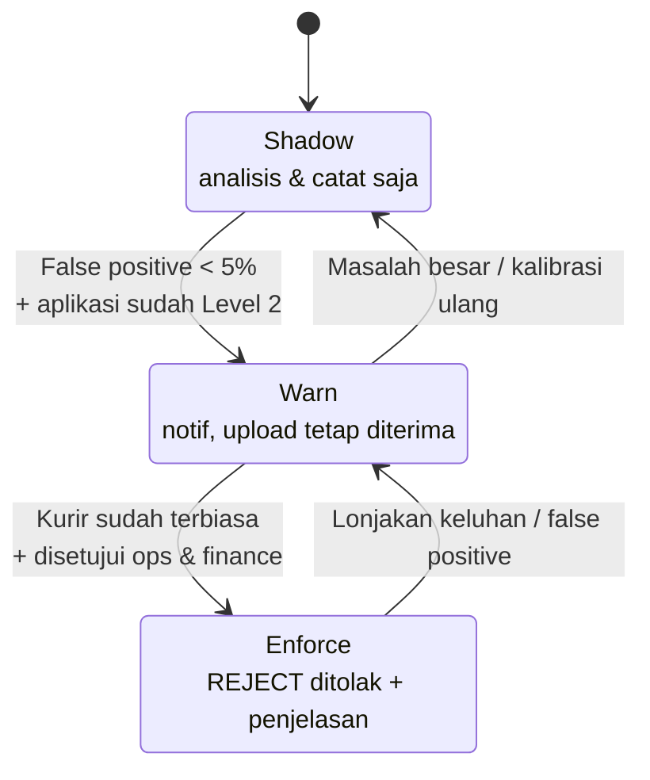

Mode diatur **per tenant dan per profile**, jadi bisa enforce untuk resi tapi masih warn untuk foto lokasi.

### 4.9 Flow onboarding aplikasi baru

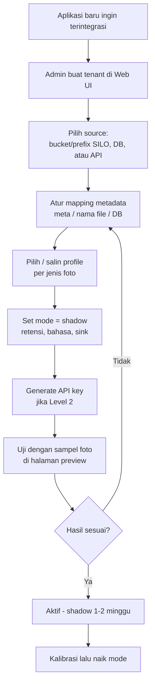

Tidak ada perubahan kode engine untuk menambah aplikasi baru.

### 4.10 Flow migrasi foto lama dari server aplikasi

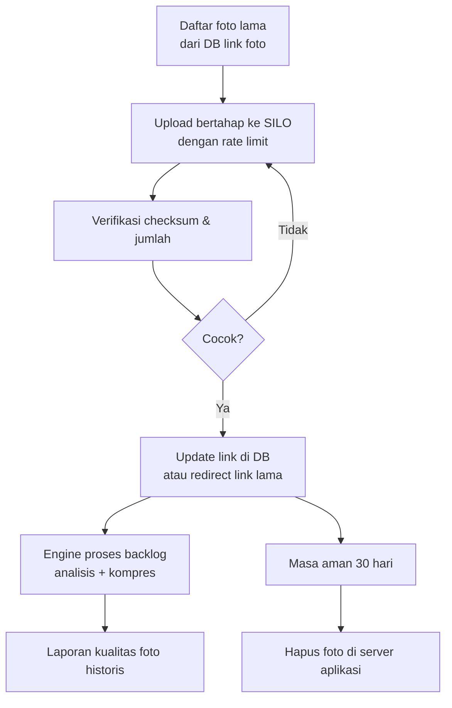

### 4.11 Flow backup & retensi

Backup ke NAS dijalankan **engine** (worker) sesuai jadwal di halaman Web UI **Backup NAS**: dump database dan foto
yang disimpan aplikasi di SILO (engine membacanya dari lokasi yang dilaporkan aplikasi; opsi `include_photos`, bisa
dimatikan jika tim infra sudah mem-mirror bucket aplikasi). Backup hanya menyalin; penghapusan retensi di SILO tidak
diterapkan ke NAS. Detail: [operations.md bagian 6](operations.md#6-postgresql--backup).

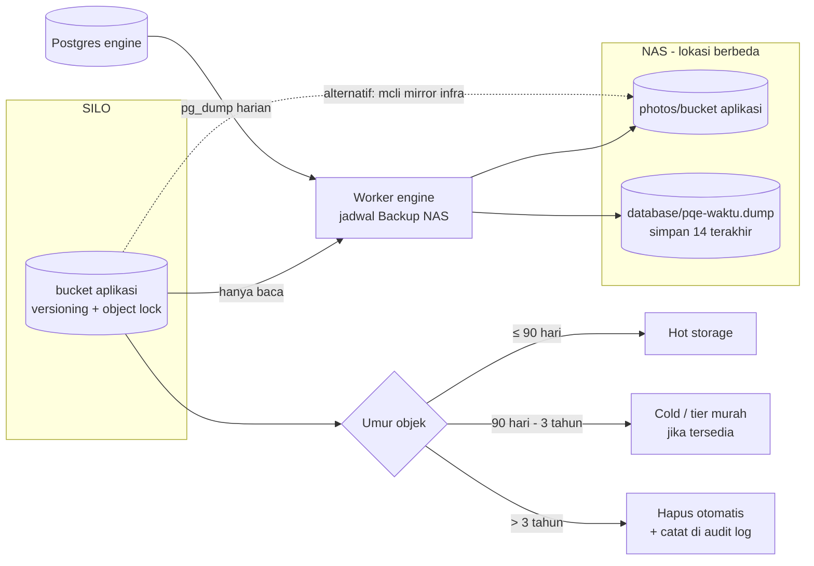

| Data | Backup | Retensi default |
|---|---|---|
| Foto pengiriman di bucket aplikasi | **Wajib**: disalin engine ke NAS (`include_photos`, bawaan aktif) atau `mcli mirror` infra | 3 tahun (lifecycle di SILO, diatur infra) |
| Postgres | **Wajib**, dump oleh engine setiap 24 jam (bawaan), simpan 14 terakhir; tambah WAL archiving untuk PITR | 3 tahun data analisis |
| Data versi lama di bucket engine (`photos-upload`, `photos-processed`, `photos-thumb`) | Opsi "Data versi lama" di Backup NAS | Sampai habis masa retensi |

Uji restore berkala (misal bulanan, sampel acak). Durasi retensi final dikonfirmasi ke legal/finance (UU PDP dan kemungkinan kewajiban simpan dokumen pajak).

---

## 5. Implementasi

### 5.1 Struktur repository (rencana)

```
ocr-engine/
├── docs/                     # dokumen perencanaan, arsitektur, ADR
├── engine/
│   ├── api/                  # FastAPI: routes /v1, auth, i18n
│   ├── ingestor/             # silo_event, s3_poll, db_poll, api
│   ├── worker/               # job runner, retry, dead-letter
│   ├── analyzers/            # plugin: sharpness, resolution, exposure, exif, duplicate, ocr, authenticity
│   ├── compressor/           # kompresi dinamis + thumbnail
│   ├── verdict/              # rules engine skor → verdict
│   ├── evidence/             # PDF + verifikasi hash
│   ├── storage/              # adapter S3 (SILO)
│   ├── config/               # loader tenant/profile + versi
│   └── locales/              # id.yaml, en.yaml
├── webui/                    # React + TypeScript
├── migrations/               # skema Postgres
├── tests/
│   ├── unit/
│   ├── integration/
│   └── fixtures/             # sampel sintetis & berlabel
├── tools/
│   ├── synth_samples/        # generator sampel buram/pecah/gelap
│   └── migrate_legacy/       # migrasi foto lama ke SILO
├── deploy/
│   ├── docker-compose.yml    # PC: engine + SILO + Postgres + Redis + Web UI
│   └── helm/                 # K8s
└── README.md
```

### 5.2 Kontrak analyzer plugin

Setiap analyzer mengimplementasikan antarmuka yang sama, sehingga menambah pemeriksaan baru tidak mengubah yang lama:

```python
class Analyzer(Protocol):
    name: str                                   # contoh: "sharpness"
    def analyze(self, image: Image, ctx: Context) -> AnalyzerResult: ...
    # AnalyzerResult: score 0-100, reason_codes, raw_metrics, duration_ms
```

### 5.3 Metode deteksi (rule-based)

| Pemeriksaan | Metode |
|---|---|
| Blur | Variance of Laplacian, Tenengrad, rasio frekuensi tinggi FFT. Dihitung per tile (misal 4×4), diambil tile terbaik + persentil |
| Resolusi / pecah | Dimensi minimum, deteksi blocking 8×8 JPEG, estimasi quality dari quantization table |
| Upscale palsu | Energi frekuensi tinggi dibanding dimensi |
| Exposure | Histogram: mean, clipping gelap/terang, area glare |
| EXIF | Kamera, waktu, GPS, software editing, konsistensi |
| Duplikat | pHash + Hamming distance vs histori (diindeks) |
| OCR | Confidence rata-rata teks terdeteksi (profile dokumen) |
| Foto dari layar | Deteksi pola moiré (fase 2) |
| Indikasi edit | Error Level Analysis (fase 2, hanya sinyal) |

### 5.4 Standar pengembangan

- Git flow: branch per fitur, merge request dengan review minimal 1 orang.
- Lint & format: `ruff`, `black`, `mypy` (Python); `eslint`, `prettier` (TS).
- CI: lint → unit test → integration test (docker compose) → build image.
- Semua perubahan skema lewat migrasi. Perubahan arsitektur penting dicatat sebagai ADR di `docs/adr/`.
- Konvensi commit: Conventional Commits (`feat:`, `fix:`, `docs:`).

### 5.5 Rincian pekerjaan Fase 1

| # | Pekerjaan | Done jika |
|---|---|---|
| 1 | Docker compose: SILO, Postgres, Redis, engine, Web UI | `docker compose up` menjalankan semua |
| 2 | Generator sampel sintetis | Set sampel buram/pecah/gelap/bagus tersedia |
| 3 | Analyzer sharpness, resolution, exposure, exif, duplicate | Unit test lulus pada sampel sintetis |
| 4 | Compressor + thumbnail | ≥ 95% sampel besar < 1 MB, guard terpenuhi |
| 5 | Verdict engine + i18n ID/EN | Kode alasan & pesan sesuai profile |
| 6 | Ingestor SILO (event + polling) + checkpoint + reconciliation | Tidak ada foto terlewat pada uji 10.000 objek |
| 7 | Queue + worker + retry + dead-letter | Uji kegagalan SILO/DB lulus tanpa kehilangan job |
| 8 | API v1 + OpenAPI + API key | Swagger tersedia, endpoint utama berfungsi |
| 9 | Web UI admin (tenant, profile, source, mapping, mode) | Perubahan config berlaku tanpa restart |
| 10 | Web UI ops review + dashboard | Ops bisa approve/request retake/mark fraud |
| 11 | Metrik + health check | Prometheus metrics & `/healthz` tersedia |

---

## 6. Testing

### 6.1 Strategi

| Level | Cakupan | Alat |
|---|---|---|
| Unit | Analyzer, compressor, verdict, mapping | pytest |
| Integrasi | Ingestor ↔ SILO ↔ queue ↔ worker ↔ Postgres | pytest + docker compose (SILO lokal) |
| Akurasi | Skor & verdict vs sampel berlabel (precision/recall per kelas) | Dataset uji + notebook laporan |
| Kompresi | Ukuran akhir, SSIM, penurunan sharpness/OCR | Dataset uji |
| Performa | Throughput worker, latency p95, fast path | Locust / k6 |
| Ketahanan (chaos) | Matikan engine/SILO/DB/Redis di tengah proses | Skrip uji kegagalan |
| Keamanan | Auth, isolasi tenant/pelanggan, presigned URL kedaluwarsa | Uji otomatis + review manual |
| UAT | Ops & finance mencoba Web UI dan evidence | Skenario UAT |

### 6.2 Dataset

1. **Sintetis (fase 1):** foto tajam dibuat blur (Gaussian/motion), diperkecil lalu diperbesar, dikompres JPEG quality sangat rendah, digelapkan/terangkan.
2. **Shadow mode (fase 1–2):** foto asli dari produksi, diberi label oleh ops lewat Web UI review.
3. **Golden set:** ±500 foto berlabel lintas profile, dipakai sebagai regression test setiap kali threshold atau analyzer berubah.

### 6.3 Kriteria penerimaan utama

| Kriteria | Target |
|---|---|
| Deteksi REJECT (pecah/blur parah) | Recall ≥ 95%, precision ≥ 90% |
| False positive di mode shadow sebelum naik ke warn | < 5% |
| Foto besar setelah kompres | ≥ 95% di bawah 1 MB |
| Penurunan OCR confidence setelah kompres (resi) | ≤ 5% |
| Latency jalur kurir | Tidak berubah (diukur sebelum & sesudah) |
| Foto selesai dianalisis | ≤ 1 menit (p95) |
| Engine mati 30 menit | 0 foto hilang, backlog selesai otomatis |

---

## 7. Deployment

### 7.1 Lingkungan

| Lingkungan | Tempat | Tujuan |
|---|---|---|
| Lokal / uji coba | PC (docker compose) + SILO lokal | Pengembangan, kalibrasi, demo |
| Staging | PC/VM terhubung ke **bucket staging** di SILO | Shadow dengan data nyata, UAT |
| Produksi | K8s (Helm) + SILO `s3.pcpexpress.com` | Operasional |

### 7.2 Topologi produksi (K8s)

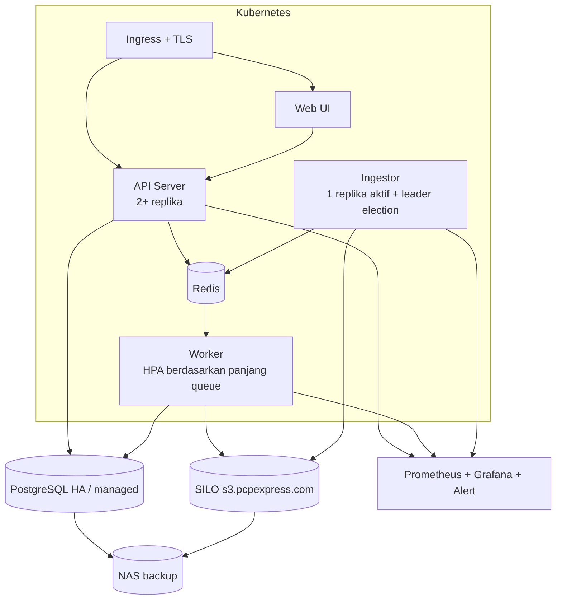

### 7.3 Flow rilis

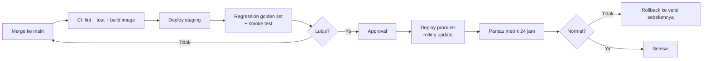

Karena engine di luar jalur kurir, deploy atau rollback **tidak berdampak ke operasional kurir**.

### 7.4 Checklist go-live fase 1

- [ ] Akses read-only ke bucket aplikasi di SILO + akses tulis ke bucket engine
- [ ] Bucket notification SILO aktif (atau polling dikonfigurasi)
- [ ] Bucket original private, presigned URL berfungsi
- [ ] Mirror SILO → NAS berjalan, uji restore lulus
- [ ] Backup Postgres berjalan, uji restore lulus
- [ ] Lifecycle retensi dikonfigurasi (dicek dulu di staging)
- [ ] Dashboard metrik & alert aktif
- [ ] Semua tenant/profile dalam mode **shadow**
- [ ] Ops sudah dilatih memakai Web UI review

---

## 8. Operasional & Maintenance

### 8.1 Monitoring & alert

| Metrik | Alert jika |
|---|---|
| Panjang queue / keterlambatan analisis | > 5 menit tertinggal |
| Error rate worker | > 2% dalam 15 menit |
| Isi dead-letter queue | > 0 (ditinjau harian) |
| Selisih reconciliation (bucket vs DB) | > 0 setelah reconciliation |
| Distribusi verdict | Lonjakan REJECT tiba-tiba (indikasi masalah aplikasi/kamera atau threshold) |
| Mirror NAS / backup Postgres | Gagal atau tertinggal > 1 jam / 1 hari |
| Kapasitas storage SILO/NAS | > 80% |
| Latency API (fase 3) | p95 > 300 ms |

### 8.2 Kalibrasi berkelanjutan

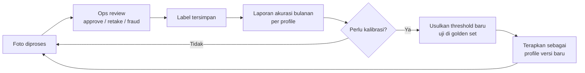

### 8.3 Pekerjaan rutin

| Frekuensi | Pekerjaan |
|---|---|
| Harian | Tinjau dead-letter, ops review antrean, laporan kualitas per cabang |
| Mingguan | Tinjau false positive, tren kualitas per aplikasi/kurir |
| Bulanan | Uji restore backup, laporan akurasi, kalibrasi threshold, update dependency keamanan |
| Per rilis SILO | Uji di staging sebelum upgrade |
| Tahunan | Review kebijakan retensi bersama legal/finance |

### 8.4 Runbook singkat

| Masalah | Langkah |
|---|---|
| Backlog menumpuk | Cek status SILO/DB → tambah replika worker → cek dead-letter |
| Lonjakan REJECT | Cek apakah satu aplikasi/versi tertentu (setting kamera/kompres) → pertimbangkan turunkan mode sementara |
| SILO tidak bisa diakses | Engine otomatis retry. Ingestor lanjut dari checkpoint setelah pulih |
| Foto tidak muncul di engine | Jalankan reconciliation manual untuk prefix/tanggal terkait |
| Pelanggan menyangsikan bukti | Gunakan `/v1/verify/{hash}` + original di SILO/NAS |

---

## 9. Keputusan yang Masih Terbuka

| # | Pertanyaan | Pemilik | Dampak |
|---|---|---|---|
| Q1 | Apakah bucket notification (webhook/Redis/Kafka) bisa diaktifkan di SILO `s3.pcpexpress.com`? | Tim infra | Real-time vs polling |
| Q2 | Apakah SILO kalian mendukung lifecycle/tiering dan object lock? | Tim infra | Retensi & perlindungan ransomware |
| Q3 | Konvensi key + metadata objek bisa dimasukkan ke aplikasi versi baru yang sedang dikembangkan? | Tim developer aplikasi | Akurasi mapping |
| Q4 | Kanal pelanggan menerima bukti POD saat ini (portal, email, lampiran invoice)? | Finance | Bentuk evidence |
| Q5 | Retensi final: 3 tahun cukup, atau ada kewajiban simpan dokumen pajak lebih lama? | Legal / finance | Konfigurasi retensi & kapasitas |
| Q6 | SSO/LDAP kantor tersedia untuk login Web UI? | Tim infra | Autentikasi |
| Q7 | Lokasi NAS backup (gedung/ruangan berbeda dari SILO)? | Tim infra | Keandalan backup |
| Q8 | Pemilihan OCR: PaddleOCR vs Tesseract (diputuskan dari uji akurasi fase 2) | Tim engine | Akurasi resi |
| Q10 | Service account khusus engine di SILO (read-only bucket aplikasi, read-write bucket engine) | Tim infra | Keamanan kredensial |
| Q9 | Sampel foto berlabel dari ops/finance (bagus vs ditolak) | Ops / finance | Kalibrasi |

---

## 10. Glosarium

| Istilah | Arti |
|---|---|
| **POD** | Proof of Delivery, bukti pengiriman (foto penerima, resi, dll.) |
| **AWB** | Airway bill / nomor resi |
| **SILO** | Object storage kompatibel S3 (fork komunitas MinIO dari Pigsty) di `s3.pcpexpress.com` |
| **Tenant** | Satu aplikasi yang terintegrasi dengan engine, dengan config sendiri |
| **Profile** | Kumpulan aturan per jenis foto (threshold, kompresi, mode) |
| **Shadow / Warn / Enforce** | Mode penegakan: catat saja / beri notif / tolak |
| **pHash** | Perceptual hash, sidik jari visual untuk mendeteksi foto yang mirip/sama |
| **Presigned URL** | Link sementara ke objek private yang kedaluwarsa otomatis |
| **Dead-letter queue** | Antrean untuk job yang gagal setelah semua retry, untuk ditinjau manual |
| **Reconciliation** | Pengecekan berkala bahwa semua foto di bucket sudah diproses engine |
| **Fail-open** | Jika engine gagal, proses utama tetap diizinkan berjalan |
| **Golden set** | Dataset berlabel tetap untuk regression test akurasi |
